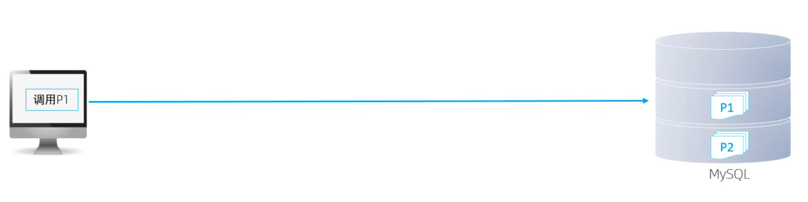

# 4. 视图

## 4.1 视图的本质与核心定义

视图是**虚拟表**，只保存查询的 SQL 逻辑定义，不存储任何实际数据。视图的行和列数据，都来自定义视图时引用的底层基表，在查询视图时**动态执行内部 SQL、实时计算生成结果**。

通俗理解：视图就是给一段复杂的 SELECT 语句起了一个别名，把查询逻辑封装起来复用。使用时直接查询视图名，本质上等价于执行视图内部定义的完整查询语句。

结合业务举例： 把「商家关联对应职位」的联表查询封装成视图，后续业务代码直接查视图即可，不用每次重复编写 JOIN 逻辑。

------

## 4.2 基础语法

### 4.2.1 创建视图

**完整语法**

```sql
CREATE [OR REPLACE] VIEW 视图名[(列名列表)] 
AS SELECT语句
[WITH [CASCADED | LOCAL] CHECK OPTION];
```

**参数逐一详解**

| 参数                | 作用                   | 说明                                                         |
| ------------------- | ---------------------- | ------------------------------------------------------------ |
| `OR REPLACE`        | 视图存在则直接替换重建 | 无需先删除再创建，开发中推荐使用，幂等操作                   |
| `列名列表`          | 自定义视图返回的列名   | 可选，数量必须和 SELECT 结果列数一致；不写则默认沿用 SELECT 里的列名 |
| `WITH CHECK OPTION` | 增改数据的约束校验     | 保证通过视图写入的数据，必须满足视图的 WHERE 过滤条件，写入后仍能在该视图中查到 |
| `CASCADED`          | 级联检查（默认值）     | 校验当前视图 + 所有依赖的底层视图的全部过滤条件              |
| `LOCAL`             | 本地检查               | 仅校验当前视图自身的过滤条件，不检查底层依赖视图             |

**基础创建示例（基于 merchant 商家表）**

```sql
-- 创建：仅展示启用状态商家的视图
CREATE OR REPLACE VIEW v_merchant_active AS
SELECT id, shop_name, phone, city, status
FROM merchant
WHERE status = 1;
```

**自定义列名示例**

```sql
CREATE OR REPLACE VIEW v_merchant_simple(商家ID, 店铺名, 手机号) AS
SELECT id, shop_name, phone
FROM merchant
WHERE status = 1;
```

------

### 4.2.2 查询视图

使用方式和普通物理表完全一致：

```sql
-- 查询视图数据，支持加 WHERE、ORDER BY、LIMIT 等
SELECT * FROM v_merchant_active WHERE city = '北京';

-- 查看视图的完整创建语句
SHOW CREATE VIEW v_merchant_active;
```

------

### 4.2.3 修改视图

两种方式效果等价，推荐第一种：

```sql
-- 方式1：替换重建（推荐，视图不存在会自动创建）
CREATE OR REPLACE VIEW v_merchant_active AS ...

-- 方式2：修改已有视图
ALTER VIEW v_merchant_active AS ...
```

------

### 4.2.4 删除视图

```sql
-- 删除单个视图
DROP VIEW IF EXISTS v_merchant_active;

-- 批量删除多个视图
DROP VIEW IF EXISTS v_merchant_simple, v_merchant_position;
```

------

## 4.3 视图的更新机制

视图本身不存数据，通过视图执行 `INSERT/UPDATE/DELETE`，本质是修改底层基表的数据。但**不是所有视图都支持更新**。

### 4.3.1 可更新视图（支持增删改）

满足以下条件的视图为可更新视图，行和基表行一一对应：

- 基于单表创建，没有 JOIN 关联
- 没有聚合函数（SUM/COUNT/MAX 等）
- 没有 GROUP BY、DISTINCT、UNION
- 没有子查询、没有计算列

示例（可正常增删改）：

```sql
CREATE OR REPLACE VIEW v_merchant_active AS
SELECT id, shop_name, phone, status
FROM merchant
WHERE status = 1;
```

### 4.3.2 不可更新视图（不支持增删改）

只要出现以下任意一种情况，视图就无法执行 INSERT/UPDATE/DELETE：

- 多表联查（JOIN）
- 包含聚合函数、分组、去重、联合查询
- 包含子查询、计算列、常量列
- 视图基于另一个不可更新视图

示例（不可更新）：

```sql
-- 聚合统计视图，只能查，不能改
CREATE VIEW v_merchant_count AS
SELECT city, count(*) shop_count
FROM merchant
GROUP BY city;
```

### 4.3.3 补充说明

- `DELETE` 删除：可更新视图支持删除，直接删除底层基表对应行
- `INSERT` 插入：必须满足基表所有非空字段约束，否则插入失败
- `UPDATE` 更新：只修改视图可见的字段，底层基表对应字段同步更新

------

## 4.4 WITH CHECK OPTION 约束深度详解

这是专门针对**可更新视图**的数据一致性约束，也是最容易混淆的知识点。

### 4.4.1 核心作用

**约束通过视图执行的增、改操作，保证修改后的数据仍然满足视图的 WHERE 过滤条件 —— 也就是修改完成后，这条数据依然能在当前视图中查询到。**

### 4.4.2 正反对比

> **（基于 v_merchant_active 视图）**

**场景 A：不加 CHECK OPTION（默认行为）**

```sql
CREATE OR REPLACE VIEW v_merchant_active AS
SELECT id, shop_name, phone, status
FROM merchant
WHERE status = 1;
```

执行插入：

```sql
INSERT INTO v_merchant_active VALUES (10, '测试店', '13800000000', 0);
```

- 结果：**插入成功**
- 问题：这条数据 `status=0`，不满足视图的过滤条件，**插入后在 v_merchant_active 视图里查不到**
- 本质：通过视图往基表里写入了一条视图本身不可见的数据，破坏了视图的语义一致性

**场景 B：加上 CHECK OPTION**

```sql
CREATE OR REPLACE VIEW v_merchant_active AS
SELECT id, shop_name, phone, status
FROM merchant
WHERE status = 1
WITH CHECK OPTION;
```

同样执行插入：

```sql
INSERT INTO v_merchant_active VALUES (10, '测试店', '13800000000', 0);
```

- 结果：**直接报错，拒绝执行**
- 效果：凡是通过这个视图写入的数据，必须都符合视图的过滤条件，写完一定还能在视图里查到

------

### 4.4.3 CASCADED vs LOCAL 的区别

**两者的差异只在「视图嵌套」场景下才会体现**。如果是直接基于基表创建的单层视图，两者效果完全一致。

**前置准备：两层嵌套视图**

第一层（底层视图）：

```sql
CREATE VIEW v_merchant_active AS
SELECT id, shop_name, city, status
FROM merchant
WHERE status = 1;
```

**对比 1：WITH LOCAL CHECK OPTION（仅检查当前层）**

```sql
CREATE VIEW v_merchant_yangjiang AS
SELECT id, shop_name, city, status
FROM v_merchant_active
WHERE city = '北京'
WITH LOCAL CHECK OPTION;
```

尝试插入 `city='北京', status=0` 的商家：

- 检查当前视图条件：`city='北京'` ✅ 满足
- **不检查**底层视图的 `status=1` 条件
- 结果：**插入成功**
- 副作用：插入后不满足底层视图条件，这条数据在 `v_merchant_yangjiang` 里也查不到

**对比 2：WITH CASCADED CHECK OPTION（级联检查，默认值）**

```sql
CREATE VIEW v_merchant_yangjiang AS
SELECT id, shop_name, city, status
FROM v_merchant_active
WHERE city = '北京'
WITH CASCADED CHECK OPTION;
```

同样尝试插入 `city='北京', status=0` 的商家：

- 检查当前视图条件：`city='北京'` ✅ 满足
- **级联检查**所有底层视图条件：`status=1` ❌ 不满足
- 结果：**插入失败，报错**
- 效果：保证所有层级的过滤条件都满足，数据写入后一定能在当前视图查到

------

### 4.4.4 CHECK OPTION 关键细节

1. **只约束通过视图的操作** 这个约束只对「通过视图执行的 INSERT/UPDATE」生效。如果直接修改底层基表，不受任何限制，哪怕改完不符合视图条件也可以。
2. **DELETE 不受影响** CHECK OPTION 只管增和改，不管删。通过视图删除数据，直接删除基表对应行，没有额外校验。
3. **UPDATE 同样受约束** 比如通过视图把某商家的 status 改成 0，加了 CHECK OPTION 就会报错 —— 因为改完就不满足视图条件，会从视图里消失。
4. **单层视图无差异** 如果视图直接基于基表创建，没有嵌套，那么 `LOCAL` 和 `CASCADED` 效果完全一样。

------

## 4.5 视图的核心业务价值

**1. 简化复杂查询**

把多表联查、聚合统计等长 SQL 封装成视图，业务代码直接查视图，避免重复编写复杂 SQL，降低出错概率。 比如商家职位统计逻辑，封装后业务层直接查视图，不用每次写 JOIN + GROUP BY。

**2. 权限控制与数据隔离**

不同角色只开放对应视图的查询权限，不开放基表权限，精准控制数据可见范围。 比如：

- 商家端账号只能访问「本商家数据视图」，看不到其他商家的数据
- 运营岗位只能看统计汇总视图，看不到手机号、密码等敏感字段

**3. 逻辑解耦**

业务代码依赖视图，当基表结构变更时，只需要修改视图定义，不用改动上层业务代码。 比如基表拆分了字段，在视图里拼接成原来的格式，上层业务无感知。

**4. 数据安全**

视图可以只暴露业务需要的字段，隐藏敏感字段（密码、身份证、手机号），降低数据泄露风险。

------

## 4.6 关键注意事项与建议

**1. 视图本身不提升性能**

视图只是封装了 SQL 逻辑，**不会预存计算结果**（区别于 Oracle 的物化视图）。查询视图等价于执行内部的 SELECT 语句，原 SQL 性能差，视图性能也差。 优化还是要优化底层 SQL 和索引，视图本身不带来性能提升。

**2. 不建议嵌套视图**

视图套视图（视图内部又查询其他视图），会导致性能指数级下降，且排错困难，业务开发中尽量避免多层嵌套。

**3. 视图内的 ORDER BY 可能失效**

如果视图定义里写了 ORDER BY，查询视图时又指定了其他排序规则，外层排序会覆盖视图内部的排序，视图里的 ORDER BY 无效。

**4. 优先用默认 CASCADED**

绝大多数场景使用默认的 `CASCADED` 即可，校验最严格，能保证视图的数据一致性；`LOCAL` 只在特殊定制场景使用。

**5. 复杂查询优先考虑直接写 SQL**

视图适合封装稳定、通用的查询逻辑；一次性的复杂查询、动态条件查询，直接写 SQL 更灵活，性能也更容易优化。

------

## 4.7 总结

视图是 SQL 逻辑的封装工具，核心价值是**简化代码、权限控制、逻辑解耦、数据安全**，它不是性能优化手段。 对于可更新视图，通过 `WITH CHECK OPTION` 可以保证数据一致性，默认使用 `CASCADED` 级联检查；复杂聚合视图不支持增删改，仅用于查询。

---

# 5. 存储过程

## 5.1 介绍

**存储过程介绍**

**存储过程是存储在数据库中、预先编译好的 SQL 语句集合，是数据库层面的代码封装与复用**。

你可以把它理解成「数据库里的方法」：和 Java 的方法类似，有名字、可以传参数、可以写逻辑、可以返回结果；调用的时候只需要喊它的名字 + 传参，数据库内部就会把里面的所有 SQL 一次性执行完。

和普通逐条执行 SQL 的核心区别：

- 普通方式：应用服务器把一条一条 SQL 通过网络发给 MySQL，MySQL 逐条执行，结果逐条返回。
- 存储过程方式：应用只发一句「调用 XX 存储过程，参数是 A、B」，MySQL 内部一口气执行完所有逻辑，最终只返回一次结果。



**存储过程特点**

1. **预编译，执行效率高** 存储过程在创建时就完成了语法解析和编译，直接生成执行计划存在数据库里。后续调用直接执行，不需要每次都解析 SQL、优化执行计划，比反复执行相同 SQL 性能更好。
2. **减少网络传输开销** 复杂逻辑如果有十几条 SQL，普通方式要在应用和数据库之间来回交互十几次；存储过程只需要一次调用、一次返回，网络交互量大幅降低。数据量越大、逻辑越复杂，这个优势越明显。
3. **封装与复用** 把一段数据处理逻辑封装成一个存储过程，多个业务、多个系统都可以直接调用，不用重复写相同的 SQL 逻辑。
4. **权限控制更精细** 可以只给用户开放存储过程的执行权限，不开放对应表的增删改查权限。用户只能通过存储过程操作数据，不能直接查表、改表，数据安全性更高。

---

## 5.2 基础语法

**存储过程基础语法（创建 / 调用 / 查看 / 删除）**

### 一、创建存储过程

**1. 基础语法骨架**

```sql
CREATE PROCEDURE 存储过程名([参数列表])
BEGIN
    -- 内部可以写多条 SQL 语句
    SQL语句1;
    SQL语句2;
END;
```

**2. 关键字说明**

- `CREATE PROCEDURE`：创建存储过程的固定关键字
- **存储过程名**：自定义名称，建议见名知意，比如 `get_active_merchant`
- **参数列表**：可选。可以无参数，也可以传入 / 传出参数（参数分类后面单独讲）
- `BEGIN ... END`：存储过程的语句体包裹符，相当于 Java 方法的大括号 `{ }`，里面可以写多条 SQL、变量、流程控制逻辑。

**3. 最关键细节：DELIMITER 结束符**

这是命令行执行创建语句的必写项。

**为什么必须改结束符？**

MySQL 默认的语句结束符是**分号 `;`**，遇到分号就认为一条语句结束，开始执行。 但存储过程内部的每条 SQL 本身就带分号，如果不改结束符，MySQL 读到内部第一个分号时，就会误以为整个创建语句结束了，直接执行并报语法错误。

**标准写法**

创建前先把结束符临时改成其他符号（常用 `//` 或 `$$`）；创建完成后，再改回默认的分号。

```sql
-- 1. 临时修改结束符为 //
DELIMITER //

-- 2. 创建存储过程（内部分号不会提前终止语句）
CREATE PROCEDURE 存储过程名()
BEGIN
    语句1;
    语句2;
END //  -- 这里用新结束符 // 表示整个创建语句结束

-- 3. 改回默认分号
DELIMITER ;
```

**4. 完整创建示例（基于 merchant 商家表）**

创建一个无参存储过程：查询所有正常营业（status=1）的商家信息。

```sql
DELIMITER //

CREATE PROCEDURE get_active_merchant()
BEGIN
    SELECT id, shop_name, phone, city 
    FROM merchant 
    WHERE status = 1
    ORDER BY id;
END //

DELIMITER ;
```

------

### 二、调用存储过程

**语法**

```sql
CALL 存储过程名([参数值]);
```

**示例**

调用上面创建的查询商家的存储过程：

```sql
CALL get_active_merchant();
```

执行后会直接返回查询结果，效果和直接执行内部的 SELECT 语句完全一致。

------

### 三、查看存储过程

两种常用查看方式，对应图里的两条语句：

**1. 查询指定库下所有存储过程**

从系统表 `INFORMATION_SCHEMA.ROUTINES` 查询，可以看到存储过程的名称、类型、创建时间等状态信息。

```sql
SELECT * FROM INFORMATION_SCHEMA.ROUTINES 
WHERE ROUTINE_SCHEMA = '你的数据库名';
```

> 把 `'你的数据库名'` 换成实际库名，比如 `'my_db'`，就能查到这个库下所有的存储过程和函数。

**2. 查看单个存储过程的完整创建语句**

```sql
SHOW CREATE PROCEDURE 存储过程名;
```

**示例**

查看刚才创建的存储过程定义：

```sql
SHOW CREATE PROCEDURE get_active_merchant;
```

执行后会返回完整的创建 SQL、字符集等详细信息。

------

### 四、删除存储过程

**语法**

```sql
DROP PROCEDURE [IF EXISTS] 存储过程名;
```

- `IF EXISTS`：可选。加上后，存储过程不存在也只会提示警告，不会报错；不加的话，删除不存在的过程会直接报错。

**示例**

```sql
-- 安全删除方式（推荐）
DROP PROCEDURE IF EXISTS get_active_merchant;
```

------

### 五、完整连贯执行演示

从头到尾执行一遍，方便对照理解：

```sql
-- 1. 改结束符
DELIMITER //

-- 2. 创建存储过程
CREATE PROCEDURE get_merchant_count()
BEGIN
    SELECT COUNT(*) AS 商家总数 FROM merchant;
END //

-- 3. 改回默认分号
DELIMITER ;

-- 4. 调用
CALL get_merchant_count();

-- 5. 查看定义
SHOW CREATE PROCEDURE get_merchant_count;

-- 6. 删除
DROP PROCEDURE IF EXISTS get_merchant_count;
```

---

## 5.3 变量

**存储过程的三类变量**

MySQL 存储过程中的变量按**作用域从大到小**分为三类：**系统变量 → 用户定义变量 → 局部变量**，各自的生命周期、语法、使用场景完全不同。

------

### 一、系统变量

**1. 定义**

系统变量是 MySQL 服务器**内置自带**的变量，用来控制服务器的运行行为、配置参数。比如之前讲过的 `sort_buffer_size`、`autocommit`、字符集配置等，都属于系统变量。

**2. 分类**

- **全局变量（GLOBAL）**：对所有数据库连接（会话）都生效，MySQL 重启后重置。
- **会话变量（SESSION）**：只对**当前连接**生效，每个连接可以有自己的值，连接断开就失效。**不写默认就是会话级。**

**3. 基本语法**

变量统一用 `@@` 前缀标识。

```sql
-- 查看所有系统变量
SHOW [SESSION|GLOBAL] VARIABLES ;

-- 可以通过LIKE模糊匹配方式查找变量
SHOW [SESSION|GLOBAL] VARIABLES LIKE '...';

-- 查看指定变量的值
SELECT @@[SESSION|GLOBAL] 系统变量名;

-- 设置系统变量

SET [SESSION|GLOBAL] 系统变量名 = 值;
SET @@[SESSION|GLOBAL] 系统变量名 = 值;

-- （会话级，只对当前连接生效）
SET sort_buffer_size = 1024 * 1024;

-- 全局变量（对新连接生效，已存在的连接不生效）
SET GLOBAL sort_buffer_size = 2 * 1024 * 1024;
```

**4. 示例**

```sql
-- 查看当前自动提交状态
SELECT @@autocommit;

-- 关闭当前会话的自动提交
SET autocommit = 0;
```

> 注意：全局变量需要管理员权限，普通用户只能修改会话级变量。

------

### 二、用户定义变量

**1. 定义与作用域**

用户自己定义的变量，**作用域是整个当前数据库连接（会话）**：在当前连接里，存储过程内部、外部都能用；连接一旦断开，变量自动销毁。

**2. 核心特点**

- 前缀固定带 `@`，比如 `@city_name`
- **不需要提前声明类型**，赋值时自动确定类型
- 同一个会话内全局有效，存储过程里修改了，外面也能读到

**3. 两种赋值方式**

```sql
-- 方式1：直接 set 赋值
SET @city = '阳江';

-- 方式2：查询结果赋值给变量
SELECT COUNT(*) INTO @count FROM merchant WHERE city = @city;
```

**4. 结合存储过程示例**

```sql
-- 定义存储过程：根据城市统计商家数，结果存入用户变量
DELIMITER //
CREATE PROCEDURE count_merchant_by_city(IN city_name VARCHAR(50))
BEGIN
    SELECT COUNT(*) INTO @total
    FROM merchant
    WHERE city = city_name;
END //
DELIMITER ;

-- 调用
CALL count_merchant_by_city('广州');

-- 外部直接读取用户变量
SELECT @total;
```

> 常见用法：存储过程的 `OUT` 参数底层就是用用户变量接收结果。

------

### 三、局部变量

**1. 定义与作用域**

在**存储过程 / 函数内部**定义的变量，作用域**只限于当前的 `BEGIN ... END` 代码块**，出了这个块就失效。是存储过程内部最常用的临时变量。

**2. 核心特点**

- 必须用 `DECLARE` 关键字**提前声明**，同时指定数据类型
- 声明必须写在 `BEGIN` 块的**最顶部**，所有 SQL 语句之前
- 没有前缀，直接写变量名
- 可以设置默认值

**3. 声明语法**

```sql
DECLARE 变量名 数据类型 [DEFAULT 默认值];
```

**4. 赋值方式**

```sql
-- 方式1：直接赋值
SET 变量名 = 值;

-- 方式2：查询结果赋值
SELECT 字段 INTO 变量名 FROM 表 ... LIMIT 1;
```

**5. 完整存储过程示例**

```sql
DELIMITER //
CREATE PROCEDURE get_merchant_info(IN merchant_id INT)
BEGIN
    -- 必须在最前面声明所有局部变量
    DECLARE shop_name VARCHAR(100);
    DECLARE shop_phone VARCHAR(20);
    DECLARE status_desc VARCHAR(20) DEFAULT '未知';

    -- 查询赋值
    SELECT shop_name, phone INTO shop_name, shop_phone
    FROM merchant
    WHERE id = merchant_id;

    -- 逻辑判断赋值
    IF status = 1 THEN
        SET status_desc = '正常营业';
    ELSE
        SET status_desc = '已禁用';
    END IF;

    -- 返回结果
    SELECT shop_name, shop_phone, status_desc;
END //
DELIMITER ;
```

------

### 四、三类变量对比总结

| 变量类型     | 前缀   | 声明方式             | 作用域                | 生命周期         | 声明位置   |
| ------------ | ------ | -------------------- | --------------------- | ---------------- | ---------- |
| 系统变量     | `@@`   | 系统内置             | 全局 / 当前会话       | 服务器运行期间   | -          |
| 用户定义变量 | `@`    | 无需声明，赋值即创建 | 当前整个会话          | 连接断开销毁     | 任意位置   |
| 局部变量     | 无前缀 | `DECLARE` 显式声明   | 当前 `BEGIN...END` 块 | 代码块执行完销毁 | 块内最顶部 |

------

### 五、常见易错点

1. **局部变量必须声明在最前面**`DECLARE` 不能写在 SQL 语句中间，必须全部放在 `BEGIN` 之后的第一行，否则语法报错。
2. **变量名不要和字段名重名** 比如表有 `name` 字段，变量也叫 `name`，查询时会优先识别成字段，导致逻辑错误。建议加前缀区分，比如 `v_name`。
3. **用户变量跨存储过程生效** 同一个会话里，A 存储过程修改了 `@x`，B 存储过程里读到的就是修改后的值，注意不要互相污染。

---

## 5.4 if 判断

