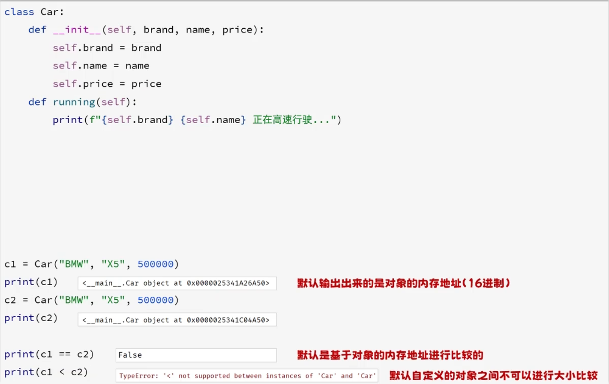
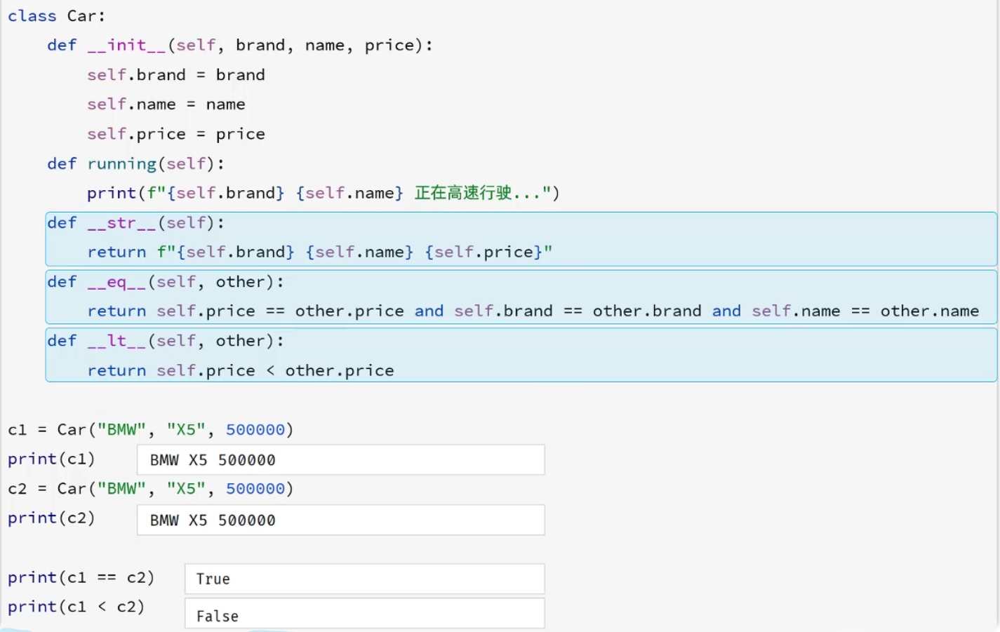

# 21. 面向对象基础

## 21.1 类的定义

**1. 定义类的语法如下**

**(动态添加属性)**：

```python
# 定义类
class 类名:
    pass

# 创建对象
对象名 = 类名()
对象名.属性名1 = 属性值1
对象名.属性名2 = 属性值2
```

```python
# 定义类
class Car:
    pass
# 创建对象
c1 = Car()
c1.brand = "BMW"
c1.name = "X5"
c1.price = 500000
print(c1.__dict__)
```

> 说明：类名的命名规范，遵循大驼峰命名法，每个单词的首字母都是大写，单词之间没有分隔符，比如：UserInfo，UserAccount。

> 说明：__dict__是Python中用户自定义类实例的一个特殊属性，用于以字典形式存储对象的属性。

---

**2. 定义类时指定实例属性（init方法）**

```python
# 定义类
class 类名:
    def __init__(self, 参数列表):
        self.属性名 = 参数值
        self.属性名 = 参数值

# 创建对象
对象名 = 类名(参数列表)
```

```python
# 定义类
class Car:
    def __init__(self, c_brand, c_name, c_price):
        self.brand = c_brand
        self.name = c_name
        self.price = c_price

# 创建对象
c1 = Car("BMW", "X5", 500000)
print(c1.__dict__)
```

- `self`：方法的第一个参数，表示当前创建的实例对象
- `__init__`：初始化方法，对象创建后自动调用，主要用于设置对象的初始状态（设置对象属性）

> 说明：定义在类的外面的称之为函数，定义在类中的函数称之为方法。

---

## 21.2 实例方法

在类中定义实例方法时，定义语法与之前学习的函数定义的方式是一致的。

```python
# 定义类
class 类名:
    def __init__(self, 形参列表):
        self.属性名 = 参数值
        self.属性名 = 参数值

    def 方法名(self, 形参列表):
        ...

    def 方法名(self, 形参列表):
        ...

# 创建对象
对象名 = 类名(参数列表)
对象名.方法名(实参)
```

```python
class Car:
    def __init__(self, brand, name, price):
        self.brand = brand
        self.name = name
        self.price = price

    def running(self):
        print(f"{self.brand} {self.name} 正在高速行驶...")

    def total_cost(self, discount, rate):
        return self.price * discount + self.price * rate

c1 = Car("BMW", "X5", 500000)
total_cost = c1.total_cost(0.9, 0.1)
print(f"提车总价为：{total_price:.0f}")

c1.running()
```

> 说明：self表示当前实例对象，方法调用时无需传递

---

## 21.3 魔法方法

- 魔法方法是指Python中提供的以双下划线开头和结尾的特殊方法，用于定义类的特殊行为，比如：`__init__`。
- 魔法方法是不需要我们手动调用的，Python会在合适的时机自动调用。

| 魔法方法 | 描述 |
| :------- | :--- |
| `__init__` | 初始化方法 |
| `__str__` | 字符串表示的方法 |
| `__eq__` | 比较两个对象是否相等（equal） |
| `__lt__`，`__le__`，`__gt__`，`__ge__` | 支持比较两个对象的大小（小于(less than)，小于等于(less than or equal)，大于(greater than)，大于等于(greater than or equal)） |

---



用魔法方法解决这些问题


