# 1.初识Redis

Redis是一种键值型的NoSql数据库，这里有两个关键字：

- 键值型

- NoSql

其中**键值型**，是指Redis中存储的数据都是以key、value对的形式存储，而value的形式多种多样，可以是字符串、数值、甚至json：

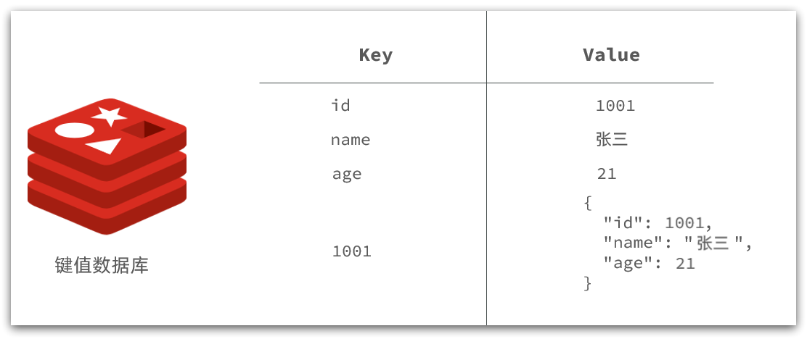

而NoSql则是相对于传统关系型数据库而言，有很大差异的一种数据库。

---

## 1.1.认识NoSQL

**NoSql**可以翻译做Not Only Sql（不仅仅是SQL），或者是No Sql（非Sql的）数据库。是相对于传统关系型数据库而言，有很大差异的一种特殊的数据库，因此也称之为**非关系型数据库**。

### 1.1.1.结构化与非结构化

传统关系型数据库是结构化数据，每一张表都有严格的约束信息：字段名、字段数据类型、字段约束等等信息，插入的数据必须遵守这些约束：

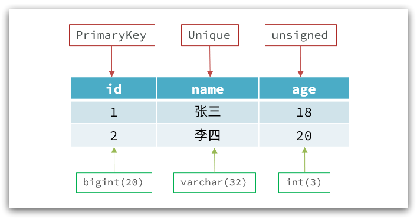

而NoSql则对数据库格式没有严格约束，往往形式松散，自由。

可以是键值型：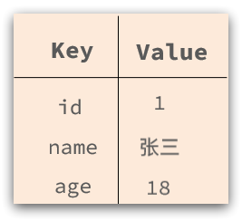

也可以是文档型：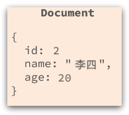

甚至可以是图格式：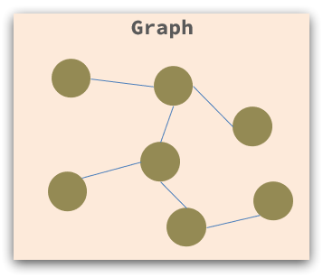

---

### 1.1.2.关联和非关联

传统数据库的表与表之间往往存在关联，例如外键：

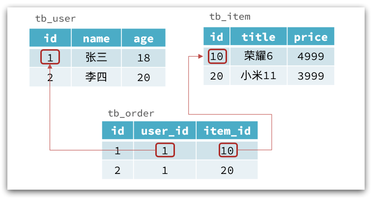

而非关系型数据库不存在关联关系，要维护关系要么靠代码中的业务逻辑，要么靠数据之间的耦合：

```json
{
  id: 1,
  name: "张三",
  orders: [
    {
       id: 1,
       item: {
	 id: 10, title: "荣耀6", price: 4999
       }
    },
    {
       id: 2,
       item: {
	 id: 20, title: "小米11", price: 3999
       }
    }
  ]
}
```

此处要维护“张三”的订单与商品“荣耀”和“小米11”的关系，不得不冗余的将这两个商品保存在张三的订单文档中，不够优雅。还是建议用业务来维护关联关系。

### 1.1.3.查询方式

传统关系型数据库会基于Sql语句做查询，语法有统一标准；

而不同的非关系数据库查询语法差异极大，五花八门各种各样。

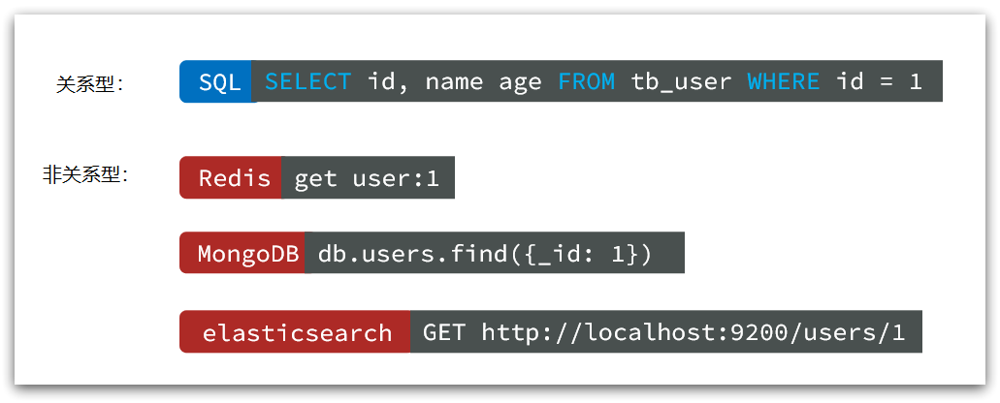

### 1.1.4.事务

传统关系型数据库能满足事务ACID的原则。

> - **原子性（Atomicity）**：事务是不可分割的**最小操作单元**，要么全部成功，要么全部失败。
> - **一致性（Consistency）**：事务完成时，必须使所有的数据都保持**一致状态**。
> - **隔离性（Isolation）**：数据库系统提供的隔离机制，保证事务在**不受外部并发操作影响**的独立环境下运行。
> - **持久性（Durability）**：事务一旦提交或回滚，它对数据库中的数据的**改变就是永久的**。

而非关系型数据库往往不支持事务，或者不能严格保证ACID的特性，只能实现**基本的一致性**。

### 1.1.5.总结

除了上述四点以外，在存储方式、扩展性、查询性能上关系型与非关系型也都有着显著差异，总结如下：

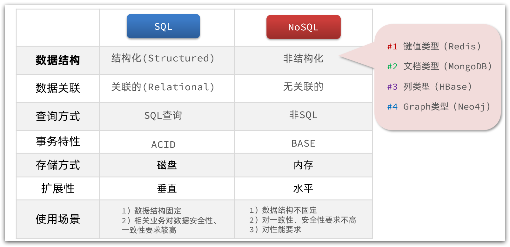

- 存储方式
  - **关系型数据库**基于**磁盘**进行存储，会有**大量的磁盘IO**，对性能有一定影响
  - **非关系型数据库**，他们的操作更多的是依赖于**内存**来操作，内存的**读写速度会非常快**，性能自然会好一些

* 扩展性
  * **关系型数据库集群模式一般是主从**，主从数据一致，起到数据备份的作用，称为**垂直扩展**。
  * **非关系型数据库可以将数据拆分**，存储在不同机器上，可以保存海量数据，解决内存大小有限的问题。称为**水平扩展**。
  * 关系型数据库因为表之间存在**关联关系**，如果做水平扩展会给数据查询带来很多麻烦

---

## 1.2.认识Redis

Redis诞生于2009年全称是**Re**mote  **D**ictionary **S**erver 远程词典服务器，是一个基于内存的键值型NoSQL数据库。

**特征**：

- 键值（key-value）型，value支持多种不同数据结构，功能丰富
- 单线程，每个命令具备原子性
- 低延迟，速度快（基于内存、IO多路复用、良好的编码）。
- 支持数据持久化
- 支持主从集群、分片集群
- 支持多语言客户端

**Redis的官方网站地址：https://redis.io/**

## 1.3 安装Redis

这里我使用 `Ubuntu 26.04` 安装配置 `Redis` 

**一、安装 Redis**

```bash
# 1. 更新本地软件源
sudo apt update

# 2. 一键安装 Redis 服务端+客户端
sudo apt install redis-server -y
```

**二、验证安装结果**

```bash
# 查看 Redis 版本
redis-server -v

# 查看服务运行状态
sudo systemctl status redis-server
# 显示 active (running) 即为安装成功且正常运行
```

**三、核心配置修改**

配置文件路径：`/etc/redis/redis.conf`
```bash
# 编辑配置文件
sudo vim /etc/redis/redis.conf
```

**Vim 编辑操作说明**

- 快速定位：命令模式下输入 `/关键词` 回车，按 `n` 跳转到下一个匹配项
- 进入编辑：定位到目标行后，按 `i` 进入插入模式即可修改内容
- 保存退出：修改完成按 `Esc` 回到命令模式，输入 `:wq` 回车
- 放弃修改：按 `Esc` 后输入 `:q!` 回车，强制退出不保存改动

**常用配置项（按需修改）**

1. **允许远程访问**（仅学习环境使用，生产环境谨慎）
   搜索 `/bind 127`，找到 `bind 127.0.0.1 -::1`，修改为：
   ```properties
   bind 0.0.0.0
   ```

2. **设置登录密码**
   搜索 `/requirepass`，找到 `# requirepass foobared`，去掉注释并替换为自定义密码：
   
   ```properties
   requirepass 你的密码
   ```
   
3. **开启 AOF 持久化**（提升数据安全性，默认关闭）
   搜索 `/appendonly`，找到 `appendonly no`，修改为：
   
   ```properties
   appendonly yes
   ```

**Redis的其它常见配置：**

```properties
# 监听的端口
port 6379
# 工作目录，默认是当前目录，也就是运行redis-server时的命令，日志、持久化等文件会保存在这个目录
dir .
# 数据库数量，设置为1，代表只使用1个库，默认有16个库，编号0~15
databases 1
# 设置redis能够使用的最大内存
maxmemory 512mb
# 日志文件，默认为空，不记录日志，可以指定日志文件名
logfile "redis.log"
```

**四、重启服务使配置生效**

```bash
# 重启服务
sudo systemctl restart redis-server

# 可选：设置开机自启（安装后默认已开启）
sudo systemctl enable redis-server
```

**五、连接测试**

**本地连接测试**

```bash
# 进入 Redis 命令行
redis-cli

# 连通性测试
ping
# 返回 PONG 即为正常

# 若设置了密码，执行身份验证
auth 你的密码
# 返回 OK 即为验证成功
```

**远程访问（需开放防火墙）**

```bash
# 放行 Redis 默认端口 6379
sudo ufw allow 6379/tcp
```
远程连接命令：`redis-cli -h 服务器IP地址 -p 6379`

**六、常用服务管理命令**

```bash
# 启动服务
sudo systemctl start redis-server

# 停止服务
sudo systemctl stop redis-server

# 重启服务
sudo systemctl restart redis-server

# 查看运行状态
sudo systemctl status redis-server
```

---

## 1.4.Redis桌面客户端

安装完成Redis，我们就可以操作Redis，实现数据的CRUD了。这需要用到Redis客户端，包括：

- 命令行客户端
- 图形化桌面客户端
- 编程客户端

### 1.4.1.Redis命令行客户端

Redis安装完成后就自带了命令行客户端：redis-cli，使用方式如下：

```bash
redis-cli [options] [commonds]
```

其中常见的options有：

- `-h 127.0.0.1`：指定要连接的redis节点的IP地址，默认是127.0.0.1
- `-p 6379`：指定要连接的redis节点的端口，默认是6379
- `-a 123321`：指定redis的访问密码 

其中的commonds就是Redis的操作命令，例如：

- `ping`：与redis服务端做心跳测试，服务端正常会返回`pong`

不指定commond时，会进入`redis-cli`的交互控制台：

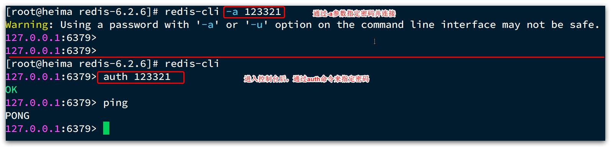

### 1.4.2.图形化桌面客户端

GitHub上的大神编写了Redis的图形化桌面客户端，地址：https://github.com/uglide/RedisDesktopManager

不过该仓库提供的是RedisDesktopManager的源码，并未提供windows安装包。


在下面这个仓库可以找到安装包：https://github.com/lework/RedisDesktopManager-Windows/releases

Redis默认有16个仓库，编号从0至15.  通过配置文件可以设置仓库数量，但是不超过16，并且不能自定义仓库名称。

如果是基于redis-cli连接Redis服务，可以通过select命令来选择数据库：

```bash
# 选择 0号库
select 0
```

# 2.Redis常见命令

Redis是典型的key-value数据库，key一般是字符串，而value包含很多不同的数据类型：

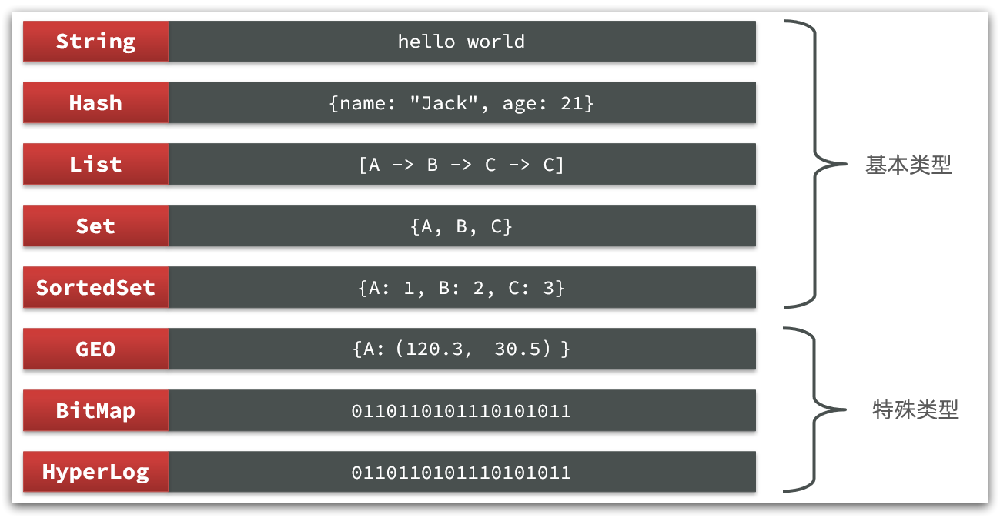

Redis为了方便我们学习，将操作不同数据类型的命令也做了分组，在官网（ [https://redis.io/commands ](https://redis.io/commands)）可以查看到不同的命令：

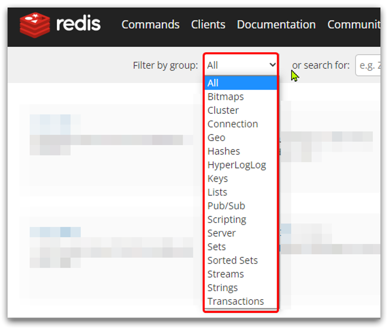

不同类型的命令称为一个group，我们也可以通过help命令来查看各种不同group的命令：

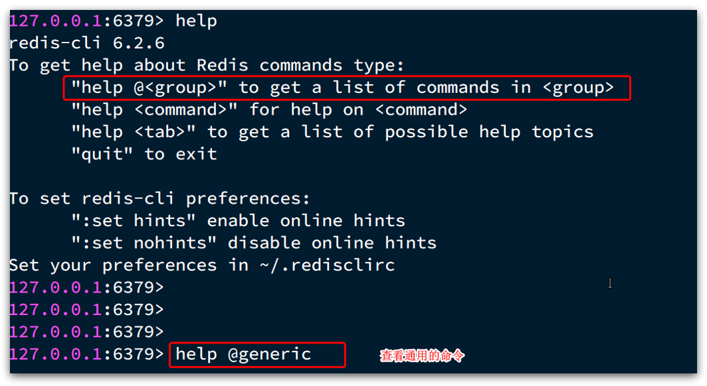

---

## 2.1.Redis通用命令

通用指令是部分数据类型的，都可以使用的指令，常见的有：

- `KEYS`：查看符合模板的所有`key` **(不建议在生产环境设备上使用)**
- `DEL`：删除一个指定的`key`
- `EXISTS`：判断`key`是否存在
- `EXPIRE`：给一个`key`设置有效期，有效期到期时该`key`会被自动删除
- `TTL`：查看一个`KEY`的剩余有效期

通过`help [command]` 可以查看一个命令的具体用法，例如：

```bash
# 查看keys命令的帮助信息：
127.0.0.1:6379> help keys

KEYS pattern
summary: Find all keys matching the given pattern
since: 1.0.0
group: generic
```

## 2.2.String类型

String类型，也就是字符串类型，是Redis中最简单的存储类型。

其value是字符串，不过根据字符串的格式不同，又可以分为3类：

- string：普通字符串
- int：整数类型，可以做自增、自减操作
- float：浮点类型，可以做自增、自减操作

不管是哪种格式，底层都是**字节数组**形式存储，只不过是**编码方式**不同。字符串类型的最大空间不能超过512m.

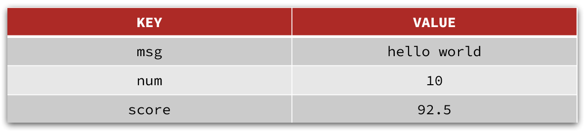

**String的常见命令有：**

- `SET`：添加或者修改已经存在的一个`String`类型的键值对
- `GET`：根据key获取`String`类型的`value`
- `MSET`：批量添加多个`String`类型的键值对
- `MGET`：根据多个`key`获取多个`String`类型的`value`
- `INCR`：让一个整型的`key`自增 1
- `INCRBY`:让一个整型的`key`自增并指定步长，例如：`incrby num 2` 让`num`值自增2
- `INCRBYFLOAT`：让一个浮点类型的数字自增并指定步长
- `SETNX`：添加一个`String`类型的键值对，前提是这个`key`不存在，否则不执行
- `SETEX`：添加一个`String`类型的键值对，并且指定有效期

**Key结构**

Redis没有类似MySQL中的Table的概念，我们该如何区分不同类型的key呢？

例如，需要存储用户、商品信息到redis，有一个用户id是1，有一个商品id恰好也是1，此时如果使用id作为key，那就会冲突了，该怎么办？

我们可以通过给key添加前缀加以区分，不过这个前缀不是随便加的，有一定的规范：

Redis的key允许有多个单词形成层级结构，多个单词之间用':'隔开，格式如下：

```
	项目名:业务名:类型:id
```

这个格式并非固定，也可以根据自己的需求来删除或添加词条。这样以来，我们就可以把不同类型的数据区分开了。从而避免了key的冲突问题。

例如我们的项目名称叫 heima，有user和product两种不同类型的数据，我们可以这样定义key：

- user相关的key：**heima:user:1**

- product相关的key：**heima:product:1**

如果Value是一个Java对象，例如一个User对象，则可以将对象序列化为JSON字符串后存储：

| **KEY**         | **VALUE**                                  |
| --------------- | ------------------------------------------ |
| heima:user:1    | {"id":1,  "name": "Jack", "age": 21}       |
| heima:product:1 | {"id":1,  "name": "小米11", "price": 4999} |

并且，在Redis的桌面客户端中，还会以相同前缀作为层级结构，让数据看起来层次分明，关系清晰：

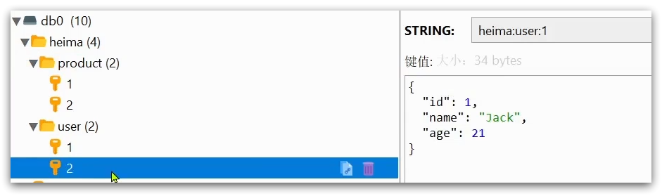

---

## 2.3.Hash类型

Hash类型，也叫散列，其value是一个无序字典，类似于Java中的HashMap结构。

String结构是将对象序列化为JSON字符串后存储，当需要修改对象某个字段时很不方便：

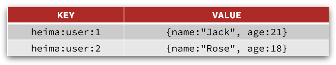

Hash结构可以将对象中的每个字段独立存储，可以针对单个字段做CRUD：

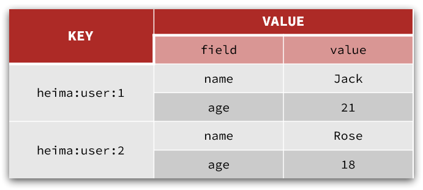

**Hash的常见命令有：**

- `HSET key field value`：添加或者修改hash类型key的field的值

- `HGET key field`：获取一个hash类型key的field的值

- `HMSET`：批量添加多个hash类型key的field的值

- `HMGET`：批量获取多个hash类型key的field的值

- `HGETALL`：获取一个hash类型的key中的所有的field和value
- `HKEYS`：获取一个hash类型的key中的所有的field
- `HINCRBY`:让一个hash类型key的字段值自增并指定步长
- `HSETNX`：添加一个hash类型的key的field值，前提是这个field不存在，否则不执行

---

## 2.4.List类型

Redis中的`List`类型与Java中的`LinkedList`类似，可以看做是一个双向链表结构。既可以支持正向检索和也可以支持反向检索。

**特征也与`LinkedList`类似：**

- 有序
- 元素可以重复
- 插入和删除快
- 查询速度一般

> 常用来存储一个有序数据，例如：朋友圈点赞列表，评论列表等。

**List的常见命令有：**

- `LPUSH key element ...` ：向列表**左侧**插入一个或多个元素
- `LPOP key`：移除并返回列表左侧的第一个元素，没有则返回`nil`
- `RPUSH key element ...` ：向列表右侧插入一个或多个元素
- `RPOP key`：移除并返回列表右侧的第一个元素
- `LRANGE key star end`：返回一段角标范围内的所有元素
- `BLPOP和BRPOP`：与LPOP和RPOP类似，只不过在没有元素时等待指定时间，而不是直接返回`nil`

## 2.5.Set类型

Redis的`Set`结构与Java中的`HashSet`类似，可以看做是一个`value`为`null`的`HashMap`。因为也是一个hash表，因此**具备与HashSet类似的特征：**

- 无序

- 元素不可重复

- 查找快

- 支持交集、并集、差集等功能

**Set的常见命令有：**

- `SADD key member ...` ：向set中添加一个或多个元素
- `SREM key member ...` : 移除set中的指定元素
- `SCARD key`： 返回set中元素的个数
- `SISMEMBER key member`：判断一个元素是否存在于set中
- `SMEMBERS`：获取set中的所有元素
- `SINTER key1 key2 ...` ：求key1与key2的交集
- `SDIFF key1 key2 ...` ：求key1与key2的差集
- `SUNION key1 key2 ..`：求key1和key2的并集


**例如两个集合：s1和s2:**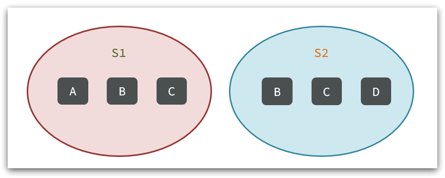

求**交集**：`SINTER s1 s2`

求s1与s2的**不同(差集)**：`SDIFF s1 s2`

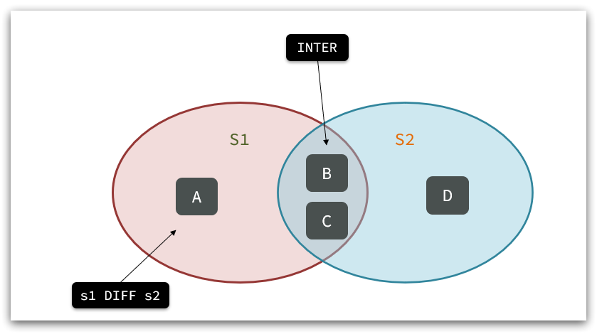

---

## 2.6.SortedSet类型

`Redis`的`SortedSet`是一个可排序的`set`集合，与`Java`中的`TreeSet`有些类似，但底层数据结构却差别很大。`SortedSet`中的每一个元素都带有一个`score`属性，可以基于`score`属性对元素排序，底层的实现是一个跳表`（SkipList）`加 `hash`表。

**SortedSet具备下列特性：**

- 可排序
- 元素不重复
- 查询速度快

> 因为SortedSet的可排序特性，经常被用来实现排行榜这样的功能。

**SortedSet的常见命令有：**

- `ZADD key score member`：添加一个或多个元素到sorted set ，如果已经存在则更新其score值
- `ZREM key member`：删除sorted set中的一个指定元素
- `ZSCORE key member` : 获取sorted set中的指定元素的score值
- `ZRANK key member`：获取sorted set 中的指定元素的排名
- `ZCARD key`：获取sorted set中的元素个数
- `ZCOUNT key min max`：统计score值在给定范围内的所有元素的个数
- `ZINCRBY key increment member`：让sorted set中的指定元素自增，步长为指定的increment值
- `ZRANGE key min max`：按照score排序后，获取指定排名范围内的元素
- `ZRANGEBYSCORE key min max`：按照score排序后，获取指定score范围内的元素
- `ZDIFF、ZINTER、ZUNION`：求差集、交集、并集

注意：所有的排名默认都是**升序**，如果要**降序**则在命令的**`Z`**后面添加**`REV`**即可，例如：

- **升序**获取sorted set 中的指定元素的排名：`ZRANK key member`

- **降序**获取sorted set 中的指定元素的排名：`ZREVRANK key memeber`

---

# 3.Redis的Java客户端

在Redis官网中提供了各种语言的客户端，地址：https://redis.io/docs/clients/

这里展示的是java相关的介绍

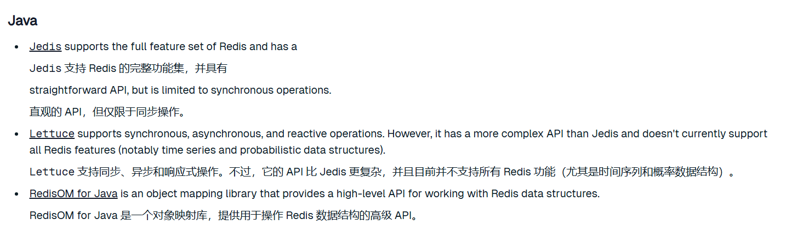

---

## 3.1.Jedis客户端

Jedis的官网地址： https://github.com/redis/jedis

### 3.1.1.快速入门

1）引入依赖：

```xml
<!--jedis-->
<dependency>
    <groupId>redis.clients</groupId>
    <artifactId>jedis</artifactId>
    <version>3.7.0</version>
</dependency>
<!--单元测试-->
<dependency>
    <groupId>org.junit.jupiter</groupId>
    <artifactId>junit-jupiter</artifactId>
    <version>5.7.0</version>
    <scope>test</scope>
</dependency>
```

2）建立连接

新建一个单元测试类，内容如下：

```java
private Jedis jedis;

@BeforeEach
void setUp() {
    // 1.建立连接
    jedis = new Jedis("192.168.100.128", 6379);
    // 2.设置密码
    jedis.auth("123456");
    // 3.选择库
    jedis.select(0);
}
```

3）测试：

```java
@Test
void testString() {
    // 存入数据
    String result = jedis.set("name", "虎哥");
    System.out.println("result = " + result);
    // 获取数据
    String name = jedis.get("name");
    System.out.println("name = " + name);
}

@Test
void testHash() {
    // 插入hash数据
    jedis.hset("user:1", "name", "Jack");
    jedis.hset("user:1", "age", "21");

    // 获取
    Map<String, String> map = jedis.hgetAll("user:1");
    System.out.println(map);
}
```

4）释放资源

```java
@AfterEach
void tearDown() {
    if (jedis != null) {
        jedis.close();
    }
}
```

测试结果:

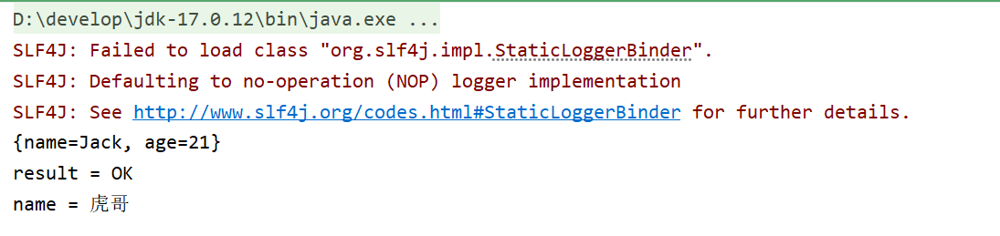

---

### 3.1.2.连接池

Jedis本身是线程不安全的，并且频繁的创建和销毁连接会有性能损耗，因此推荐使用**`Jedis`连接池**代替`Jedis`的直连方式。

```java
package util;

import redis.clients.jedis.ConnectionPoolConfig;
import redis.clients.jedis.DefaultJedisClientConfig;
import redis.clients.jedis.RedisClient;

import java.time.Duration;

public class JedisConnectionFactory {
    
    private static final RedisClient redisClient;
    
    static {
        // 1. 配置连接池参数（new 对象后 set 参数，无 builder 模式）
        ConnectionPoolConfig poolConfig = new ConnectionPoolConfig();
        poolConfig.setMaxTotal(8);        // 最大连接数
        poolConfig.setMaxIdle(8);         // 最大空闲连接数
        poolConfig.setMinIdle(2);         // 最小空闲连接数
        poolConfig.setMaxWait(Duration.ofMillis(1000)); // 获取连接最大等待时间
        poolConfig.setTestWhileIdle(true); // 空闲时检测连接有效性
        
        // 2. 配置客户端认证信息（密码、超时、库号等）
        DefaultJedisClientConfig clientConfig = DefaultJedisClientConfig.builder()
                .password("123456")
                .database(0)
                .timeoutMillis(1000) // 连接超时时间
                .build();
        
        // 3. 创建 RedisClient（内置连接池，替代旧版 JedisPool）
        redisClient = RedisClient.builder()
                .hostAndPort("192.168.100.128", 6379)
                .clientConfig(clientConfig)
                .poolConfig(poolConfig)
                .build();
    }
    
    /**
     * 直接获取 RedisClient 即可使用，线程安全，全局单例
     */
    public static RedisClient getRedisClient() {
        return redisClient;
    }
}
```

测试代码:

```java
public class JedisTest {
    
    private RedisClient jedis;
    @BeforeEach
    void setUp() {
        // 密码、库号都已在连接工厂创建时统一配置，直接获取使用
        jedis = JedisConnectionFactory.getRedisClient();
    }
    
    @Test
    void testString() {
        // 存入数据
        String result = jedis.set("name", "虎哥");
        System.out.println("result = " + result);
        // 获取数据
        String name = jedis.get("name");
        System.out.println("name = " + name);
    }
    
    @Test
    void testHash() {
        // 插入hash数据
        jedis.hset("user:1", "name", "Jack");
        jedis.hset("user:1", "age", "21");
        
        // 获取
        Map<String, String> map = jedis.hgetAll("user:1");
        System.out.println(map);
    }
    
    @AfterEach
    void tearDown() {
        if (jedis != null) {
            jedis.close();
        }
    }
}
```

测试结果

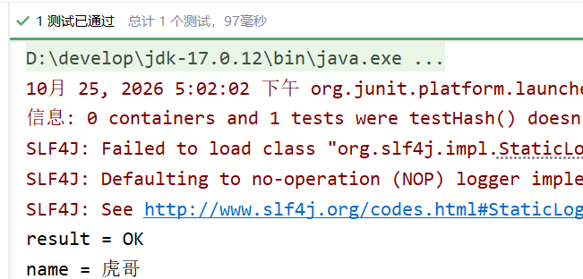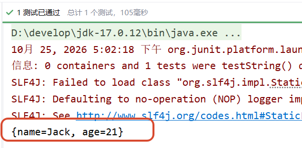

---

## 3.2.SpringDataRedis客户端

SpringData是Spring中数据操作的模块，包含对各种数据库的集成，其中对Redis的集成模块就叫做SpringDataRedis，官网地址：https://spring.io/projects/spring-data-redis

- 提供了对不同Redis客户端的整合（Lettuce和Jedis）
- 提供了RedisTemplate统一API来操作Redis
- 支持Redis的发布订阅模型
- 支持Redis哨兵和Redis集群
- 支持基于Lettuce的响应式编程
- 支持基于JDK、JSON、字符串、Spring对象的数据序列化及反序列化
- 支持基于Redis的JDKCollection实现

---

SpringDataRedis中提供了RedisTemplate工具类，其中封装了各种对Redis的操作。并且将不同数据类型的操作API封装到了不同的类型中：

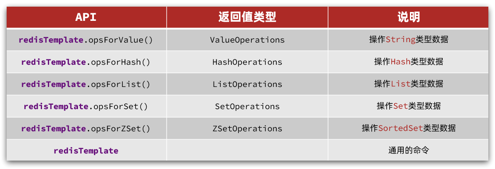
