# 1. 软件开发原则

> 这里引出了软件七大开发原则中的 **OCP开闭原则** 和 **DIP依赖倒置原则**
>
> 详细内容在 [**OCP开闭原则**](../软件开发原则/2.OCP开闭原则.md)  [**DIP依赖倒置原则**](../软件开发原则/5.DIP依赖倒置原则.md) .......
>
> 其他原则自行学习

阅读以下代码：

```java
public class UserController {

    private UserService userService = new UserServiceImpl();

    public void login(){
        String username = "admin";
        String password = "123456";
        boolean success = userService.login(username, password);
        if (success) {
            // 登录成功
        } else {
            // 登录失败
        }
    }
}
```

```java
public class UserServiceImpl implements UserService {

    private UserDao userDao = new UserDaoImplForMySQL();

    public boolean login(String username, String password) {
        User user = userDao.selectByUsernameAndPassword(username, password);
        if (user != null) {
            return true;
        }
        return false;
    }
}

```

```java
public class UserDaoImplForMySQL implements UserDao {
    public User selectByUsernameAndPassword(String username, String password) {
        // 连接MySQL数据库，根据用户名和密码查询用户信息
        return null;
    }
}
```

可以看出，UserDaoImplForMySQL中主要是连接MySQL数据库进行操作。如果更换到Oracle数据库上，则需要再提供一个UserDaoImplForOracle，如下：

```java
public class UserDaoImplForOracle implements UserDao {
    public User selectByUsernameAndPassword(String username, String password) {
        // 连接Oracle数据库，根据用户名和密码查询用户信息
        return null;
    }
}
```

很明显，以上的操作正在进行功能的扩展，添加了一个新的类UserDaoImplForOracle来应付数据库的变化，这里的变化会引起连锁反应吗？当然会，如果想要切换到Oracle数据库上，UserServiceImpl类代码就需要修改，如下：

```java
public class UserServiceImpl implements UserService {

    //private UserDao userDao = new UserDaoImplForMySQL();
    private UserDao userDao = new UserDaoImplForOracle();

    public boolean login(String username, String password) {
        User user = userDao.selectByUsernameAndPassword(username, password);
        if (user != null) {
            return true;
        }
        return false;
    }
}
```

## 1.1 OCP开闭原则

**什么是 OCP？**

OCP 是软件七大开发原则当中最基本的一个原则：**开闭原则**。

- 对什么开？对**扩展**开放。
- 对什么闭？对**修改**关闭。

OCP 原则是最核心的、最基本的，其他的六个原则都是为这个原则服务的。

**OCP 开闭原则的核心是什么？**

- 只要你在扩展系统功能的时候，没有修改以前写好的代码，那么你就是符合 OCP 原则的。
- 反之，如果在扩展系统功能的时候，你修改了之前的代码，那么这个设计是失败的，违背 OCP 原则。

> 当进行系统功能扩展的时候，如果动了之前稳定的程序、修改了之前的程序，之前所有程序都需要进行重新测试。这是不想看到的，因为非常麻烦。

详细内容见 → [**OCP开闭原则**](../软件开发原则/2.OCP开闭原则.md)

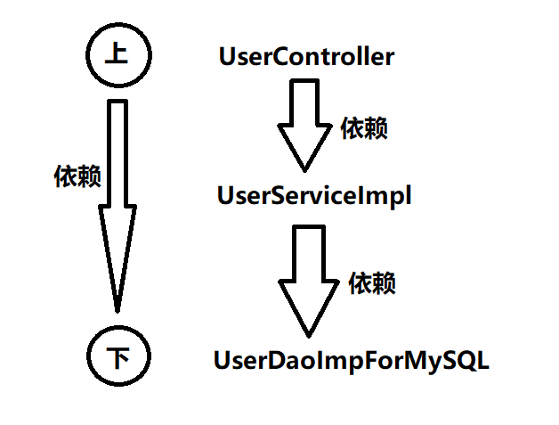

可以很明显的看出，**上层**是依赖**下层**的。UserController依赖UserServiceImpl，而UserServiceImpl依赖UserDaoImplForMySQL，这样就会导致**下面只要改动**，**上面必然会受牵连（跟着也会改）**，所谓牵一发而动全身。这样也就同时违背了另一个开发原则：依赖倒置原则。

## 1.2 DIP依赖倒置原则

依赖倒置原则(Dependence Inversion Principle)，简称DIP，主要倡导面向抽象编程，面向接口编程，不要面向具体编程，让**上层**不再依赖**下层**，下面改动了，上面的代码不会受到牵连。这样可以大大降低程序的耦合度，耦合度低了，扩展力就强了，同时代码复用性也会增强。（**软件七大开发原则都是在为解耦合服务**）
你可能会说，上面的代码已经面向接口编程了呀：

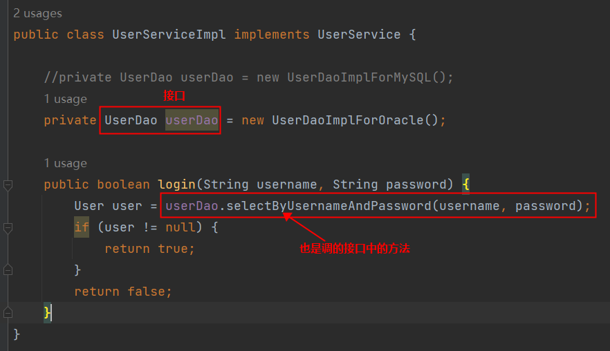

确实已经面向接口编程了，但对象的创建是：new UserDaoImplForOracle()显然并没有完全面向接口编程，还是使用到了具体的接口实现类。什么叫做完全面向接口编程？什么叫做完全符合依赖倒置原则呢？请看以下代码：

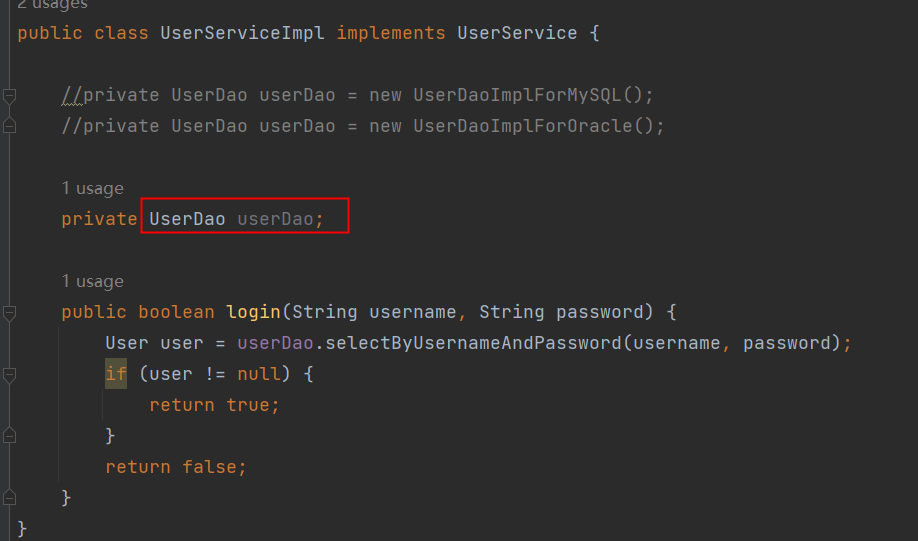

如果代码是这样编写的，才算是完全面向接口编程，才符合依赖倒置原则。那你可能会问，这样userDao是null，在执行的时候就会出现空指针异常呀。你说的有道理，确实是这样的，所以我们要解决这个问题。解决空指针异常的问题，其实就是解决两个核心的问题：

- 第一个问题：谁来负责对象的创建。【也就是说谁来：new UserDaoImplForOracle()/new UserDaoImplForMySQL()】
- 第二个问题：谁来负责把创建的对象赋到这个属性上。【也就是说谁来把上面创建的对象赋给userDao属性】

如果我们把以上两个核心问题解决了，就可以做到既符合OCP开闭原则，又符合依赖倒置原则。
很荣幸的通知你：Spring框架可以做到。
在Spring框架中，它可以帮助我们new对象，并且它还可以将new出来的对象赋到属性上。换句话说，Spring框架可以帮助我们创建对象，并且可以帮助我们维护对象和对象之间的关系。比如：

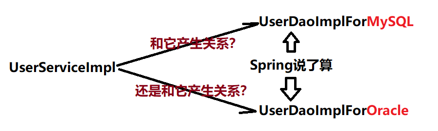

Spring可以new出来UserDaoImplForMySQL对象，也可以new出来UserDaoImplForOracle对象，并且还可以让new出来的dao对象和service对象产生关系（产生关系其实本质上就是给属性赋值）。
很显然，这种方式是将对象的创建权/管理权交出去了，不再使用硬编码的方式了。同时也把对象关系的管理权交出去了，也不再使用硬编码的方式了。像这种把对象的创建权交出去，把对象关系的管理权交出去，被称为控制反转。

---

## 1.3 控制反转IoC

控制反转（Inversion of Control，缩写为IoC），是面向对象编程中的一种设计思想，可以用来降低代码之间的耦合度，符合依赖倒置原则。
控制反转的核心是：**将对象的创建权交出去，将对象和对象之间关系的管理权交出去，由第三方容器来负责创建与维护**。
控制反转常见的实现方式：**依赖注入（Dependency Injection，简称DI）**
通常，依赖注入的实现又包括两种方式：

- set方法注入
- 构造方法注入

而Spring框架就是一个实现了IoC思想的框架。
IoC可以认为是一种**全新的设计模式**，但是理论和时间成熟相对较晚，并没有包含在GoF中。（GoF指的是23种设计模式）

> "依赖": A对象和B对象的关系
>
> "注入": 一种手段, 通过这种手段可以让A对象和B对象产生关系

---

# 2. Spring概述

## 2.1 Spring简介

****

来自百度百科

> Spring是一个开源框架，它由Rod Johnson创建。它是为了解决企业应用开发的复杂性而创建的。
> 从简单性、可测试性和松耦合的角度而言，任何Java应用都可以从Spring中受益。
> **Spring是一个轻量级的控制反转(IoC)和面向切面(AOP)的容器框架。**
> **Spring最初的出现是为了解决EJB臃肿的设计，以及难以测试等问题。**
> **Spring为简化开发而生，让程序员只需关注核心业务的实现，尽可能的不再关注非业务逻辑代码（事务控制，安全日志等）。**

## 2.2 Spring8大模块

注意：Spring5版本之后是8个模块。在Spring5中新增了WebFlux模块。

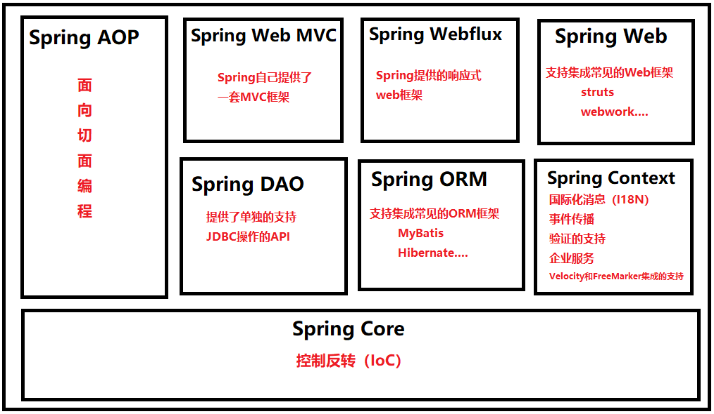

1. **Spring Core模块**

这是Spring框架最基础的部分，它提供了依赖注入（DependencyInjection）特征来实现容器对Bean的管理。核心容器的主要组件是 BeanFactory，BeanFactory是工厂模式的一个实现，是任何Spring应用的核心。它使用IoC将应用配置和依赖从实际的应用代码中分离出来。

2. **Spring Context模块**

如果说核心模块中的BeanFactory使Spring成为容器的话，那么上下文模块就是Spring成为框架的原因。
这个模块扩展了BeanFactory，增加了对国际化（I18N）消息、事件传播、验证的支持。另外提供了许多企业服务，例如电子邮件、JNDI访问、EJB集成、远程以及时序调度（scheduling）服务。也包括了对模版框架例如Velocity和FreeMarker集成的支持

3. **Spring AOP模块**

Spring在它的AOP模块中提供了对面向切面编程的丰富支持，Spring AOP 模块为基于 Spring 的应用程序中的对象提供了事务管理服务。通过使用 Spring AOP，不用依赖组件，就可以将声明性事务管理集成到应用程序中，可以自定义拦截器、切点、日志等操作。

4. **Spring DAO模块**

提供了一个JDBC的抽象层和异常层次结构，消除了烦琐的JDBC编码和数据库厂商特有的错误代码解析，用于简化JDBC。

5. **Spring ORM模块**

Spring提供了ORM模块。Spring并不试图实现它自己的ORM解决方案，而是为几种流行的ORM框架提供了集成方案，包括Hibernate、JDO和iBATIS SQL映射，这些都遵从 Spring 的通用事务和 DAO 异常层次结构。

6. **Spring Web MVC模块**

Spring为构建Web应用提供了一个功能全面的MVC框架。虽然Spring可以很容易地与其它MVC框架集成，例如Struts，但Spring的MVC框架使用IoC对控制逻辑和业务对象提供了完全的分离。

7. **Spring WebFlux模块**

Spring Framework 中包含的原始 Web 框架 Spring Web MVC 是专门为 Servlet API 和 Servlet 容器构建的。反应式堆栈 Web 框架 Spring WebFlux 是在 5.0 版的后期添加的。它是完全非阻塞的，支持反应式流(Reactive Stream)背压，并在Netty，Undertow和Servlet 3.1+容器等服务器上运行。

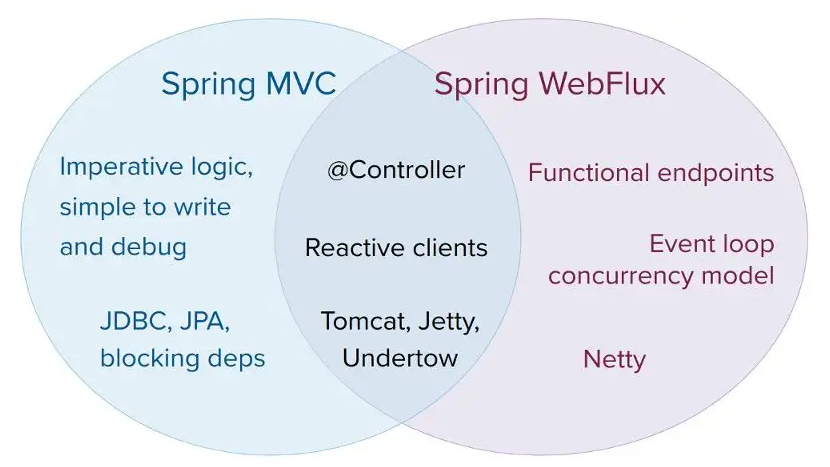

8. **Spring Web模块**

Web 上下文模块建立在应用程序上下文模块之上，为基于 Web 的应用程序提供了上下文，提供了Spring和其它Web框架的集成，比如Struts、WebWork。还提供了一些面向服务支持，例如：实现文件上传的multipart请求。

---

## 2.3 Spring特点

1. **轻量**

   1. 从大小与开销两方面而言Spring都是轻量的。完整的Spring框架可以在一个大小只有1MB多的JAR文件里发布。并且Spring所需的处理开销也是微不足道的。
   2. Spring是非侵入式的：Spring应用中的对象不依赖于Spring的特定类。

   > **侵入式**是描述框架 / 组件对业务代码的绑定程度：使用它时，**必须让你的业务代码去继承它的类、实现它的接口、依赖它的专属 API，甚至遵循它的特定代码结构**，你的代码会和这个框架强绑定，相当于被框架 “侵入” 了自身的代码体系。
   >
   > 对应的**非侵入式**：使用时几乎不需要改动原有业务代码，通常只需要加配置、加注解、调用工具方法，业务代码本身不依赖框架的特殊结构，换掉这个框架，业务代码本身基本还能用。

2. **控制反转**

   1. Spring通过一种称作控制反转（IoC）的技术促进了松耦合。当应用了IoC，一个对象依赖的其它对象会通过被动的方式传递进来，而不是这个对象自己创建或者查找依赖对象。你可以认为IoC与JNDI相反——不是对象从容器中查找依赖，而是容器在对象初始化时不等对象请求就主动将依赖传递给它。

3. **面向切面**

   1. Spring提供了面向切面编程的丰富支持，允许通过分离应用的业务逻辑与系统级服务（例如审计（auditing）和事务（transaction）管理）进行内聚性的开发。应用对象只实现它们应该做的——完成业务逻辑——仅此而已。它们并不负责（甚至是意识）其它的系统级关注点，例如日志或事务支持。

4. **容器**

   1. Spring包含并管理应用对象的配置和生命周期，在这个意义上它是一种容器，你可以配置你的每个bean如何被创建——基于一个可配置原型（prototype），你的bean可以创建一个单独的实例或者每次需要时都生成一个新的实例——以及它们是如何相互关联的。然而，Spring不应该被混同于传统的重量级的EJB容器，它们经常是庞大与笨重的，难以使用。

5. **框架**

   1. Spring可以将简单的组件配置、组合成为复杂的应用。在Spring中，应用对象被声明式地组合，典型地是在一个XML文件里。Spring也提供了很多基础功能（事务管理、持久化框架集成等等），将应用逻辑的开发留给了你。

所有Spring的这些特征使你能够编写更干净、更可管理、并且更易于测试的代码。它们也为Spring中的各种模块提供了基础支持。

---

# 3. Spring入门

## 3.1 快速使用Spring

**1.引入依赖**

```xml
<dependencies>
    <!--spring context依赖-->
    <dependency>
        <groupId>org.springframework</groupId>
        <artifactId>spring-context</artifactId>
        <version>6.2.19</version>
        <scope>compile</scope>
    </dependency>
    <!--junit-->
    <dependency>
        <groupId>junit</groupId>
        <artifactId>junit</artifactId>
        <version>4.13.2</version>
        <scope>test</scope>
    </dependency>
</dependencies>
```

>当加入spring context的依赖之后，会关联引入其他依赖：
>spring aop：面向切面编程
>spring beans：IoC核心
>spring core：spring的核心工具包
>spring jcl：spring的日志包
>spring expression：spring表达式

**2.定义bean: User**

```java
package bean;

public class User {
}
```

> 默认有空参构造方法

**3.编写spring的配置文件：beans.xml  ,  该文件放在类的根路径下(resources)**

```xml
<?xml version="1.0" encoding="UTF-8"?>
<beans xmlns="http://www.springframework.org/schema/beans"
       xmlns:xsi="http://www.w3.org/2001/XMLSchema-instance"
       xsi:schemaLocation="http://www.springframework.org/schema/beans http://www.springframework.org/schema/beans/spring-beans.xsd">

    <bean id="userBean" class="bean.User"/>

</beans>
```

bean的id和class属性：

- **id属性：代表对象的唯一标识。可以看做一个人的身份证号。**
- **class属性：用来指定要创建的java对象的类名，这个类名必须是全限定类名（带包名）。**

**4.编写测试程序**

```java
public class Spring6Test {
    @Test
    public void testFirst(){
        // 初始化Spring容器上下文（解析beans.xml文件，创建所有的bean对象）
        ApplicationContext applicationContext = new ClassPathXmlApplicationContext("beans.xml");
        // 根据id获取bean对象
        Object userBean = applicationContext.getBean("userBean");
        System.out.println(userBean);
    }
}
```

**5.结果如下, 成功获取到了bean对象**

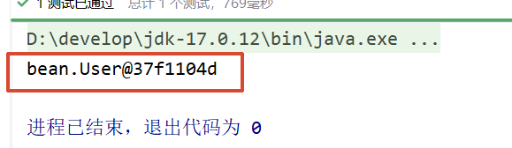

---

## 3.2 详细剖析

**1.在spring的配置文件中id是不能重名。**

> 这个就不写测试了
>
> 可以自行研究

```xml
<bean id="userBean" class="bean.User"/>
```

---

**2.底层是怎么创建对象的，是通过反射机制调用无参数构造方法吗？**

给User的无参构造方法加上以下内容

```java
public class User {
    public User() {
        System.out.println("User的无参构造方法执行...");
    }
}
```

启动测试

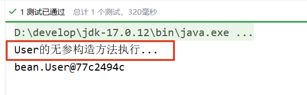

**通过测试得知：创建对象时确实调用了无参数构造方法。**

如果提供一个有参数构造方法，不提供无参数构造方法会怎样呢？

```java
public class User {
    /* public User() {
        System.out.println("User的无参构造方法执行...");
    } */
    
    public User(String name) {
        System.out.println("User的有参构造方法执行...");
    }
}
```

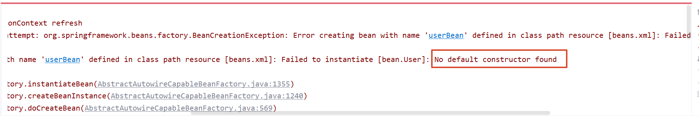

**通过测试得知：spring是通过调用类的无参数构造方法来创建对象的，所以要想让spring给你创建对象，必须保证无参数构造方法是存在的。**

Spring是如何创建对象的呢？原理是什么？

```java
// dom4j解析beans.xml文件，从中获取class的全限定类名
// 通过反射机制调用无参数构造方法创建对象
Class clazz = Class.forName("com.powernode.spring6.bean.User");
Object obj = clazz.newInstance();
```

---

**3.把创建好的对象存储到一个什么样的数据结构当中了呢？**

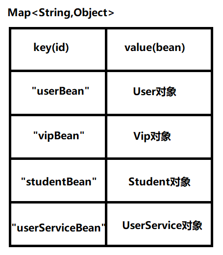

---

**4.spring配置文件的名字必须叫做beans.xml吗？**

```java
ApplicationContext applicationContext = new ClassPathXmlApplicationContext("beans.xml");
```

通过以上的java代码可以看出，这个spring配置文件名字是我们负责提供的，显然spring配置文件的名字是随意的。

---

**5.像这样的beans.xml文件可以有多个吗？**

再创建一个spring配置文件，起名：spring.xml

```xml
<?xml version="1.0" encoding="UTF-8"?>
<beans xmlns="http://www.springframework.org/schema/beans"
       xmlns:xsi="http://www.w3.org/2001/XMLSchema-instance"
       xsi:schemaLocation="http://www.springframework.org/schema/beans http://www.springframework.org/schema/beans/spring-beans.xsd">

    <bean id="vipBean" class="bean.Vip"></bean>

</beans>
```

再写各vip类, 这里不展示

接着就是test类

```java
public class Spring6Test {
    
    @Test
    public void testFirst(){
        // 初始化Spring容器上下文（解析xml文件，创建所有的bean对象）
        ApplicationContext applicationContext = new ClassPathXmlApplicationContext("beans.xml", "spring.xml");
        // 根据id获取bean对象
        Object userBean = applicationContext.getBean("userBean");
        Object vipBean = applicationContext.getBean("vipBean");
        
        System.out.println(userBean);
        System.out.println(vipBean);
    }
}
```

> 注意: 传入的是 `"beans.xml", "spring.xml"` 两个xml文件

**运行结果**

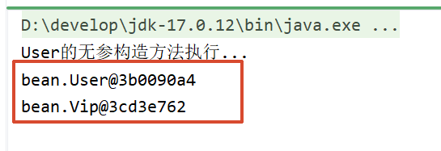

通过测试得知，spring的配置文件可以有多个，在ClassPathXmlApplicationContext构造方法的参数上传递文件路径即可。这是为什么呢？通过源码可以看到：

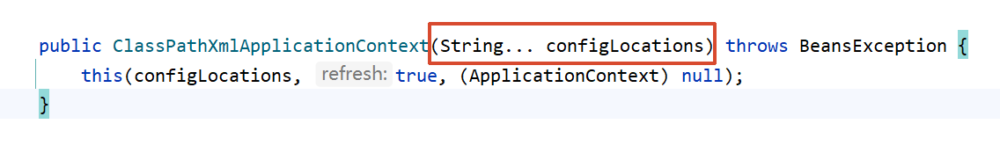

---

**6.在配置文件中配置的类必须是自定义的吗，可以使用JDK中的类吗，例如：java.util.Date**

```xml
<?xml version="1.0" encoding="UTF-8"?>
<beans xmlns="http://www.springframework.org/schema/beans"
       xmlns:xsi="http://www.w3.org/2001/XMLSchema-instance"
       xsi:schemaLocation="http://www.springframework.org/schema/beans http://www.springframework.org/schema/beans/spring-beans.xsd">

    <bean id="userBean" class="bean.User"/>

    <bean id="dateBean" class="java.util.Date"/>

</beans>
```

> <bean id="dateBean" class="java.util.Date"/>

**运行结果**

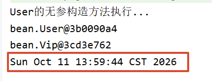

通过测试得知，在spring配置文件中配置的bean可以任意类，只要这个类不是抽象的，并且提供了无参数构造方法。

---

**7.getBean()方法调用时，如果指定的id不存在会怎样？**

这个我都不用写测试案例了

很明显, 当id不存在的时候，会出现异常。

**`No bean named 'id不存在的bean的名字' available`**

---

**8.getBean()方法返回的类型是Object，如果访问子类的特有属性和方法时，还需要向下转型，有其它办法可以解决这个问题吗？**

```java
User user = applicationContext.getBean("userBean", User.class);
```

---

**9.ClassPathXmlApplicationContext是从类路径中加载配置文件，如果没有在类路径当中，又应该如何加载配置文件呢？**

没有在类路径中的话，需要使用FileSystemXmlApplicationContext类进行加载配置文件。
这种方式较少用。一般都是将配置文件放到类路径当中，这样可移植性更强。

---

**10.ApplicationContext的超级父接口BeanFactory。**

```java
BeanFactory beanFactory = new ClassPathXmlApplicationContext("spring.xml");
Object vipBean = beanFactory.getBean("vipBean");
System.out.println(vipBean);
```

BeanFactory是Spring容器的超级接口。ApplicationContext是BeanFactory的子接口。

---

# 4. Spring对IoC的实现

## 4.1 IoC 控制反转

- 控制反转是一种思想。
- 控制反转是为了降低程序耦合度，提高程序扩展力，达到OCP原则，达到DIP原则。
- 控制反转，反转的是什么？
  - 将对象的创建权利交出去，交给第三方容器负责。
  - 将对象和对象之间关系的维护权交出去，交给第三方容器负责。
- 控制反转这种思想如何实现呢？
  - DI（Dependency Injection）：依赖注入

---

## 4.2 依赖注入

依赖注入实现了控制反转的思想。
**Spring通过依赖注入的方式来完成Bean管理的。**
**Bean管理说的是：Bean对象的创建，以及Bean对象中属性的赋值（或者叫做Bean对象之间关系的维护）。**
依赖注入：

- 依赖指的是对象和对象之间的关联关系。
- 注入指的是一种数据传递行为，通过注入行为来让对象和对象产生关系。

依赖注入常见的实现方式包括两种：

- 第一种：set注入
- 第二种：构造注入

---

### 4.2.1 set注入

set注入，基于set方法实现的，底层会通过反射机制调用属性对应的set方法然后给属性赋值。这种方式要求属性必须对外提供set方法。

**UserMapper**

```java
public class UserMapper {
    public void insert(){
        System.out.println("正在保存用户数据。");
    }
}
```

**UserServiceImpl**

```java
public class UserServiceImpl implements UserService {
    
    private UserMapper userMapper;
    
    // 使用set方式注入，必须提供set方法。
    // 反射机制要调用这个方法给属性赋值的。
    public void setUserMapper(UserMapper userMapper) {
        this.userMapper = userMapper;
    }
    
    @Override
    public void save(){
        userMapper.insert();
    }
}
```

**beans.xml**

```xml
<?xml version="1.0" encoding="UTF-8"?>
<beans xmlns="http://www.springframework.org/schema/beans"
       xmlns:xsi="http://www.w3.org/2001/XMLSchema-instance"
       xsi:schemaLocation="http://www.springframework.org/schema/beans http://www.springframework.org/schema/beans/spring-beans.xsd">

    <bean id="userMapperBean" class="mapper.UserMapper"/>

    <bean id="userServiceImplBean" class="service.impl.UserServiceImpl">
        <property name="userMapper" ref="userMapperBean"/>
    </bean>

</beans>
```

**Spring6Test**

```java
public class Spring6Test {
    
    @Test
    public void testFirst(){
        // 初始化Spring容器上下文（解析beans.xml文件，创建所有的bean对象）
        ApplicationContext applicationContext = new ClassPathXmlApplicationContext("beans.xml");
        // 根据id获取bean对象
        UserService userService = applicationContext.getBean("userServiceImplBean", UserServiceImpl.class);
        // 调用方法
        userService.save();        
    }
}
```

运行结果：

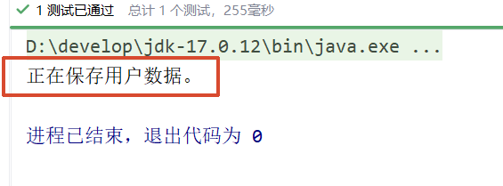

重点内容是，什么原理：

```xml
<bean id="userMapperBean" class="mapper.UserMapper"/>

<bean id="userServiceImplBean" class="service.impl.UserServiceImpl">
    <property name="userMapper" ref="userMapperBean"/>
</bean>
```

实现原理：
通过property标签获取到属性名：userMapper
通过属性名推断出set方法名：setUserMapper

> `public void setUserMapper(UserMapper userMapper)`

通过反射机制调用 `setUserMapper()` 方法给属性赋值
property标签的name是属性名。
property标签的ref是要注入的bean对象的id。**(通过ref属性来完成bean的装配，这是bean最简单的一种装配方式。装配指的是：创建系统组件之间关联的动作)**
**可以把set方法注释掉，再测试一下**：

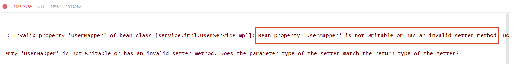

通过测试得知，底层实际上调用了setUserMapper()方法。所以需要确保这个方法的存在。
我们现在把属性名修改一下，但方法名还是setUserMapper()，我们来测试一下：

```java
public class UserServiceImpl implements UserService {
    
    private UserMapper aaa;
    
    // 使用set方式注入，必须提供set方法。
    // 反射机制要调用这个方法给属性赋值的。
    public void setUserMapper(UserMapper userMapper) {
        this.aaa = userMapper;
    }
    
    @Override
    public void save(){
        aaa.insert();
    }
}
```

**beans.xml不动**

```xml
<bean id="userMapperBean" class="mapper.UserMapper"/>

    <bean id="userServiceImplBean" class="service.impl.UserServiceImpl">
        <property name="userMapper" ref="userMapperBean"/>
    </bean>
```

**运行结果**

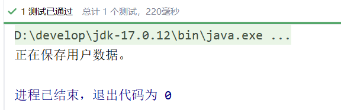

通过测试看到程序仍然可以正常执行，说明property标签的name是：setUserMapper()方法名演变得到的。演变的规律是：

- setUsername() 演变为 username
- setPassword() 演变为 password
- setUserMapper() 演变为 userMapper
- setUserService() 演变为 userService

另外，对于property标签来说，ref属性也可以采用标签的方式，但使用ref属性是多数的：

```xml
<bean id="userServiceImplBean" class="service.impl.UserServiceImpl">
    <property name="userMapper">
        <ref bean="userMapperBean"/>
    </property>
</bean>
```

**总结：set注入的核心实现原理：通过反射机制调用set方法来给属性赋值，让两个对象之间产生关系。**

---

### 4.2.2 构造注入