# 1. 软件开发原则

> 这里引出了软件七大开发原则中的 **OCP开闭原则** 和 **DIP依赖倒置原则**
>
> 详细内容在 [**OCP开闭原则**](../软件开发原则/2.OCP开闭原则.md)  [**DIP依赖倒置原则**](../软件开发原则/5.DIP依赖倒置原则.md) .......
>
> 其他原则自行学习

阅读以下代码：

```java
public class UserController {

    private UserService userService = new UserServiceImpl();

    public void login(){
        String username = "admin";
        String password = "123456";
        boolean success = userService.login(username, password);
        if (success) {
            // 登录成功
        } else {
            // 登录失败
        }
    }
}
```

```java
public class UserServiceImpl implements UserService {

    private UserDao userDao = new UserDaoImplForMySQL();

    public boolean login(String username, String password) {
        User user = userDao.selectByUsernameAndPassword(username, password);
        if (user != null) {
            return true;
        }
        return false;
    }
}

```

```java
public class UserDaoImplForMySQL implements UserDao {
    public User selectByUsernameAndPassword(String username, String password) {
        // 连接MySQL数据库，根据用户名和密码查询用户信息
        return null;
    }
}
```

可以看出，UserDaoImplForMySQL中主要是连接MySQL数据库进行操作。如果更换到Oracle数据库上，则需要再提供一个UserDaoImplForOracle，如下：

```java
public class UserDaoImplForOracle implements UserDao {
    public User selectByUsernameAndPassword(String username, String password) {
        // 连接Oracle数据库，根据用户名和密码查询用户信息
        return null;
    }
}
```

很明显，以上的操作正在进行功能的扩展，添加了一个新的类UserDaoImplForOracle来应付数据库的变化，这里的变化会引起连锁反应吗？当然会，如果想要切换到Oracle数据库上，UserServiceImpl类代码就需要修改，如下：

```java
public class UserServiceImpl implements UserService {

    //private UserDao userDao = new UserDaoImplForMySQL();
    private UserDao userDao = new UserDaoImplForOracle();

    public boolean login(String username, String password) {
        User user = userDao.selectByUsernameAndPassword(username, password);
        if (user != null) {
            return true;
        }
        return false;
    }
}
```

## 1.1 OCP开闭原则

**什么是 OCP？**

OCP 是软件七大开发原则当中最基本的一个原则：**开闭原则**。

- 对什么开？对**扩展**开放。
- 对什么闭？对**修改**关闭。

OCP 原则是最核心的、最基本的，其他的六个原则都是为这个原则服务的。

**OCP 开闭原则的核心是什么？**

- 只要你在扩展系统功能的时候，没有修改以前写好的代码，那么你就是符合 OCP 原则的。
- 反之，如果在扩展系统功能的时候，你修改了之前的代码，那么这个设计是失败的，违背 OCP 原则。

> 当进行系统功能扩展的时候，如果动了之前稳定的程序、修改了之前的程序，之前所有程序都需要进行重新测试。这是不想看到的，因为非常麻烦。

详细内容见 → [**OCP开闭原则**](../软件开发原则/2.OCP开闭原则.md)


可以很明显的看出，**上层**是依赖**下层**的。UserController依赖UserServiceImpl，而UserServiceImpl依赖UserDaoImplForMySQL，这样就会导致**下面只要改动**，**上面必然会受牵连（跟着也会改）**，所谓牵一发而动全身。这样也就同时违背了另一个开发原则：依赖倒置原则。

## 1.2 DIP依赖倒置原则

依赖倒置原则(Dependence Inversion Principle)，简称DIP，主要倡导面向抽象编程，面向接口编程，不要面向具体编程，让**上层**不再依赖**下层**，下面改动了，上面的代码不会受到牵连。这样可以大大降低程序的耦合度，耦合度低了，扩展力就强了，同时代码复用性也会增强。（**软件七大开发原则都是在为解耦合服务**）
你可能会说，上面的代码已经面向接口编程了呀：


确实已经面向接口编程了，但对象的创建是：new UserDaoImplForOracle()显然并没有完全面向接口编程，还是使用到了具体的接口实现类。什么叫做完全面向接口编程？什么叫做完全符合依赖倒置原则呢？请看以下代码：


如果代码是这样编写的，才算是完全面向接口编程，才符合依赖倒置原则。那你可能会问，这样userDao是null，在执行的时候就会出现空指针异常呀。你说的有道理，确实是这样的，所以我们要解决这个问题。解决空指针异常的问题，其实就是解决两个核心的问题：

- 第一个问题：谁来负责对象的创建。【也就是说谁来：new UserDaoImplForOracle()/new UserDaoImplForMySQL()】
- 第二个问题：谁来负责把创建的对象赋到这个属性上。【也就是说谁来把上面创建的对象赋给userDao属性】

如果我们把以上两个核心问题解决了，就可以做到既符合OCP开闭原则，又符合依赖倒置原则。
很荣幸的通知你：Spring框架可以做到。
在Spring框架中，它可以帮助我们new对象，并且它还可以将new出来的对象赋到属性上。换句话说，Spring框架可以帮助我们创建对象，并且可以帮助我们维护对象和对象之间的关系。比如：


Spring可以new出来UserDaoImplForMySQL对象，也可以new出来UserDaoImplForOracle对象，并且还可以让new出来的dao对象和service对象产生关系（产生关系其实本质上就是给属性赋值）。
很显然，这种方式是将对象的创建权/管理权交出去了，不再使用硬编码的方式了。同时也把对象关系的管理权交出去了，也不再使用硬编码的方式了。像这种把对象的创建权交出去，把对象关系的管理权交出去，被称为控制反转。

---

## 1.3 控制反转IoC

控制反转（Inversion of Control，缩写为IoC），是面向对象编程中的一种设计思想，可以用来降低代码之间的耦合度，符合依赖倒置原则。
控制反转的核心是：**将对象的创建权交出去，将对象和对象之间关系的管理权交出去，由第三方容器来负责创建与维护**。
控制反转常见的实现方式：**依赖注入（Dependency Injection，简称DI）**
通常，依赖注入的实现又包括两种方式：

- set方法注入
- 构造方法注入

而Spring框架就是一个实现了IoC思想的框架。
IoC可以认为是一种**全新的设计模式**，但是理论和时间成熟相对较晚，并没有包含在GoF中。（GoF指的是23种设计模式）

> "依赖": A对象和B对象的关系
>
> "注入": 一种手段, 通过这种手段可以让A对象和B对象产生关系

---

# 2. Spring概述

## 2.1 Spring简介

****

来自百度百科

> Spring是一个开源框架，它由Rod Johnson创建。它是为了解决企业应用开发的复杂性而创建的。
> 从简单性、可测试性和松耦合的角度而言，任何Java应用都可以从Spring中受益。
> **Spring是一个轻量级的控制反转(IoC)和面向切面(AOP)的容器框架。**
> **Spring最初的出现是为了解决EJB臃肿的设计，以及难以测试等问题。**
> **Spring为简化开发而生，让程序员只需关注核心业务的实现，尽可能的不再关注非业务逻辑代码（事务控制，安全日志等）。**

## 2.2 Spring8大模块

注意：Spring5版本之后是8个模块。在Spring5中新增了WebFlux模块。


1. **Spring Core模块**

这是Spring框架最基础的部分，它提供了依赖注入（DependencyInjection）特征来实现容器对Bean的管理。核心容器的主要组件是 BeanFactory，BeanFactory是工厂模式的一个实现，是任何Spring应用的核心。它使用IoC将应用配置和依赖从实际的应用代码中分离出来。

2. **Spring Context模块**

如果说核心模块中的BeanFactory使Spring成为容器的话，那么上下文模块就是Spring成为框架的原因。
这个模块扩展了BeanFactory，增加了对国际化（I18N）消息、事件传播、验证的支持。另外提供了许多企业服务，例如电子邮件、JNDI访问、EJB集成、远程以及时序调度（scheduling）服务。也包括了对模版框架例如Velocity和FreeMarker集成的支持

3. **Spring AOP模块**

Spring在它的AOP模块中提供了对面向切面编程的丰富支持，Spring AOP 模块为基于 Spring 的应用程序中的对象提供了事务管理服务。通过使用 Spring AOP，不用依赖组件，就可以将声明性事务管理集成到应用程序中，可以自定义拦截器、切点、日志等操作。

4. **Spring DAO模块**

提供了一个JDBC的抽象层和异常层次结构，消除了烦琐的JDBC编码和数据库厂商特有的错误代码解析，用于简化JDBC。

5. **Spring ORM模块**

Spring提供了ORM模块。Spring并不试图实现它自己的ORM解决方案，而是为几种流行的ORM框架提供了集成方案，包括Hibernate、JDO和iBATIS SQL映射，这些都遵从 Spring 的通用事务和 DAO 异常层次结构。

6. **Spring Web MVC模块**

Spring为构建Web应用提供了一个功能全面的MVC框架。虽然Spring可以很容易地与其它MVC框架集成，例如Struts，但Spring的MVC框架使用IoC对控制逻辑和业务对象提供了完全的分离。

7. **Spring WebFlux模块**

Spring Framework 中包含的原始 Web 框架 Spring Web MVC 是专门为 Servlet API 和 Servlet 容器构建的。反应式堆栈 Web 框架 Spring WebFlux 是在 5.0 版的后期添加的。它是完全非阻塞的，支持反应式流(Reactive Stream)背压，并在Netty，Undertow和Servlet 3.1+容器等服务器上运行。


8. **Spring Web模块**

Web 上下文模块建立在应用程序上下文模块之上，为基于 Web 的应用程序提供了上下文，提供了Spring和其它Web框架的集成，比如Struts、WebWork。还提供了一些面向服务支持，例如：实现文件上传的multipart请求。

---

## 2.3 Spring特点

1. **轻量**

   1. 从大小与开销两方面而言Spring都是轻量的。完整的Spring框架可以在一个大小只有1MB多的JAR文件里发布。并且Spring所需的处理开销也是微不足道的。
   2. Spring是非侵入式的：Spring应用中的对象不依赖于Spring的特定类。

   > **侵入式**是描述框架 / 组件对业务代码的绑定程度：使用它时，**必须让你的业务代码去继承它的类、实现它的接口、依赖它的专属 API，甚至遵循它的特定代码结构**，你的代码会和这个框架强绑定，相当于被框架 “侵入” 了自身的代码体系。
   >
   > 对应的**非侵入式**：使用时几乎不需要改动原有业务代码，通常只需要加配置、加注解、调用工具方法，业务代码本身不依赖框架的特殊结构，换掉这个框架，业务代码本身基本还能用。

2. **控制反转**

   1. Spring通过一种称作控制反转（IoC）的技术促进了松耦合。当应用了IoC，一个对象依赖的其它对象会通过被动的方式传递进来，而不是这个对象自己创建或者查找依赖对象。你可以认为IoC与JNDI相反——不是对象从容器中查找依赖，而是容器在对象初始化时不等对象请求就主动将依赖传递给它。

3. **面向切面**

   1. Spring提供了面向切面编程的丰富支持，允许通过分离应用的业务逻辑与系统级服务（例如审计（auditing）和事务（transaction）管理）进行内聚性的开发。应用对象只实现它们应该做的——完成业务逻辑——仅此而已。它们并不负责（甚至是意识）其它的系统级关注点，例如日志或事务支持。

4. **容器**

   1. Spring包含并管理应用对象的配置和生命周期，在这个意义上它是一种容器，你可以配置你的每个bean如何被创建——基于一个可配置原型（prototype），你的bean可以创建一个单独的实例或者每次需要时都生成一个新的实例——以及它们是如何相互关联的。然而，Spring不应该被混同于传统的重量级的EJB容器，它们经常是庞大与笨重的，难以使用。

5. **框架**

   1. Spring可以将简单的组件配置、组合成为复杂的应用。在Spring中，应用对象被声明式地组合，典型地是在一个XML文件里。Spring也提供了很多基础功能（事务管理、持久化框架集成等等），将应用逻辑的开发留给了你。

所有Spring的这些特征使你能够编写更干净、更可管理、并且更易于测试的代码。它们也为Spring中的各种模块提供了基础支持。

---

# 3. Spring入门

## 3.1 快速使用Spring

**1.引入依赖**

```xml
<dependencies>
    <!--spring context依赖-->
    <dependency>
        <groupId>org.springframework</groupId>
        <artifactId>spring-context</artifactId>
        <version>6.2.19</version>
        <scope>compile</scope>
    </dependency>
    <!--junit-->
    <dependency>
        <groupId>junit</groupId>
        <artifactId>junit</artifactId>
        <version>4.13.2</version>
        <scope>test</scope>
    </dependency>
</dependencies>
```

>当加入spring context的依赖之后，会关联引入其他依赖：
>spring aop：面向切面编程
>spring beans：IoC核心
>spring core：spring的核心工具包
>spring jcl：spring的日志包
>spring expression：spring表达式

**2.定义bean: User**

```java
package bean;

public class User {
}
```

> 默认有空参构造方法

**3.编写spring的配置文件：beans.xml  ,  该文件放在类的根路径下(resources)**

```xml
<?xml version="1.0" encoding="UTF-8"?>
<beans xmlns="http://www.springframework.org/schema/beans"
       xmlns:xsi="http://www.w3.org/2001/XMLSchema-instance"
       xsi:schemaLocation="http://www.springframework.org/schema/beans http://www.springframework.org/schema/beans/spring-beans.xsd">

    <bean id="userBean" class="bean.User"/>

</beans>
```

bean的id和class属性：

- **id属性：代表对象的唯一标识。可以看做一个人的身份证号。**
- **class属性：用来指定要创建的java对象的类名，这个类名必须是全限定类名（带包名）。**

**4.编写测试程序**

```java
public class Spring6Test {
    @Test
    public void testFirst(){
        // 初始化Spring容器上下文（解析beans.xml文件，创建所有的bean对象）
        ApplicationContext applicationContext = new ClassPathXmlApplicationContext("beans.xml");
        // 根据id获取bean对象
        Object userBean = applicationContext.getBean("userBean");
        System.out.println(userBean);
    }
}
```

**5.结果如下, 成功获取到了bean对象**


---

## 3.2 详细剖析

**1.在spring的配置文件中id是不能重名。**

> 这个就不写测试了
>
> 可以自行研究

```xml
<bean id="userBean" class="bean.User"/>
```

---

**2.底层是怎么创建对象的，是通过反射机制调用无参数构造方法吗？**

给User的无参构造方法加上以下内容

```java
public class User {
    public User() {
        System.out.println("User的无参构造方法执行...");
    }
}
```

启动测试


**通过测试得知：创建对象时确实调用了无参数构造方法。**

如果提供一个有参数构造方法，不提供无参数构造方法会怎样呢？

```java
public class User {
    /* public User() {
        System.out.println("User的无参构造方法执行...");
    } */
    
    public User(String name) {
        System.out.println("User的有参构造方法执行...");
    }
}
```


**通过测试得知：spring是通过调用类的无参数构造方法来创建对象的，所以要想让spring给你创建对象，必须保证无参数构造方法是存在的。**

Spring是如何创建对象的呢？原理是什么？

```java
// dom4j解析beans.xml文件，从中获取class的全限定类名
// 通过反射机制调用无参数构造方法创建对象
Class clazz = Class.forName("com.powernode.spring6.bean.User");
Object obj = clazz.newInstance();
```

---

**3.把创建好的对象存储到一个什么样的数据结构当中了呢？**


---

**4.spring配置文件的名字必须叫做beans.xml吗？**

```java
ApplicationContext applicationContext = new ClassPathXmlApplicationContext("beans.xml");
```

通过以上的java代码可以看出，这个spring配置文件名字是我们负责提供的，显然spring配置文件的名字是随意的。

---

**5.像这样的beans.xml文件可以有多个吗？**

再创建一个spring配置文件，起名：spring.xml

```xml
<?xml version="1.0" encoding="UTF-8"?>
<beans xmlns="http://www.springframework.org/schema/beans"
       xmlns:xsi="http://www.w3.org/2001/XMLSchema-instance"
       xsi:schemaLocation="http://www.springframework.org/schema/beans http://www.springframework.org/schema/beans/spring-beans.xsd">

    <bean id="vipBean" class="bean.Vip"></bean>

</beans>
```

再写各vip类, 这里不展示

接着就是test类

```java
public class Spring6Test {
    
    @Test
    public void testFirst(){
        // 初始化Spring容器上下文（解析xml文件，创建所有的bean对象）
        ApplicationContext applicationContext = new ClassPathXmlApplicationContext("beans.xml", "spring.xml");
        // 根据id获取bean对象
        Object userBean = applicationContext.getBean("userBean");
        Object vipBean = applicationContext.getBean("vipBean");
        
        System.out.println(userBean);
        System.out.println(vipBean);
    }
}
```

> 注意: 传入的是 `"beans.xml", "spring.xml"` 两个xml文件

**运行结果**


通过测试得知，spring的配置文件可以有多个，在ClassPathXmlApplicationContext构造方法的参数上传递文件路径即可。这是为什么呢？通过源码可以看到：


---

**6.在配置文件中配置的类必须是自定义的吗，可以使用JDK中的类吗，例如：java.util.Date**

```xml
<?xml version="1.0" encoding="UTF-8"?>
<beans xmlns="http://www.springframework.org/schema/beans"
       xmlns:xsi="http://www.w3.org/2001/XMLSchema-instance"
       xsi:schemaLocation="http://www.springframework.org/schema/beans http://www.springframework.org/schema/beans/spring-beans.xsd">

    <bean id="userBean" class="bean.User"/>

    <bean id="dateBean" class="java.util.Date"/>

</beans>
```

> <bean id="dateBean" class="java.util.Date"/>

**运行结果**


通过测试得知，在spring配置文件中配置的bean可以任意类，只要这个类不是抽象的，并且提供了无参数构造方法。

---

**7.getBean()方法调用时，如果指定的id不存在会怎样？**

这个我都不用写测试案例了

很明显, 当id不存在的时候，会出现异常。

**`No bean named 'id不存在的bean的名字' available`**

---

**8.getBean()方法返回的类型是Object，如果访问子类的特有属性和方法时，还需要向下转型，有其它办法可以解决这个问题吗？**

```java
User user = applicationContext.getBean("userBean", User.class);
```

---

**9.ClassPathXmlApplicationContext是从类路径中加载配置文件，如果没有在类路径当中，又应该如何加载配置文件呢？**

没有在类路径中的话，需要使用FileSystemXmlApplicationContext类进行加载配置文件。
这种方式较少用。一般都是将配置文件放到类路径当中，这样可移植性更强。

---

**10.ApplicationContext的超级父接口BeanFactory。**

```java
BeanFactory beanFactory = new ClassPathXmlApplicationContext("spring.xml");
Object vipBean = beanFactory.getBean("vipBean");
System.out.println(vipBean);
```

BeanFactory是Spring容器的超级接口。ApplicationContext是BeanFactory的子接口。

---

# 4. Spring对IoC的实现

## 4.1 IoC 控制反转

- 控制反转是一种思想。
- 控制反转是为了降低程序耦合度，提高程序扩展力，达到OCP原则，达到DIP原则。
- 控制反转，反转的是什么？
  - 将对象的创建权利交出去，交给第三方容器负责。
  - 将对象和对象之间关系的维护权交出去，交给第三方容器负责。
- 控制反转这种思想如何实现呢？
  - DI（Dependency Injection）：依赖注入

---

## 4.2 依赖注入

依赖注入实现了控制反转的思想。
**Spring通过依赖注入的方式来完成Bean管理的。**
**Bean管理说的是：Bean对象的创建，以及Bean对象中属性的赋值（或者叫做Bean对象之间关系的维护）。**
依赖注入：

- 依赖指的是对象和对象之间的关联关系。
- 注入指的是一种数据传递行为，通过注入行为来让对象和对象产生关系。

依赖注入常见的实现方式包括两种：

- 第一种：set注入
- 第二种：构造注入

---

### 4.2.1 set注入

set注入，基于set方法实现的，底层会通过反射机制调用属性对应的set方法然后给属性赋值。这种方式要求属性必须对外提供set方法。

**UserMapper**

```java
public class UserMapper {
    public void insert(){
        System.out.println("正在保存用户数据。");
    }
}
```

**UserServiceImpl**

```java
public class UserServiceImpl implements UserService {
    
    private UserMapper userMapper;
    
    // 使用set方式注入，必须提供set方法。
    // 反射机制要调用这个方法给属性赋值的。
    public void setUserMapper(UserMapper userMapper) {
        this.userMapper = userMapper;
    }
    
    @Override
    public void save(){
        userMapper.insert();
    }
}
```

**beans.xml**

```xml
<?xml version="1.0" encoding="UTF-8"?>
<beans xmlns="http://www.springframework.org/schema/beans"
       xmlns:xsi="http://www.w3.org/2001/XMLSchema-instance"
       xsi:schemaLocation="http://www.springframework.org/schema/beans http://www.springframework.org/schema/beans/spring-beans.xsd">

    <bean id="userMapperBean" class="mapper.UserMapper"/>

    <bean id="userServiceImplBean" class="service.impl.UserServiceImpl">
        <property name="userMapper" ref="userMapperBean"/>
    </bean>

</beans>
```

**Spring6Test**

```java
public class Spring6Test {
    
    @Test
    public void testFirst(){
        // 初始化Spring容器上下文（解析beans.xml文件，创建所有的bean对象）
        ApplicationContext applicationContext = new ClassPathXmlApplicationContext("beans.xml");
        // 根据id获取bean对象
        UserService userService = applicationContext.getBean("userServiceImplBean", UserServiceImpl.class);
        // 调用方法
        userService.save();        
    }
}
```

运行结果：


重点内容是，什么原理：

```xml
<bean id="userMapperBean" class="mapper.UserMapper"/>

<bean id="userServiceImplBean" class="service.impl.UserServiceImpl">
    <property name="userMapper" ref="userMapperBean"/>
</bean>
```

实现原理：
通过property标签获取到属性名：userMapper
通过属性名推断出set方法名：setUserMapper

> `public void setUserMapper(UserMapper userMapper)`

通过反射机制调用 `setUserMapper()` 方法给属性赋值
property标签的name是属性名。
property标签的ref是要注入的bean对象的id。**(通过ref属性来完成bean的装配，这是bean最简单的一种装配方式。装配指的是：创建系统组件之间关联的动作)**
**可以把set方法注释掉，再测试一下**：


通过测试得知，底层实际上调用了setUserMapper()方法。所以需要确保这个方法的存在。
我们现在把属性名修改一下，但方法名还是setUserMapper()，我们来测试一下：

```java
public class UserServiceImpl implements UserService {
    
    private UserMapper aaa;
    
    // 使用set方式注入，必须提供set方法。
    // 反射机制要调用这个方法给属性赋值的。
    public void setUserMapper(UserMapper userMapper) {
        this.aaa = userMapper;
    }
    
    @Override
    public void save(){
        aaa.insert();
    }
}
```

**beans.xml不动**

```xml
<bean id="userMapperBean" class="mapper.UserMapper"/>

    <bean id="userServiceImplBean" class="service.impl.UserServiceImpl">
        <property name="userMapper" ref="userMapperBean"/>
    </bean>
```

**运行结果**


通过测试看到程序仍然可以正常执行，说明property标签的name是：setUserMapper()方法名演变得到的。演变的规律是：

- setUsername() 演变为 username
- setPassword() 演变为 password
- setUserMapper() 演变为 userMapper
- setUserService() 演变为 userService

另外，对于property标签来说，ref属性也可以采用标签的方式，但使用ref属性是多数的：

```xml
<bean id="userServiceImplBean" class="service.impl.UserServiceImpl">
    <property name="userMapper">
        <ref bean="userMapperBean"/>
    </property>
</bean>
```

**总结：set注入的核心实现原理：通过反射机制调用set方法来给属性赋值，让两个对象之间产生关系。**

---

### 4.2.2 构造注入

核心原理：通过调用构造方法来给属性赋值。

> 这里为简化, 就不搞什么service什么实现类了,简化案例

**1.一个参数**

**Mapper**

```java
public class UserMapper {
    public void deleteById(){
        System.out.println("正在删除用户数据。");
    }
    
}
```

**Service**

```java
public class UserService {
    private UserMapper userMapper;
    
    // 通过反射机制调用构造方法给属性赋值
    public UserService(UserMapper userMapper) {
        this.userMapper = userMapper;
    }
    
    public void delete(){
        userMapper.deleteById();
    }
}
```

**beans.xml**

```xml
<bean id="userMapperBean" class="mapper.UserMapper"/>

<bean id="userServiceBean" class="service.UserService">
    <!--index="0"表示构造方法的第一个参数，将userMapperBean对象传递给构造方法的第一个参数。-->
    <constructor-arg index="0" ref="userMapperBean"/>
</bean>
```

**test**

```java
@Test
public void testConstructorDI(){
    ApplicationContext applicationContext = new ClassPathXmlApplicationContext("beans.xml");
    UserService userServiceBean = applicationContext.getBean("userServiceBean", UserService.class);
    userServiceBean.delete();

}
```

**运行结果**

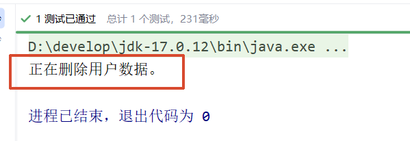

---

**2.如果构造方法有两个参数：**

```java
public class UserService {
    private UserMapper userMapper;
    private OrderMapper orderMapper;
    
    // 通过反射机制调用构造方法给属性赋值
    public UserService(UserMapper userMapper, OrderMapper orderMapper) {
        this.userMapper = userMapper;
        this.orderMapper = orderMapper;
    }
    
    public void delete(){
        userMapper.deleteById();
        orderMapper.deleteOrder();
    }
}
```

**beans.xml**

```xml
<bean id="userMapperBean" class="mapper.UserMapper"/>
<bean id="orderMapperBean" class="mapper.OrderMapper"/>

<bean id="userServiceBean" class="service.UserService">
    <!--index="0"表示构造方法的第一个参数，将userMapperBean对象传递给构造方法的第一个参数。-->
    <constructor-arg index="0" ref="userMapperBean"/>
    <!--第二个参数下标是1-->
    <constructor-arg index="1" ref="orderMapperBean"/>
</bean>
```

**运行结果**

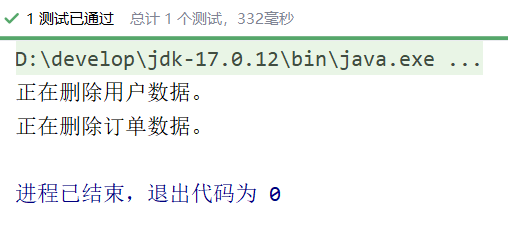

---

**3.不使用参数下标，使用参数的名字可以吗？**

```xml
<bean id="userMapperBean" class="mapper.UserMapper"/>
<bean id="orderMapperBean" class="mapper.OrderMapper"/>

<bean id="userServiceBean" class="service.UserService">
    <constructor-arg name="userMapper" ref="userMapperBean"/>
    <constructor-arg name="orderMapper" ref="orderMapperBean"/>
</bean>
```

**运行结果**

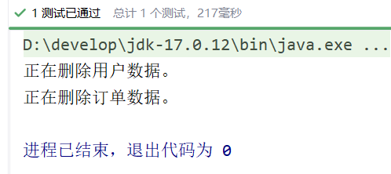

---

**4.不指定参数下标，不指定参数名字，可以吗？**

```xml
<bean id="userMapperBean" class="mapper.UserMapper"/>
<bean id="orderMapperBean" class="mapper.OrderMapper"/>

<bean id="userServiceBean" class="service.UserService">
    <constructor-arg ref="userMapperBean"/>   
    <constructor-arg ref="orderMapperBean"/>
</bean>
```

**运行结果**

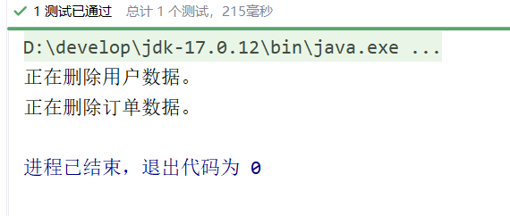

---

**5.配置文件中构造方法参数的类型顺序和构造方法参数的类型顺序不一致呢？**

**构造方法**

```java
public UserService(UserMapper userMapper, OrderMapper orderMapper) {
    this.userMapper = userMapper;
    this.orderMapper = orderMapper;
}
```

**beans.xml**

```xml
<bean id="userMapperBean" class="mapper.UserMapper"/>
<bean id="orderMapperBean" class="mapper.OrderMapper"/>

<bean id="userServiceBean" class="service.UserService">
    <constructor-arg ref="orderMapperBean"/>
    <constructor-arg ref="userMapperBean"/>
</bean>
```

**运行结果**

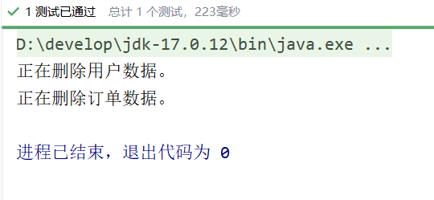

通过测试得知，通过构造方法注入的时候：

- 可以通过下标
- 可以通过参数名
- 也可以不指定下标和参数名，可以类型自动推断。

Spring在装配方面做的还是比较健壮的。

---

## 4.3 set注入专题

### 4.3.1 注入外部Bean

在之前4.2.1中使用的案例就是注入外部Bean的方式。

```xml
<bean id="userMapperBean" class="mapper.UserMapper"/>

<bean id="userServiceImplBean" class="service.impl.UserServiceImpl">
    <property name="userMapper" ref="userMapperBean"/>
</bean>
```

外部Bean的特点：bean定义到外面，在property标签中使用ref属性进行注入。通常这种方式是常用。

---

### 4.3.2 注入内部Bean

内部Bean的方式：在bean标签中嵌套bean标签。

```xml
<bean id="userServiceBean" class="service.UserService">
    <property name="userMapper">
        <bean class="mapper.UserMapper"/>
    </property>
</bean>
```

```java
@Test
public void testConstructorDI(){
    ApplicationContext applicationContext = new ClassPathXmlApplicationContext("beans.xml");
    UserService userServiceBean = applicationContext.getBean("userServiceBean", UserService.class);
    userServiceBean.delete();

}
```

**运行结果**

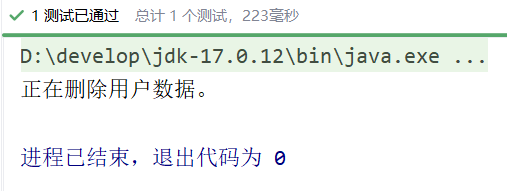

这种方式作为了解。

---

### 4.3.3 注入简单类型

我们之前在进行注入的时候，对象的属性是另一个对象。

**那如果对象的属性是int类型呢？**

```java
public class User{
    
    private int age;
    
    public void setAge(int age){
        this.age = age;
    }
    
}
```

可以通过set注入的方式给该属性赋值吗？

- 当然可以。因为只要能够调用set方法就可以给属性赋值。

**编写程序给一个User对象的age属性赋值20：**
第一步：定义User类，提供age属性，提供age属性的setter方法。

```java
public class User{
    
    private int age;
    
    public void setAge(int age){
        this.age = age;
    }
    
    @Override
    public String toString() {
        return "User{" +
                "age=" + age +
                '}';
    }
}
```

第二步：编写spring配置文件：**beans.xml**

```xml
<bean id="userBean" class="bean.User">
<!--如果像这种int类型的属性，我们称为简单类型，这种简单类型在注入的时候要使用value属性，不能使用ref-->
<!-- 也可以写为 <property name="age" value="20"/> -->
    <property name="age">
        <value>20</value>
    </property>
</bean>
```

第三步：编写测试程序

```java
@Test
public void testSimpleType(){
    ApplicationContext applicationContext = new ClassPathXmlApplicationContext("beans.xml");
    User user = applicationContext.getBean("userBean", User.class);
    System.out.println(user);
}
```

**运行结果**

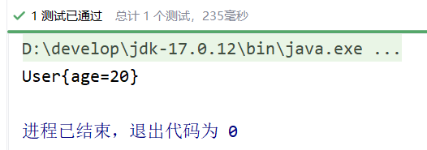

---

需要特别注意：如果给简单类型赋值，使用value属性或value标签。而不是ref。**
简单类型包括哪些呢？可以通过Spring的源码来分析一下：BeanUtils类

```java
public class BeanUtils{
    
    //.......
    
    /**
	 * Check if the given type represents a "simple" property: a simple value
	 * type or an array of simple value types.
	 * <p>See {@link #isSimpleValueType(Class)} for the definition of <em>simple
	 * value type</em>.
	 * <p>Used to determine properties to check for a "simple" dependency-check.
	 * @param type the type to check
	 * @return whether the given type represents a "simple" property
	 * @see org.springframework.beans.factory.support.RootBeanDefinition#DEPENDENCY_CHECK_SIMPLE
	 * @see org.springframework.beans.factory.support.AbstractAutowireCapableBeanFactory#checkDependencies
	 * @see #isSimpleValueType(Class)
	 */
	public static boolean isSimpleProperty(Class<?> type) {
		Assert.notNull(type, "'type' must not be null");
		return isSimpleValueType(type) || (type.isArray() && isSimpleValueType(type.getComponentType()));
	}

	/**
	 * Check if the given type represents a "simple" value type: a primitive or
	 * primitive wrapper, an enum, a String or other CharSequence, a Number, a
	 * Date, a Temporal, a URI, a URL, a Locale, or a Class.
	 * <p>{@code Void} and {@code void} are not considered simple value types.
	 * @param type the type to check
	 * @return whether the given type represents a "simple" value type
	 * @see #isSimpleProperty(Class)
	 */
	public static boolean isSimpleValueType(Class<?> type) {
		return (Void.class != type && void.class != type &&
				(ClassUtils.isPrimitiveOrWrapper(type) ||
				Enum.class.isAssignableFrom(type) ||
				CharSequence.class.isAssignableFrom(type) ||
				Number.class.isAssignableFrom(type) ||
				Date.class.isAssignableFrom(type) ||
				Temporal.class.isAssignableFrom(type) ||
				URI.class == type ||
				URL.class == type ||
				Locale.class == type ||
				Class.class == type));
	}
    
    //........
}
```

**通过源码分析得知，简单类型包括：**

- **基本数据类型**
- **基本数据类型对应的包装类**
- **String或其他的CharSequence子类**
- **Number子类**
- **Date子类**
- **Enum子类**
- **URI**
- **URL**
- **Temporal子类**
- **Locale**
- **Class**
- **另外还包括以上简单值类型对应的数组类型。**

**经典案例：给数据源的属性注入值：**
假设我们现在要自己手写一个数据源，我们都知道所有的数据源都要实现javax.sql.DataSource接口，并且数据源中应该有连接数据库的信息，例如：driver、url、username、password等。

```java
public class MyBataSource implements DataSource {
    private String driver;
    private String url;
    private String username;
    private String password;
    
    public void setDriver(String driver) {
        this.driver = driver;
    }
    
    public void setUrl(String url) {
        this.url = url;
    }
    
    public void setUsername(String username) {
        this.username = username;
    }
    
    public void setPassword(String password) {
        this.password = password;
    }
    
    @Override
    public String toString() {
        return "MyDataSource{" +
                "driver='" + driver + '\'' +
                ", url='" + url + '\'' +
                ", username='" + username + '\'' +
                ", password='" + password + '\'' +
                '}';
    }
    .....//此处省略了重写接口的方法
}
```

我们给driver、url、username、password四个属性分别提供了setter方法，我们可以使用spring的依赖注入完成数据源对象的创建和属性的赋值吗？看配置文件

```xml
<bean id="dataSource" class="bean.MyDataSource">
    <property name="driver" value="com.mysql.cj.jdbc.Driver"/>
    <property name="url" value="jdbc:mysql://localhost:3306/spring"/>
    <property name="username" value="root"/>
    <property name="password" value="123456"/>
</bean>
```

测试程序：

```java
@Test
public void testDataSource(){
    ApplicationContext applicationContext = new ClassPathXmlApplicationContext("beans.xml");
    MyDataSource dataSource = applicationContext.getBean("dataSource", MyDataSource.class);
    System.out.println(dataSource);
}
```

**运行结果**

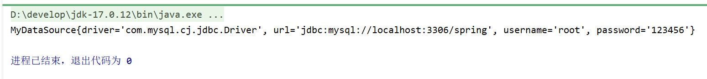

**需要注意的是：**

- **如果把Date当做简单类型的话，日期字符串格式不能随便写。格式必须符合Date的toString()方法格式。显然这就比较鸡肋了。如果我们提供一个这样的日期字符串：2010-10-11，在这里是无法赋值给Date类型的属性的。**
- **spring6之后，当注入的是URL，那么这个url字符串是会进行有效性检测的。如果是一个存在的url，那就没问题。如果不存在则报错。**

---

### 4.3.4 级联属性赋值（了解）

这里就不做演示了

---

### 4.3.5 注入数组

**当数组中的元素是简单类型**：

```java
public class Person {
    private String[] favouriteFoods;
    
    public void setFavouriteFoods(String[] favouriteFoods) {
        this.favouriteFoods = favouriteFoods;
    }
    
    @Override
    public String toString() {
        return "Person{" +
                "favouriteFoods=" + Arrays.toString(favouriteFoods) +
                '}';
    }
}
```

**beans.xml**

```xml
<bean id="person" class="bean.Person">
    <property name="favouriteFoods">
        <array>
            <value>鸡排</value>
            <value>汉堡</value>
            <value>鹅肝</value>
        </array>
    </property>
</bean>
```

**test**

```java
@Test
public void testPerson(){
    ApplicationContext applicationContext = new ClassPathXmlApplicationContext("beans.xml");
    Person person = applicationContext.getBean("person", Person.class);
    System.out.println(person);
}
```

**运行结果**

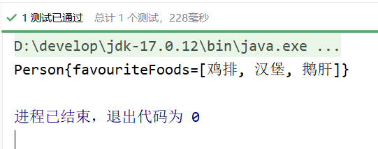

---

**当数组中的元素是非简单类型：一个订单中包含多个商品。**

**Goods(商品类)**

```java
public class Goods {
    private String name;
    
    public Goods() {
    }
    
    public Goods(String name) {
        this.name = name;
    }
    
    public String getName() {
        return name;
    }
    
    public void setName(String name) {
        this.name = name;
    }
    
    @Override
    public String toString() {
        return "Goods{" +
                "name='" + name + '\'' +
                '}';
    }
}
```

**Order(订单类)**

```java
public class Order {
    // 一个订单中有多个商品
    private Goods[] goods;
    
    public Order() {
    }
    
    public Order(Goods[] goods) {
        this.goods = goods;
    }
    
    public void setGoods(Goods[] goods) {
        this.goods = goods;
    }
    
    @Override
    public String toString() {
        return "Order{" +
                "goods=" + Arrays.toString(goods) +
                '}';
    }
}
```

**beans.xml**

```xml
<bean id="goods1" class="bean.Goods">
    <property name="name" value="西瓜"/>
</bean>

<bean id="goods2" class="bean.Goods">
    <property name="name" value="苹果"/>
</bean>

<bean id="order" class="bean.Order">
    <property name="goods">
        <array>
            <!--这里使用ref标签即可-->
            <ref bean="goods1"/>
            <ref bean="goods2"/>
        </array>
    </property>
</bean>
```

**test**

```java
@Test
public void testArray(){
    ApplicationContext applicationContext = new ClassPathXmlApplicationContext("beans.xml");
    Order order = applicationContext.getBean("order", Order.class);
    System.out.println(order);
}
```

**运行结果**

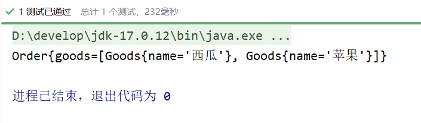

**要点：**

- **如果数组中是简单类型，使用value标签。**
- **如果数组中是非简单类型，使用ref标签。**

---

### 4.3.6 注入List集合

List集合：有序可重复

```java
public class People {
    // 一个人有多个名字
    private List<String> names;
    
    public void setNames(List<String> names) {
        this.names = names;
    }
    
    @Override
    public String toString() {
        return "People{" +
                "names=" + names +
                '}';
    }
}
```

**beans.xml**

```xml
<bean id="peopleBean" class="bean.People">
    <property name="names">
        <list>
            <value>铁锤</value>
            <value>张三</value>
            <value>张三</value>
            <value>张三</value>
            <value>狼</value>
        </list>
    </property>
</bean>
```

**test**

```java
@Test
public void testArray(){
    ApplicationContext applicationContext = new ClassPathXmlApplicationContext("beans.xml");
    People peopleBean = applicationContext.getBean("peopleBean", People.class);
    System.out.println(peopleBean);
}
```

**运行结果**

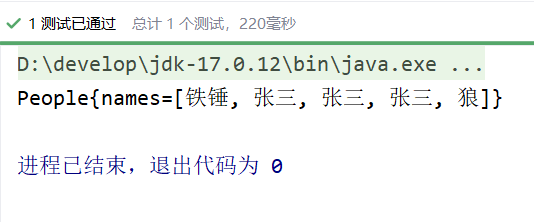

**注意：注入List集合的时候使用list标签，如果List集合中是简单类型使用value标签，反之使用ref标签。**

---

### 4.3.7 注入Set集合

Set集合：无序不可重复

```java
public class People {
    // 一个人有多个电话
    private Set<String> phones;
    
    public void setPhones(Set<String> phones) {
        this.phones = phones;
    }
    
    @Override
    public String toString() {
        return "People{" +
                "phones=" + phones +
                '}';
    }
}
```

**beans.xml**

```xml
<bean id="peopleBean" class="bean.People">
    <property name="phones">
        <set>
            <!--非简单类型可以使用ref，简单类型使用value-->
            <value>110</value>
            <value>110</value>
            <value>120</value>
            <value>120</value>
            <value>119</value>
            <value>119</value>
        </set>
    </property>
</bean>
```

执行结果：

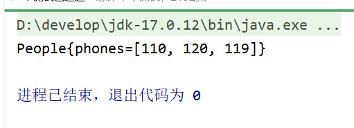

**要点：**

- **使用`<set>`标签**
- **set集合中元素是简单类型的使用value标签，反之使用ref标签。**

---

### 4.3.8 注入Map集合

```java
public class People {
    // 一个人有多个住址
    private Map<Integer, String> addrs;
    
    public void setAddrs(Map<Integer, String> addrs) {
        this.addrs = addrs;
    }
    
    @Override
    public String toString() {
        return "People{" +
                "addrs=" + addrs +
                '}';
    }
}
```

**beans.xml**

```xml
<bean id="peopleBean" class="bean.People">
    <property name="addrs">
        <map>
            <!--如果key不是简单类型，使用 key-ref 属性-->
            <!--如果value不是简单类型，使用 value-ref 属性-->
            <entry key="1" value="北京大兴区"/>
            <entry key="2" value="上海浦东区"/>
            <entry key="3" value="深圳宝安区"/>
        </map>
    </property>
</bean>
```

执行结果：

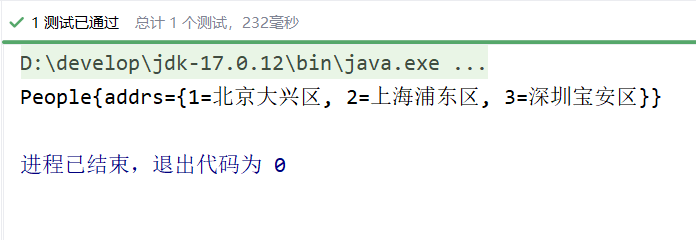

**要点：**

- **使用`<map>`标签**
- **如果key是简单类型，使用 key 属性，反之使用 key-ref 属性。**
- **如果value是简单类型，使用 value 属性，反之使用 value-ref 属性。**

---

### 4.3.9 注入Properties

java.util.Properties继承java.util.Hashtable，所以Properties也是一个Map集合。

```java
public class People {
    
    private Properties properties;
    
    public void setProperties(Properties properties) {
        this.properties = properties;
    }
    
    @Override
    public String toString() {
        return "People{" +
                "properties=" + properties +
                '}';
    }
}
```

**beans.xml**

```xml
<bean id="peopleBean" class="bean.People">
    <property name="properties">
        <props>
            <prop key="driver">com.mysql.cj.jdbc.Driver</prop>
            <prop key="url">jdbc:mysql://localhost:3306/spring</prop>
            <prop key="username">root</prop>
            <prop key="password">123456</prop>
        </props>
    </property>
</bean>
```

执行测试程序：

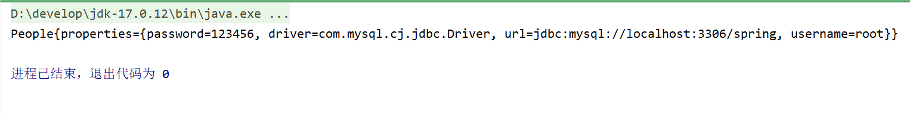

**要点：**

- **使用`<props>`标签嵌套`<prop>`标签完成。**

---

### 4.3.10 注入null和空字符串

注入空字符串使用：`<value/>` 或者 `value=""`
注入null使用：`<null/>` 或者 不为该属性赋值

- 我们先来看一下，怎么注入空字符串。

```java
public class Vip {
    private String email;
    
    public void setEmail(String email) {
        this.email = email;
    }
    
    @Override
    public String toString() {
        return "Vip{" +
                "email='" + email + '\'' +
                '}';
    }
}
```

**beans.xml**

```xml
<bean id="vipBean" class="bean.Vip">
    <!--空串的第一种方式-->
    <!--<property name="email" value=""/>-->
    <!--空串的第二种方式-->
    <property name="email">
        <value/>
    </property>
</bean>
```

**test**

```java
@Test
public void testVip(){
    ApplicationContext applicationContext = new ClassPathXmlApplicationContext("beans.xml");
    Vip vipBean = applicationContext.getBean("vipBean", Vip.class);
    System.out.println(vipBean);
}
```

**运行结果**

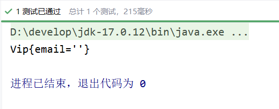

---

- 怎么注入null呢？

第一种方式：不给属性赋值

```xml
<bean id="vipBean" class="bean.Vip" />
```

执行结果：

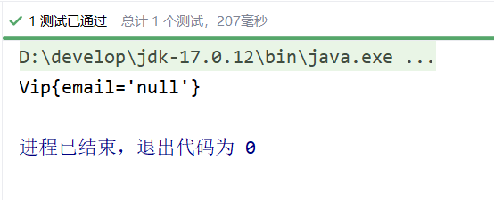

第二种方式：使用`<null/>`

```xml
<bean id="vipBean" class="bean.Vip">
    <property name="email">
        <null/>
    </property>
</bean>
```

执行结果：

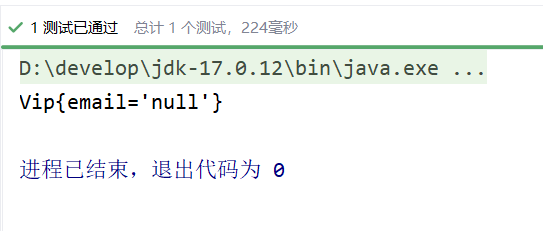

---

### 4.3.11 注入的值中含有特殊符号

XML中有5个特殊字符，分别是：<、>、'、"、&
以上5个特殊符号在XML中会被特殊对待，会被当做XML语法的一部分进行解析，如果这些特殊符号直接出现在注入的字符串当中，会报错。

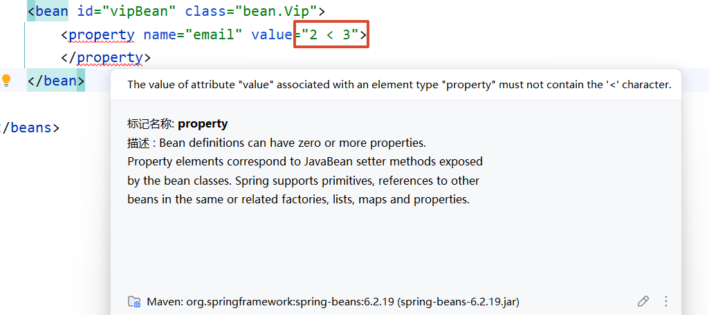

解决方案包括两种：

- 第一种：特殊符号使用转义字符代替。
- 第二种：将含有特殊符号的字符串放到：`<![CDATA[]]>` 当中。因为放在CDATA区中的数据不会被XML文件解析器解析。

5个特殊字符对应的转义字符分别是：

| **特殊字符** | **转义字符** |
| ------------ | ------------ |
| >            | `&gt;`       |
| <            | `&lt;`       |
| '            | `&apos;`     |
| "            | `&quot;`     |
| &            | `&amp;`      |

**先使用转义字符来代替：**

```java
public class Math {
    private String result;
    
    public void setResult(String result) {
        this.result = result;
    }
    
    @Override
    public String toString() {
        return "Math{" +
                "result='" + result + '\'' +
                '}';
    }
}
```

```xml
<bean id="mathBean" class="bean.Math">
    <property name="result" value="2 &lt; 3"/>
</bean>
```

```java
@Test
public void testSpecial(){
    ApplicationContext applicationContext = new ClassPathXmlApplicationContext("beans.xml");
    bean.Math mathBean = applicationContext.getBean("mathBean", bean.Math.class);
    System.out.println(mathBean);
}
```

运行结果

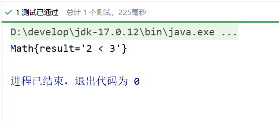

---

**我们再来使用CDATA方式：**

```xml
<bean id="mathBean" class="bean.Math">
    <property name="result">
        <!--只能使用value标签-->
        <value><![CDATA[2 < 3]]></value>
    </property>
</bean>
```

**注意：使用CDATA时，不能使用value属性，只能使用value标签。**
执行结果：

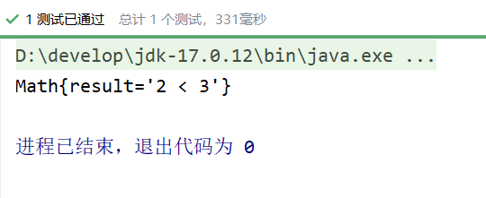

---

## 4.4 p命名空间注入

目的：简化配置。
使用p命名空间注入的前提条件包括两个：

- 第一：在XML头部信息中添加p命名空间的配置信息：`xmlns:p="http://www.springframework.org/schema/p"`
- 第二：p命名空间注入是基于setter方法的，所以需要对应的属性提供setter方法。

```java
public class Customer {
    private String name;
    private int age;
    
    public void setName(String name) {
        this.name = name;
    }
    
    public void setAge(int age) {
        this.age = age;
    }
    
    @Override
    public String toString() {
        return "Customer{" +
                "name='" + name + '\'' +
                ", age=" + age +
                '}';
    }
}
```

```xml
<?xml version="1.0" encoding="UTF-8"?>
<beans xmlns="http://www.springframework.org/schema/beans"
       
       xmlns:p="http://www.springframework.org/schema/p"
       
       xmlns:xsi="http://www.w3.org/2001/XMLSchema-instance"
       xsi:schemaLocation="http://www.springframework.org/schema/beans http://www.springframework.org/schema/beans/spring-beans.xsd">

    <bean id="customerBean" class="bean.Customer" p:name="zhangsan" p:age="20"/>

</beans>
```

```java
@Test
public void testP(){
    ApplicationContext applicationContext = new ClassPathXmlApplicationContext("beans.xml");
    Customer customerBean = applicationContext.getBean("customerBean", Customer.class);
    System.out.println(customerBean);
}
```

执行结果：

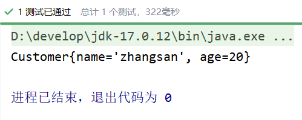

把setter方法去掉会报错

所以p命名空间实际上是对set注入的简化。

---

## 4.5 c命名空间注入

c命名空间是简化构造方法注入的。
使用c命名空间的两个前提条件：
第一：需要在xml配置文件头部添加信息：`xmlns:c="http://www.springframework.org/schema/c"`
第二：需要提供构造方法。

```java
public class MyTime {
    private int year;
    private int month;
    private int day;
    
    public MyTime(int year, int month, int day) {
        this.year = year;
        this.month = month;
        this.day = day;
    }
    
    @Override
    public String toString() {
        return "MyTime{" +
                "year=" + year +
                ", month=" + month +
                ", day=" + day +
                '}';
    }
}
```

```xml
<?xml version="1.0" encoding="UTF-8"?>
<beans xmlns="http://www.springframework.org/schema/beans"
       
       xmlns:c="http://www.springframework.org/schema/c"
       
       xmlns:xsi="http://www.w3.org/2001/XMLSchema-instance"
       xsi:schemaLocation="http://www.springframework.org/schema/beans http://www.springframework.org/schema/beans/spring-beans.xsd">

    <!--也可以这样写-->
    <!-- <bean id="myTimeBean" class="com.powernode.spring6.beans.MyTime" c:year="1970" c:month="1" c:day="1"/> -->

    <bean id="myTimeBean" class="bean.MyTime" c:_0="2008" c:_1="8" c:_2="8"/>

</beans>
```

```java
@Test
public void testC(){
    ApplicationContext applicationContext = new ClassPathXmlApplicationContext("beans.xml");
    MyTime myTimeBean = applicationContext.getBean("myTimeBean", MyTime.class);
    System.out.println(myTimeBean);
}
```

执行结果：

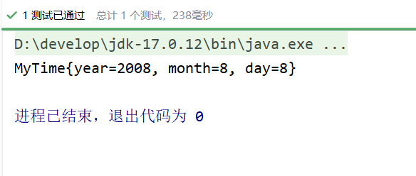

把构造方法注释掉会报错

所以，c命名空间是依靠构造方法的。
**注意：不管是p命名空间还是c命名空间，注入的时候都可以注入简单类型以及非简单类型。**

---

## 4.6 util命名空间

使用util命名空间可以让**配置复用**。
使用util命名空间的前提是：在spring配置文件头部添加配置信息。如下：

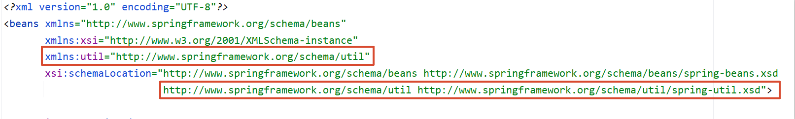

```java
public class MyDataSource1 {
    private Properties properties;
    
    public void setProperties(Properties properties) {
        this.properties = properties;
    }
    
    @Override
    public String toString() {
        return "MyDataSource1{" +
                "properties=" + properties +
                '}';
    }
}
```

```java
public class MyDataSource2 {
    private Properties properties;
    
    public void setProperties(Properties properties) {
        this.properties = properties;
    }
    
    @Override
    public String toString() {
        return "MyDataSource2{" +
                "properties=" + properties +
                '}';
    }
}
```

```xml
<?xml version="1.0" encoding="UTF-8"?>
<beans xmlns="http://www.springframework.org/schema/beans"
       xmlns:xsi="http://www.w3.org/2001/XMLSchema-instance"
       xmlns:util="http://www.springframework.org/schema/util"
       xsi:schemaLocation="http://www.springframework.org/schema/beans http://www.springframework.org/schema/beans/spring-beans.xsd
                           http://www.springframework.org/schema/util http://www.springframework.org/schema/util/spring-util.xsd">

    <util:properties id="prop">
        <prop key="driver">com.mysql.cj.jdbc.Driver</prop>
        <prop key="url">jdbc:mysql://localhost:3306/spring</prop>
        <prop key="username">root</prop>
        <prop key="password">123456</prop>
    </util:properties>

    <bean id="dataSource1" class="bean.MyDataSource1">
        <property name="properties" ref="prop"/>
    </bean>

    <bean id="dataSource2" class="bean.MyDataSource2">
        <property name="properties" ref="prop"/>
    </bean>
</beans>
```

```java
@Test
public void testUtil(){
    ApplicationContext applicationContext = new ClassPathXmlApplicationContext("beans.xml");

    MyDataSource1 dataSource1 = applicationContext.getBean("dataSource1", MyDataSource1.class);
    System.out.println(dataSource1);

    MyDataSource2 dataSource2 = applicationContext.getBean("dataSource2", MyDataSource2.class);
    System.out.println(dataSource2);
}
```

执行结果：

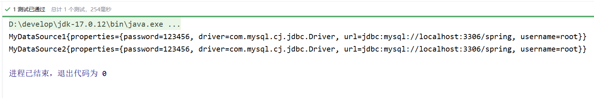

---

## 4.7 基于XML的自动装配

Spring还可以完成自动化的注入，自动化注入又被称为自动装配。它可以根据**名字**进行自动装配，也可以根据**类型**进行自动装配。

### 4.7.1 根据名称自动装配

```java
public class UserMapper {
    
    public void insert(){
        System.out.println("正在保存用户数据。");
    }
}
```

```java
public class UserService {
    private UserMapper aaa;
    
    // 这个set方法非常关键
    public void setAaa(UserMapper aaa) {
        this.aaa = aaa;
    }
    
    public void save(){
        aaa.insert();
    }
}
```

Spring的配置文件这样配置：

```xml
<?xml version="1.0" encoding="UTF-8"?>
<beans xmlns="http://www.springframework.org/schema/beans"
       xmlns:xsi="http://www.w3.org/2001/XMLSchema-instance"
       xsi:schemaLocation="http://www.springframework.org/schema/beans http://www.springframework.org/schema/beans/spring-beans.xsd">

    <bean id="userService" class="service.UserService" autowire="byName"/>

    <bean id="aaa" class="mapper.UserMapper"/>

</beans>
```

这个配置起到关键作用：

- UserService Bean中需要添加autowire="byName"，表示通过名称进行装配。
- UserService类中有一个UserDao属性，而UserDao属性的名字是aaa，**对应的set方法是setAaa()**，正好和UserDao Bean的id是一样的。这就是根据名称自动装配。

```java
@Test
public void testAutowireByName(){
    ApplicationContext applicationContext = new ClassPathXmlApplicationContext("beans.xml");
    UserService userService = applicationContext.getBean("userService", UserService.class);
    userService.save();
}
```

执行结果：

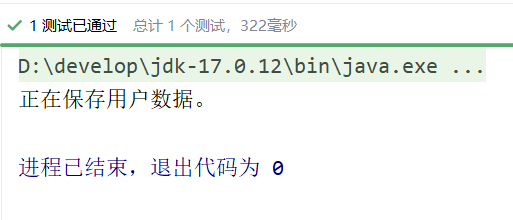

我们来测试一下，byName装配是和属性名有关还是和set方法名有关系：

```java
public class UserService {
    // 这里没修改
    private UserMapper aaa;

    /*public void setAaa(UserMapper aaa) {
        this.aaa = aaa;
    }*/
    
    // set方法名变化了
    public void setMapper(UserMapper aaa){
        this.aaa = aaa;
    }
    
    public void save(){
        aaa.insert();
    }
}
```

执行测试程序：

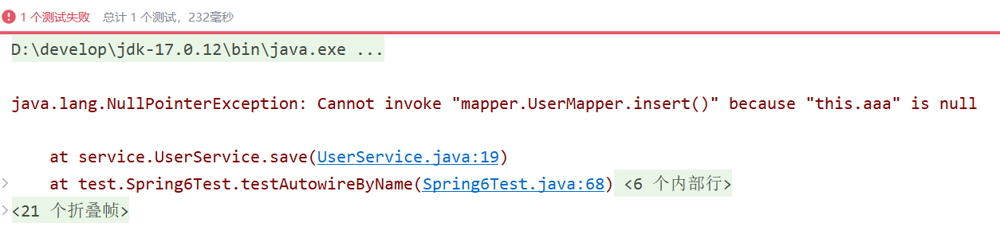

通过测试得知，aaa属性并没有赋值成功。也就是并没有装配成功。
我们将spring配置文件修改以下：

```xml
<?xml version="1.0" encoding="UTF-8"?>
<beans xmlns="http://www.springframework.org/schema/beans"
       xmlns:xsi="http://www.w3.org/2001/XMLSchema-instance"
       xsi:schemaLocation="http://www.springframework.org/schema/beans http://www.springframework.org/schema/beans/spring-beans.xsd">

    <bean id="userService" class="service.UserService" autowire="byName"/>
    <!--这个id修改了-->
    <bean id="mapper" class="mapper.UserMapper"/>

</beans>
```

执行测试程序：

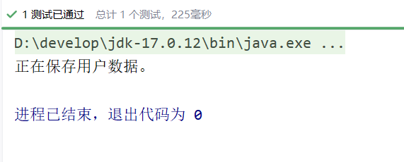

这说明，如果根据名称装配(byName)，底层会调用set方法进行注入。
例如：setAge() 对应的名字是age，setPassword()对应的名字是password，setEmail()对应的名字是email。

### 4.7.2 根据类型自动装配

```java
public class AccountMapper{
    public void insert(){
        System.out.println("正在保存账户信息");
    }
}
```

```java
public class AccountService {
    private AccountMapper accountMapper;
    
    public void setAccountMapper(AccountMapper accountMapper) {
        this.accountMapper = accountMapper;
    }
    
    public void save(){
        accountMapper.insert();
    }
}
```

```xml
<?xml version="1.0" encoding="UTF-8"?>
<beans xmlns="http://www.springframework.org/schema/beans"
       xmlns:xsi="http://www.w3.org/2001/XMLSchema-instance"
       xsi:schemaLocation="http://www.springframework.org/schema/beans http://www.springframework.org/schema/beans/spring-beans.xsd">

    <!--byType表示根据类型自动装配-->
    <bean id="accountService" class="service.AccountService" autowire="byType"/>

    <bean class="mapper.AccountMapper"/>

</beans>
```

```java
@Test
public void testAutowireByType(){
    ApplicationContext applicationContext = new ClassPathXmlApplicationContext("beans.xml");
    AccountService accountService = applicationContext.getBean("accountService", AccountService.class);
    accountService.save();
}
```

执行结果：

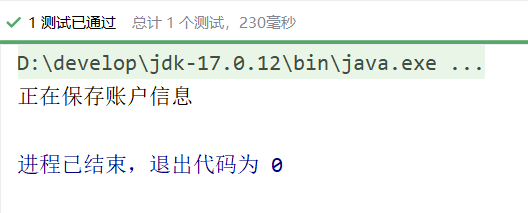

我们把UserService中的set方法注释掉，再执行：

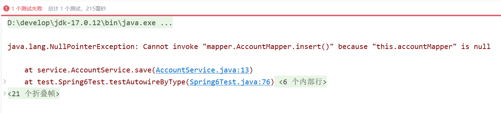

可以看到无论是byName还是byType，在装配的时候都是基于set方法的。所以set方法是必须要提供的。提供构造方法是不行的，大家可以测试一下。这里就不再赘述。
如果byType，根据类型装配时，如果配置文件中有两个类型一样的bean会出现什么问题呢？

```xml
<bean id="accountService" class="service.AccountService" autowire="byType"/>

<bean id="x" class="mapper.AccountMapper"/>
<bean id="y" class="mapper.AccountMapper"/>
```

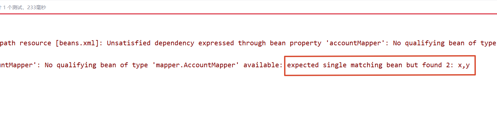

测试结果说明了，当byType进行自动装配的时候，配置文件中某种类型的Bean必须是唯一的，不能出现多个。

---

## 4.8 Spring引入外部属性配置文件

我们都知道编写数据源的时候是需要连接数据库的信息的，例如：driver url username password等信息。这些信息可以单独写到一个属性配置文件中吗，这样用户修改起来会更加的方便。当然可以。
**第一步：写一个数据源类，提供相关属性。**

```java
public class MyDataSource implements DataSource {
    @Override
    public String toString() {
        return "MyDataSource{" +
                "driver='" + driver + '\'' +
                ", url='" + url + '\'' +
                ", username='" + username + '\'' +
                ", password='" + password + '\'' +
                '}';
    }
    
    private String driver;
    private String url;
    private String username;
    private String password;
    
    public void setDriver(String driver) {
        this.driver = driver;
    }
    
    public void setUrl(String url) {
        this.url = url;
    }
    
    public void setUsername(String username) {
        this.username = username;
    }
    
    public void setPassword(String password) {
        this.password = password;
    }
    //......
}
```

**第二步：在类路径下新建jdbc.properties文件，并配置信息。**

```properties
driver=com.mysql.cj.jdbc.Driver
url=jdbc:mysql://localhost:3306/spring
username=root
password=root123
```

**第三步：在spring配置文件中引入context命名空间。**

```xml
<?xml version="1.0" encoding="UTF-8"?>
<beans xmlns="http://www.springframework.org/schema/beans"
       xmlns:xsi="http://www.w3.org/2001/XMLSchema-instance"
       xmlns:context="http://www.springframework.org/schema/context"
       xsi:schemaLocation="http://www.springframework.org/schema/beans http://www.springframework.org/schema/beans/spring-beans.xsd
                           http://www.springframework.org/schema/context http://www.springframework.org/schema/context/spring-context.xsd">

</beans>
```

**第四步：在spring中配置使用jdbc.properties文件。**

```xml
<?xml version="1.0" encoding="UTF-8"?>
<beans xmlns="http://www.springframework.org/schema/beans"
       xmlns:xsi="http://www.w3.org/2001/XMLSchema-instance"
       xmlns:context="http://www.springframework.org/schema/context"
       xsi:schemaLocation="http://www.springframework.org/schema/beans http://www.springframework.org/schema/beans/spring-beans.xsd
                           http://www.springframework.org/schema/context http://www.springframework.org/schema/context/spring-context.xsd">

    <context:property-placeholder location="jdbc.properties"/>

    <bean id="dataSource" class="bean.MyDataSource">
        <property name="driver" value="${driver}"/>
        <property name="url" value="${url}"/>
        <property name="username" value="${username}"/>
        <property name="password" value="${password}"/>
    </bean>
</beans>
```

测试程序：

```java
@Test
public void testProperties(){
	ApplicationContext applicationContext = new ClassPathXmlApplicationContext("beans.xml");
	MyDataSource dataSource = applicationContext.getBean("dataSource", MyDataSource.class);
	System.out.println(dataSource);
}
```

执行结果：

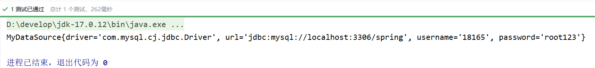

---