# 5. Bean的作用域

## 5.1 singleton

默认情况下，Spring的IoC容器创建的Bean对象是单例的。来测试一下：

```java
public class SpringBean {
}
```

```xml
<?xml version="1.0" encoding="UTF-8"?>
<beans xmlns="http://www.springframework.org/schema/beans"
       xmlns:xsi="http://www.w3.org/2001/XMLSchema-instance"
       xsi:schemaLocation="http://www.springframework.org/schema/beans http://www.springframework.org/schema/beans/spring-beans.xsd">

    <bean id="sb" class="bean.SpringBean" />

</beans>
```

```java
@Test
public void testScope(){
    ApplicationContext applicationContext = new ClassPathXmlApplicationContext("beans.xml");

    SpringBean sb1 = applicationContext.getBean("sb", SpringBean.class);
    System.out.println(sb1);

    SpringBean sb2 = applicationContext.getBean("sb", SpringBean.class);
    System.out.println(sb2);
}
```

执行结果：

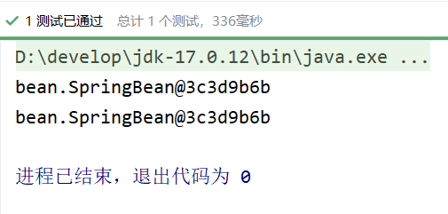

通过测试得知：Spring的IoC容器中，默认情况下，Bean对象是单例的。
这个对象在什么时候创建的呢？可以为SpringBean提供一个无参数构造方法，测试一下，如下：

```java
public class SpringBean {
    public SpringBean() {
        System.out.println("SpringBean的无参数构造方法执行。");
    }
}
```

将测试程序中getBean()所在行代码注释掉：

```java
@Test
public void testScope2(){
    ApplicationContext applicationContext = new ClassPathXmlApplicationContext("beans.xml");
}
```

执行测试程序：

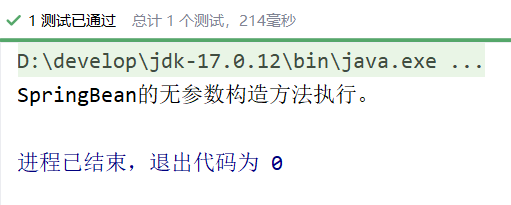

通过测试得知，默认情况下，Bean对象的创建是在初始化Spring上下文的时候就完成的。

---

## 5.2 prototype

如果想让Spring的Bean对象以多例的形式存在，可以在bean标签中指定scope属性的值为：**prototype**，这样Spring会在每一次执行getBean()方法的时候创建Bean对象，调用几次则创建几次。

```xml
<?xml version="1.0" encoding="UTF-8"?>
<beans xmlns="http://www.springframework.org/schema/beans"
       xmlns:xsi="http://www.w3.org/2001/XMLSchema-instance"
       xsi:schemaLocation="http://www.springframework.org/schema/beans http://www.springframework.org/schema/beans/spring-beans.xsd">

    <bean id="sb" class="bean.SpringBean" scope="prototype" />

</beans>
```

```java
@Test
public void testScope(){
    ApplicationContext applicationContext = new ClassPathXmlApplicationContext("beans.xml");

    SpringBean sb1 = applicationContext.getBean("sb", SpringBean.class);
    System.out.println(sb1);

    SpringBean sb2 = applicationContext.getBean("sb", SpringBean.class);
    System.out.println(sb2);
}
```

执行结果：

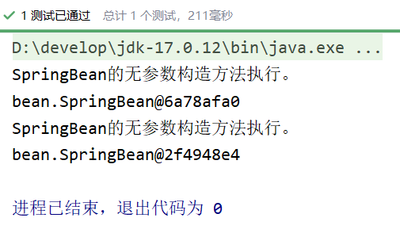

我们可以把测试代码中的getBean()方法所在行代码注释掉：

```java
@Test
public void testScope2(){
    ApplicationContext applicationContext = new ClassPathXmlApplicationContext("beans.xml");
}
```

执行结果：

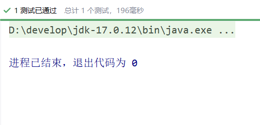

可以看到这一次在初始化Spring上下文的时候，并没有创建Bean对象。
那你可能会问：scope如果没有配置，它的默认值是什么呢？默认值是singleton，单例的。

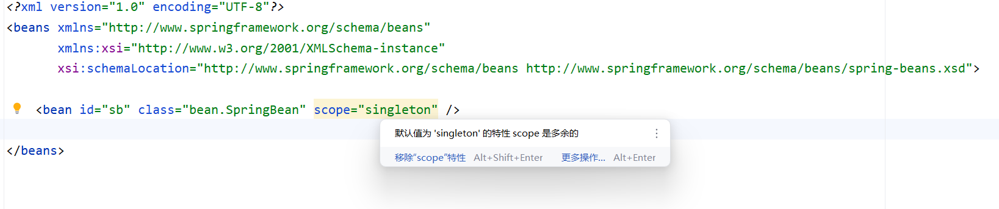

---

## 5.3 其它scope

**scope属性的值不止两个，它一共包括8个选项：**

- singleton：默认的，单例。
- prototype：原型。每调用一次getBean()方法则获取一个新的Bean对象。或每次注入的时候都是新对象。
- request：一个请求对应一个Bean。**仅限于在WEB应用中使用**。
- session：一个会话对应一个Bean。**仅限于在WEB应用中使用**。
- global session：**portlet应用中专用的**。如果在Servlet的WEB应用中使用global session的话，和session一个效果。（portlet和servlet都是规范。servlet运行在servlet容器中，例如Tomcat。portlet运行在portlet容器中。）
- application：一个应用对应一个Bean。**仅限于在WEB应用中使用。**
- websocket：一个websocket生命周期对应一个Bean。**仅限于在WEB应用中使用。**
- 自定义scope：很少使用。

接下来咱们自定义一个Scope，线程级别的Scope，在同一个线程中，获取的Bean都是同一个。跨线程则是不同的对象：（以下内容作为了解）

- 第一步：自定义Scope。（实现Scope接口）
  - spring内置了线程范围的类：org.springframework.context.support.SimpleThreadScope，可以直接用。
- 第二步：将自定义的Scope注册到Spring容器中。

```xml
<bean class="org.springframework.beans.factory.config.CustomScopeConfigurer">
  <property name="scopes">
    <map>
      <entry key="myThread">
        <bean class="org.springframework.context.support.SimpleThreadScope"/>
      </entry>
    </map>
  </property>
</bean>
```

- 第三步：使用Scope。

```xml
<bean id="sb" class="com.powernode.spring6.beans.SpringBean" scope="myThread" />
```

编写测试程序：

```java
@Test
public void testCustomScope(){
    ApplicationContext applicationContext = new ClassPathXmlApplicationContext("spring-scope.xml");
    SpringBean sb1 = applicationContext.getBean("sb", SpringBean.class);
    SpringBean sb2 = applicationContext.getBean("sb", SpringBean.class);
    System.out.println(sb1);
    System.out.println(sb2);
    // 启动线程
    new Thread(new Runnable() {
        @Override
        public void run() {
            SpringBean a = applicationContext.getBean("sb", SpringBean.class);
            SpringBean b = applicationContext.getBean("sb", SpringBean.class);
            System.out.println(a);
            System.out.println(b);
        }
    }).start();
}
```

执行结果：

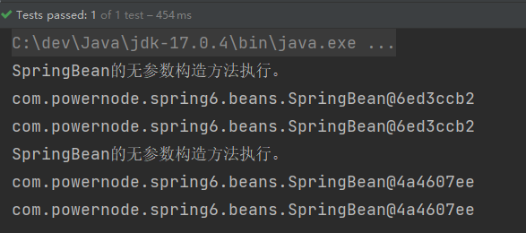

---

# 6. GoF之工厂模式

- 设计模式：一种可以被重复利用的解决方案。
- GoF（Gang of Four），中文名——四人组。
- 《Design Patterns: Elements of Reusable Object-Oriented Software》（即《设计模式》一书），1995年由 Erich Gamma、Richard Helm、Ralph Johnson 和 John Vlissides 合著。这几位作者常被称为"四人组（Gang of Four）"。
- 该书中描述了23种设计模式。我们平常所说的设计模式就是指这23种设计模式。
- 不过除了GoF23种设计模式之外，还有其它的设计模式，比如：JavaEE的设计模式（DAO模式、MVC模式等）。
- GoF23种设计模式可分为三大类：
  - **创建型**（5个）：解决对象创建问题。
    - 单例模式
    - 工厂方法模式
    - 抽象工厂模式
    - 建造者模式
    - 原型模式
  - **结构型**（7个）：一些类或对象组合在一起的经典结构。
    - 代理模式
    - 装饰模式
    - 适配器模式
    - 组合模式
    - 享元模式
    - 外观模式
    - 桥接模式
  - **行为型**（11个）：解决类或对象之间的交互问题。
    - 策略模式
    - 模板方法模式
    - 责任链模式
    - 观察者模式
    - 迭代子模式
    - 命令模式
    - 备忘录模式
    - 状态模式
    - 访问者模式
    - 中介者模式
    - 解释器模式
- 工厂模式是解决对象创建问题的，所以工厂模式属于创建型设计模式。这里为什么学习工厂模式呢？这是因为Spring框架底层使用了大量的工厂模式。

## 6.1 工厂模式的三种形态

工厂模式通常有三种形态：

- 第一种：**简单工厂模式（Simple Factory）：不属于23种设计模式之一。简单工厂模式又叫做：静态 工厂方法模式。简单工厂模式是工厂方法模式的一种特殊实现。**
- 第二种：工厂方法模式（Factory Method）：是23种设计模式之一。
- 第三种：抽象工厂模式（Abstract Factory）：是23种设计模式之一。

## 6.2 简单工厂模式

简单工厂模式的角色包括三个：

- 抽象产品 角色
- 具体产品 角色
- 工厂类 角色

简单工厂模式的代码如下：
抽象产品角色：

```java
/**
 * 武器（抽象产品角色）
 **/
public abstract class Weapon {
    /**
     * 所有的武器都有攻击行为
     */
    public abstract void attack();
}
```

具体产品角色：

```java
/**
 * 坦克（具体产品角色）
 **/
public class Tank extends Weapon{
    @Override
    public void attack() {
        System.out.println("坦克开炮！");
    }
}

```

```java
/**
 * 战斗机（具体产品角色）
 **/
public class Fighter extends Weapon{
    @Override
    public void attack() {
        System.out.println("战斗机投下原子弹！");
    }
}

```

```java
/**
 * 匕首（具体产品角色）
 **/
public class Dagger extends Weapon{
    @Override
    public void attack() {
        System.out.println("砍他丫的！");
    }
}

```

工厂类角色：

```java
/**
 * 工厂类角色
 **/
public class WeaponFactory {
    /**
     * 根据不同的武器类型生产武器
     * @param weaponType 武器类型
     * @return 武器对象
     */
    public static Weapon get(String weaponType){
        if (weaponType == null || weaponType.trim().length() == 0) {
            return null;
        }
        Weapon weapon = null;
        if ("TANK".equals(weaponType)) {
            weapon = new Tank();
        } else if ("FIGHTER".equals(weaponType)) {
            weapon = new Fighter();
        } else if ("DAGGER".equals(weaponType)) {
            weapon = new Dagger();
        } else {
            throw new RuntimeException("不支持该武器！");
        }
        return weapon;
    }
}

```

测试程序（客户端程序）：

```java
public class Client {
    public static void main(String[] args) {
        Weapon weapon1 = WeaponFactory.get("TANK");
        weapon1.attack();

        Weapon weapon2 = WeaponFactory.get("FIGHTER");
        weapon2.attack();

        Weapon weapon3 = WeaponFactory.get("DAGGER");
        weapon3.attack();
    }
}

```

执行结果：

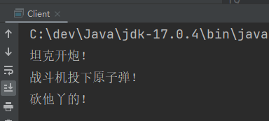

简单工厂模式的优点：

- 客户端程序不需要关心对象的创建细节，需要哪个对象时，只需要向工厂索要即可，初步实现了责任的分离。客户端只负责“消费”，工厂负责“生产”。生产和消费分离。

简单工厂模式的缺点：

- 缺点1：工厂类集中了所有产品的创造逻辑，形成一个无所不知的全能类，有人把它叫做上帝类。显然工厂类非常关键，不能出问题，一旦出问题，整个系统瘫痪。
- 缺点2：不符合OCP开闭原则，在进行系统扩展时，需要修改工厂类。

**Spring中的BeanFactory就使用了简单工厂模式。**

## 6.3 工厂方法模式

工厂方法模式既保留了简单工厂模式的优点，同时又解决了简单工厂模式的缺点。
工厂方法模式的角色包括：

- **抽象工厂角色**
- **具体工厂角色**
- 抽象产品角色
- 具体产品角色

代码如下：

```java
/**
 * 武器类（抽象产品角色）
 **/
public abstract class Weapon {
    /**
     * 所有武器都有攻击行为
     */
    public abstract void attack();
}

```

```java
/**
 * 具体产品角色
 **/
public class Gun extends Weapon{
    @Override
    public void attack() {
        System.out.println("开枪射击！");
    }
}

```

```java
/**
 * 具体产品角色
 **/
public class Fighter extends Weapon{
    @Override
    public void attack() {
        System.out.println("战斗机发射核弹！");
    }
}

```

```java
/**
 * 武器工厂接口(抽象工厂角色)
 **/
public interface WeaponFactory {
    Weapon get();
}

```

```java
/**
 * 具体工厂角色
 **/
public class GunFactory implements WeaponFactory{
    @Override
    public Weapon get() {
        return new Gun();
    }
}

```

```java
/**
 * 具体工厂角色
 **/
public class FighterFactory implements WeaponFactory{
    @Override
    public Weapon get() {
        return new Fighter();
    }
}

```

客户端程序：

```java
public class Client {
    public static void main(String[] args) {
        WeaponFactory factory = new GunFactory();
        Weapon weapon = factory.get();
        weapon.attack();

        WeaponFactory factory1 = new FighterFactory();
        Weapon weapon1 = factory1.get();
        weapon1.attack();
    }
}

```

执行客户端程序：

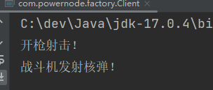

如果想扩展一个新的产品，只要新增一个产品类，再新增一个该产品对应的工厂即可，例如新增：匕首

```java
public class Dagger extends Weapon{
    @Override
    public void attack() {
        System.out.println("砍丫的！");
    }
}

```

```java
public class DaggerFactory implements WeaponFactory{
    @Override
    public Weapon get() {
        return new Dagger();
    }
}

```

客户端程序：

```java
public class Client {
    public static void main(String[] args) {
        WeaponFactory factory = new GunFactory();
        Weapon weapon = factory.get();
        weapon.attack();

        WeaponFactory factory1 = new FighterFactory();
        Weapon weapon1 = factory1.get();
        weapon1.attack();

        WeaponFactory factory2 = new DaggerFactory();
        Weapon weapon2 = factory2.get();
        weapon2.attack();
    }
}

```

执行结果如下：

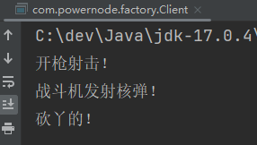

我们可以看到在进行功能扩展的时候，不需要修改之前的源代码，显然工厂方法模式符合OCP原则。
工厂方法模式的优点：

- 一个调用者想创建一个对象，只要知道其名称就可以了。 
- 扩展性高，如果想增加一个产品，只要扩展一个工厂类就可以。
- 屏蔽产品的具体实现，调用者只关心产品的接口。

工厂方法模式的缺点：

- 每次增加一个产品时，都需要增加一个具体类和对象实现工厂，使得系统中类的个数成倍增加，在一定程度上增加了系统的复杂度，同时也增加了系统具体类的依赖。这并不是什么好事。

## 6.4 抽象工厂模式（了解）

抽象工厂模式相对于工厂方法模式来说，就是工厂方法模式是针对一个产品系列的，而抽象工厂模式是针对多个产品系列的，即工厂方法模式是一个产品系列一个工厂类，而抽象工厂模式是多个产品系列一个工厂类。
抽象工厂模式特点：抽象工厂模式是所有形态的工厂模式中最为抽象和最具一般性的一种形态。抽象工厂模式是指当有多个抽象角色时，使用的一种工厂模式。抽象工厂模式可以向客户端提供一个接口，使客户端在不必指定产品的具体的情况下，创建多个产品族中的产品对象。它有多个抽象产品类，每个抽象产品类可以派生出多个具体产品类，一个抽象工厂类，可以派生出多个具体工厂类，每个具体工厂类可以创建多个具体产品类的实例。每一个模式都是针对一定问题的解决方案，工厂方法模式针对的是一个产品等级结构；而抽象工厂模式针对的是多个产品等级结果。
抽象工厂中包含4个角色：

- 抽象工厂角色
- 具体工厂角色
- 抽象产品角色
- 具体产品角色

抽象工厂模式的类图如下：

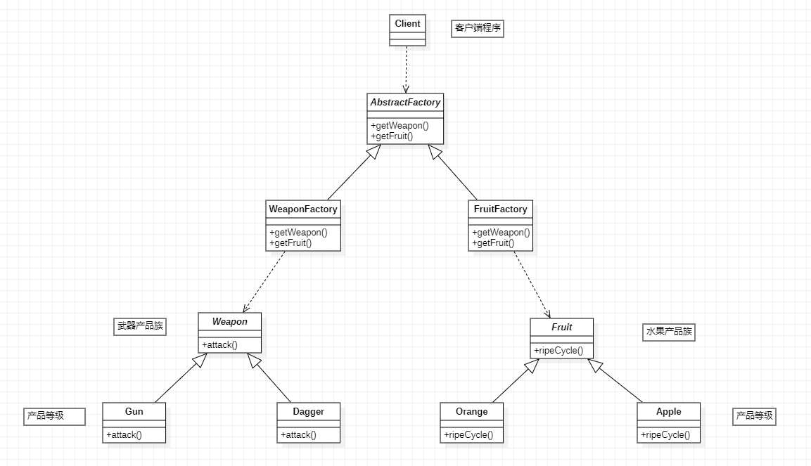

抽象工厂模式代码如下：
第一部分：武器产品族

```java
/**
 * 武器产品族
 **/
public abstract class Weapon {
    public abstract void attack();
}

```

```java
/**
 * 武器产品族中的产品等级1
 **/
public class Gun extends Weapon{
    @Override
    public void attack() {
        System.out.println("开枪射击！");
    }
}

```

```java
/**
 * 武器产品族中的产品等级2
 **/
public class Dagger extends Weapon{
    @Override
    public void attack() {
        System.out.println("砍丫的！");
    }
}

```

第二部分：水果产品族

```java
/**
 * 水果产品族
 **/
public abstract class Fruit {
    /**
     * 所有果实都有一个成熟周期。
     */
    public abstract void ripeCycle();
}

```

```java
/**
 * 水果产品族中的产品等级1
 **/
public class Orange extends Fruit{
    @Override
    public void ripeCycle() {
        System.out.println("橘子的成熟周期是10个月");
    }
}

```

```java
/**
 * 水果产品族中的产品等级2
 **/
public class Apple extends Fruit{
    @Override
    public void ripeCycle() {
        System.out.println("苹果的成熟周期是8个月");
    }
}

```

第三部分：抽象工厂类

```java
/**
 * 抽象工厂
 **/
public abstract class AbstractFactory {
    public abstract Weapon getWeapon(String type);
    public abstract Fruit getFruit(String type);
}

```

第四部分：具体工厂类

```java
/**
 * 武器族工厂
 **/
public class WeaponFactory extends AbstractFactory{

    public Weapon getWeapon(String type){
        if (type == null || type.trim().length() == 0) {
            return null;
        }
        if ("Gun".equals(type)) {
            return new Gun();
        } else if ("Dagger".equals(type)) {
            return new Dagger();
        } else {
            throw new RuntimeException("无法生产该武器");
        }
    }

    @Override
    public Fruit getFruit(String type) {
        return null;
    }
}

```

```java
/**
 * 水果族工厂
 **/
public class FruitFactory extends AbstractFactory{
    @Override
    public Weapon getWeapon(String type) {
        return null;
    }

    public Fruit getFruit(String type){
        if (type == null || type.trim().length() == 0) {
            return null;
        }
        if ("Orange".equals(type)) {
            return new Orange();
        } else if ("Apple".equals(type)) {
            return new Apple();
        } else {
            throw new RuntimeException("我家果园不产这种水果");
        }
    }
}

```

第五部分：客户端程序

```java
public class Client {
    public static void main(String[] args) {
        // 客户端调用方法时只面向AbstractFactory调用方法。
        AbstractFactory factory = new WeaponFactory(); // 注意：这里的new WeaponFactory()可以采用 简单工厂模式 进行隐藏。
        Weapon gun = factory.getWeapon("Gun");
        Weapon dagger = factory.getWeapon("Dagger");

        gun.attack();
        dagger.attack();

        AbstractFactory factory1 = new FruitFactory(); // 注意：这里的new FruitFactory()可以采用 简单工厂模式 进行隐藏。
        Fruit orange = factory1.getFruit("Orange");
        Fruit apple = factory1.getFruit("Apple");

        orange.ripeCycle();
        apple.ripeCycle();
    }
}

```

执行结果：

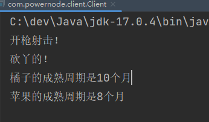

抽象工厂模式的优缺点：

- 优点：当一个产品族中的多个对象被设计成一起工作时，它能保证客户端始终只使用同一个产品族中的对象。
- 缺点：产品族扩展非常困难，要增加一个系列的某一产品，既要在AbstractFactory里加代码，又要在具体的里面加代码。

---

# 7. Bean的实例化方式

Spring为Bean提供了多种实例化方式，通常包括4种方式。（也就是说在Spring中为Bean对象的创建准备了多种方案，目的是：更加灵活）

- 第一种：通过构造方法实例化
- 第二种：通过简单工厂模式实例化
- 第三种：通过factory-bean实例化
- 第四种：通过FactoryBean接口实例化

## 7.1 通过构造方法实例化

我们之前一直使用的就是这种方式。默认情况下，会调用Bean的无参数构造方法。

```java
public class User {
    public User() {
        System.out.println("User类的无参数构造方法执行。");
    }
}
```

```xml
<?xml version="1.0" encoding="UTF-8"?>
<beans xmlns="http://www.springframework.org/schema/beans"
       xmlns:xsi="http://www.w3.org/2001/XMLSchema-instance"
       xsi:schemaLocation="http://www.springframework.org/schema/beans http://www.springframework.org/schema/beans/spring-beans.xsd">

    <bean id="userBean" class="bean.User"/>

</beans>
```

```java
@Test
public void testConstructor(){
    ApplicationContext applicationContext = new ClassPathXmlApplicationContext("beans.xml");
    User user = applicationContext.getBean("userBean", User.class);
    System.out.println(user);
}
```

执行结果：

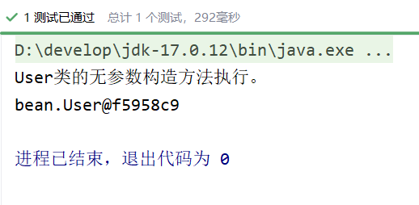

---

## 7.2 通过简单工厂模式实例化

第一步：定义一个Bean

```java
public class Vip {
}
```

第二步：编写简单工厂模式当中的工厂类

```java
public class VipFactory {
    public static Vip get(){
        return new Vip();
    }
}
```

第三步：在Spring配置文件中指定创建该Bean的方法（使用factory-method属性指定）

```xml
<bean id="vipBean" class="bean.VipFactory" factory-method="get"/>
```

第四步：编写测试程序

```java
@Test
public void testSimpleFactory(){
    ApplicationContext applicationContext = new ClassPathXmlApplicationContext("beans.xml");
    Vip vip = applicationContext.getBean("vipBean", Vip.class);
    System.out.println(vip);
}
```

执行结果：

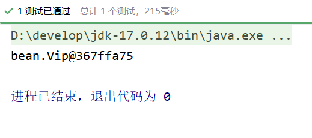

---

## 7.3 通过factory-bean实例化

这种方式本质上是：通过工厂方法模式进行实例化。
第一步：定义一个Bean

```java
public class Order {
}
```

第二步：定义具体工厂类，工厂类中定义实例方法

```java
public class OrderFactory {
    public Order get(){
        return new Order();
    }
}
```

第三步：在Spring配置文件中指定factory-bean以及factory-method

```xml
<bean id="orderFactory" class="bean.OrderFactory"/>
<bean id="orderBean" factory-bean="orderFactory" factory-method="get"/>
```

第四步：编写测试程序

```java
@Test
public void testSelfFactoryBean(){
    ApplicationContext applicationContext = new ClassPathXmlApplicationContext("beans.xml");
    Order orderBean = applicationContext.getBean("orderBean", Order.class);
    System.out.println(orderBean);
}
```

执行结果：

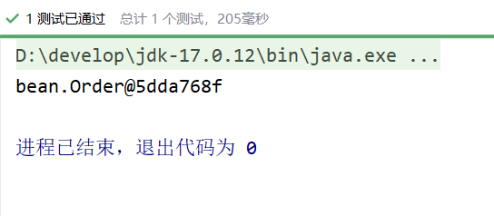

---

## 7.4 通过FactoryBean接口实例化

以上的第三种方式中，factory-bean是我们自定义的，factory-method也是我们自己定义的。
在Spring中，当你编写的类直接实现FactoryBean接口之后，factory-bean不需要指定了，factory-method也不需要指定了。
factory-bean会自动指向实现FactoryBean接口的类，factory-method会自动指向getObject()方法。
第一步：定义一个Bean

```java
public class Person {
}
```

第二步：编写一个类实现FactoryBean接口

```java
public class PersonFactoryBean implements FactoryBean<Person> {

    @Override
    public Person getObject() throws Exception {
        return new Person();
    }

    @Override
    public Class<?> getObjectType() {
        return null;
    }

    @Override
    public boolean isSingleton() {
        // true表示单例
        // false表示原型
        return true;
    }
}
```

第三步：在Spring配置文件中配置FactoryBean

```xml
<bean id="personBean" class="com.powernode.spring6.bean.PersonFactoryBean"/>
```

测试程序：

```java
@Test
public void testFactoryBean(){
    ApplicationContext applicationContext = new ClassPathXmlApplicationContext("beans.xml");
    Person personBean = applicationContext.getBean("personBean", Person.class);
    System.out.println(personBean);

    Person personBean2 = applicationContext.getBean("personBean", Person.class);
    System.out.println(personBean2);
}
```

执行结果：

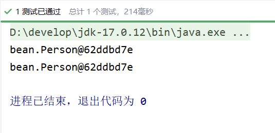

**FactoryBean在Spring中是一个接口。被称为“工厂Bean”。“工厂Bean”是一种特殊的Bean。所有的“工厂Bean”都是用来协助Spring框架来创建其他Bean对象的。**

---

## 7.5 BeanFactory和FactoryBean的区别

### 7.5.1 BeanFactory

Spring IoC容器的顶级对象，BeanFactory被翻译为“Bean工厂”，在Spring的IoC容器中，“Bean工厂”负责创建Bean对象。
BeanFactory是工厂。

### 7.5.2 FactoryBean

FactoryBean：它是一个Bean，是一个能够**辅助Spring**实例化其它Bean对象的一个Bean。
在Spring中，Bean可以分为两类：

- 第一类：普通Bean
- 第二类：工厂Bean（记住：工厂Bean也是一种Bean，只不过这种Bean比较特殊，它可以辅助Spring实例化其它Bean对象。）

## 7.6 注入自定义Date

我们前面说过，java.util.Date在Spring中被当做简单类型，简单类型在注入的时候可以直接使用value属性或value标签来完成。但我们之前已经测试过了，对于Date类型来说，采用value属性或value标签赋值的时候，对日期字符串的格式要求非常严格，必须是这种格式的：Mon Oct 10 14:30:26 CST 2022。其他格式是不会被识别的。如以下代码：

```java
public class Student {
    private Date birth;
    
    public void setBirth(Date birth) {
        this.birth = birth;
    }
    
    @Override
    public String toString() {
        return "Student{" +
                "birth=" + birth +
                '}';
    }
}
```

```xml
<bean id="studentBean" class="bean.Student">
    <property name="birth" value="Mon Oct 10 14:30:26 CST 2002"/>
</bean>
```

```java
@Test
public void testDate(){
    ApplicationContext applicationContext = new ClassPathXmlApplicationContext("beans.xml");
    Student studentBean = applicationContext.getBean("studentBean", Student.class);
    System.out.println(studentBean);
}
```

执行结果：

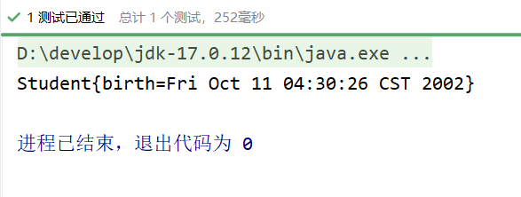

如果把日期格式修改一下：

```xml
<bean id="studentBean" class="bean.Student">
    <property name="birth" value="2002-10-10"/>
</bean>
```

执行结果：

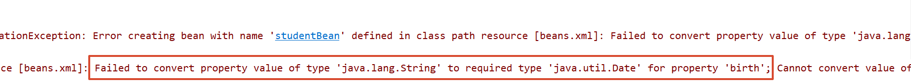

这种情况下，我们就可以使用FactoryBean来完成这个骚操作。
编写DateFactoryBean实现FactoryBean接口：

```java
public class DateFactoryBean implements FactoryBean<Date> {
    
    // 定义属性接收日期字符串
    private String date;
    
    // 通过构造方法给日期字符串属性赋值
    public DateFactoryBean(String date) {
        this.date = date;
    }
    
    @Override
    public Date getObject() throws Exception {
        SimpleDateFormat sdf = new SimpleDateFormat("yyyy-MM-dd");
        return sdf.parse(this.date);
    }
    
    @Override
    public Class<?> getObjectType() {
        return null;
    }
}
```

编写spring配置文件：

```xml
<bean id="dateBean" class="bean.DateFactoryBean">
    <constructor-arg name="date" value="1999-10-11"/>
</bean>

<bean id="studentBean" class="bean.Student">
    <property name="birth" ref="dateBean"/>
</bean>
```

执行测试程序：

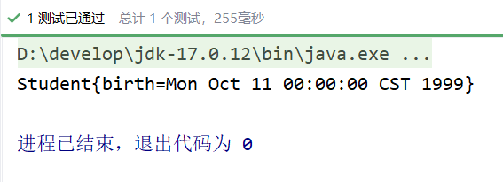

---

# 8. Bean的生命周期

## 8.1 什么是Bean的生命周期

Spring其实就是一个管理Bean对象的工厂。它负责对象的创建，对象的销毁等。
所谓的生命周期就是：对象从创建开始到最终销毁的整个过程。
什么时候创建Bean对象？
创建Bean对象的前后会调用什么方法？
Bean对象什么时候销毁？
Bean对象的销毁前后调用什么方法？

## 8.2 为什么要知道Bean的生命周期

其实生命周期的本质是：在哪个时间节点上调用了哪个类的哪个方法。
我们需要充分的了解在这个生命线上，都有哪些特殊的时间节点。
只有我们知道了特殊的时间节点都在哪，到时我们才可以确定代码写到哪。
我们可能需要在某个特殊的时间点上执行一段特定的代码，这段代码就可以放到这个节点上。当生命线走到这里的时候，自然会被调用。

## 8.3 Bean的生命周期之5步

Bean生命周期的管理，可以参考Spring的源码：

**`AbstractAutowireCapableBeanFactory`类的`doCreateBean()`方法。**
Bean生命周期可以粗略的划分为五大步：

- 第一步：实例化Bean
- 第二步：Bean属性赋值
- 第三步：初始化Bean
- 第四步：使用Bean
- 第五步：销毁Bean

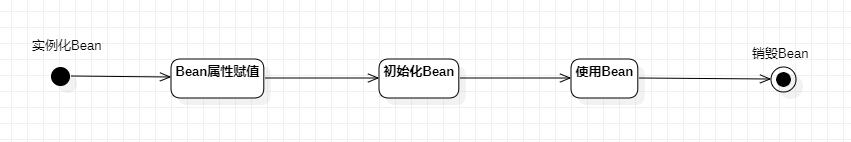

编写测试程序：
定义一个Bean

```java
public class User {
    private String name;
    
    public User() {
        System.out.println("1.实例化Bean");
    }
    
    public void setName(String name) {
        this.name = name;
        System.out.println("2.Bean属性赋值");
    }
    
    public void initBean(){
        System.out.println("3.初始化Bean");
    }
    
    public void destroyBean(){
        System.out.println("5.销毁Bean");
    }
    
}
```

```xml
<?xml version="1.0" encoding="UTF-8"?>
<beans xmlns="http://www.springframework.org/schema/beans"
       xmlns:xsi="http://www.w3.org/2001/XMLSchema-instance"
       xsi:schemaLocation="http://www.springframework.org/schema/beans http://www.springframework.org/schema/beans/spring-beans.xsd">

    <!--
    init-method属性指定初始化方法。
    destroy-method属性指定销毁方法。
    -->
    <bean id="userBean" class="bean.User" init-method="initBean" destroy-method="destroyBean">
        <property name="name" value="zhangsan"/>
    </bean>

</beans>
```

```java
@Test
public void testLifecycle(){
    ApplicationContext applicationContext = new ClassPathXmlApplicationContext("beans.xml");
    User userBean = applicationContext.getBean("userBean", User.class);
    System.out.println("4.使用Bean");
    // 只有正常关闭spring容器才会执行销毁方法
    ClassPathXmlApplicationContext context = (ClassPathXmlApplicationContext) applicationContext;
    context.close();
}
```

执行结果：

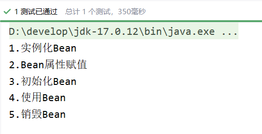

需要注意的：

- 第一：只有正常关闭spring容器，bean的销毁方法才会被调用。
- 第二：ClassPathXmlApplicationContext类才有close()方法。
- 第三：配置文件中的init-method指定初始化方法。destroy-method指定销毁方法。

---

## 8.4 Bean生命周期之7步

在以上的5步中，第3步是初始化Bean，如果你还想在初始化前和初始化后添加代码，可以加入“Bean后处理器”。
编写一个类实现BeanPostProcessor类，并且重写before和after方法：

```java
public class LogBeanPostProcessor implements BeanPostProcessor {
    @Override
    public Object postProcessBeforeInitialization(Object bean, String beanName) throws BeansException {
        System.out.println("Bean后处理器的before方法执行，即将开始初始化");
        return bean;
    }
    
    // 方法有两个参数
    // 1. 刚刚创建的bean对象
    // 2. bean的名字
    @Override
    public Object postProcessAfterInitialization(Object bean, String beanName) throws BeansException {
        System.out.println("Bean后处理器的after方法执行，已完成初始化");
        return bean;
    }
}
```

在beans.xml文件中配置“Bean后处理器”：

```xml
<!--配置Bean后处理器。这个后处理器将作用于当前配置文件中所有的bean。-->
<bean class="bean.LogBeanPostProcessor"/>
```

**一定要注意：在beans.xml文件中配置的Bean后处理器将作用于当前配置文件中所有的Bean。**
执行测试程序：

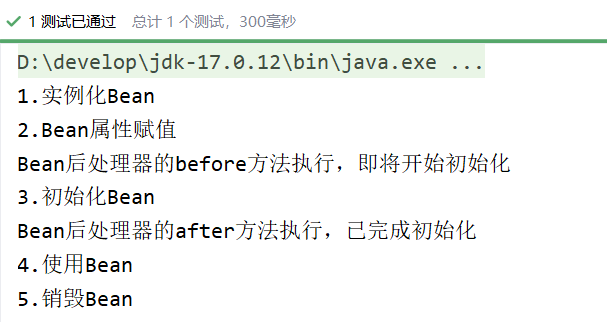

如果加上Bean后处理器的话，Bean的生命周期就是7步了：

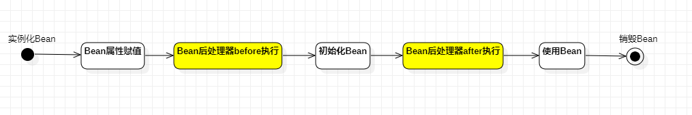

---

## 8.5 Bean生命周期之10步

如果根据源码跟踪，可以划分更细粒度的步骤，10步：

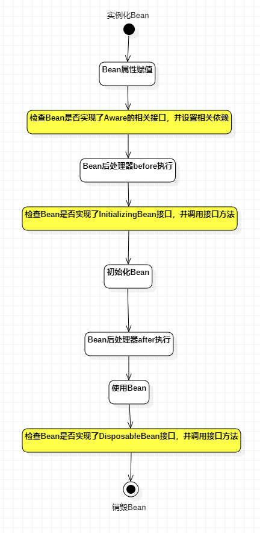

上图中检查Bean是否实现了Aware的相关接口是什么意思？
Aware相关的接口包括：BeanNameAware、BeanClassLoaderAware、BeanFactoryAware

- 当Bean实现了BeanNameAware，Spring会将Bean的名字传递给Bean。
- 当Bean实现了BeanClassLoaderAware，Spring会将加载该Bean的类加载器传递给Bean。
- 当Bean实现了BeanFactoryAware，Spring会将Bean工厂对象传递给Bean。

测试以上10步，可以让User类实现5个接口，并实现所有方法：

- BeanNameAware
- BeanClassLoaderAware
- BeanFactoryAware
- InitializingBean
- DisposableBean

代码如下：

```java
public class User implements BeanNameAware, BeanClassLoaderAware, BeanFactoryAware, InitializingBean, DisposableBean {
    private String name;

    public User() {
        System.out.println("1.实例化Bean");
    }

    public void setName(String name) {
        this.name = name;
        System.out.println("2.Bean属性赋值");
    }

    public void initBean(){
        System.out.println("6.初始化Bean");
    }

    public void destroyBean(){
        System.out.println("10.销毁Bean");
    }

    @Override
    public void setBeanClassLoader(ClassLoader classLoader) {
        System.out.println("3.类加载器：" + classLoader);
    }

    @Override
    public void setBeanFactory(BeanFactory beanFactory) throws BeansException {
        System.out.println("3.Bean工厂：" + beanFactory);
    }

    @Override
    public void setBeanName(String name) {
        System.out.println("3.bean名字：" + name);
    }

    @Override
    public void destroy() throws Exception {
        System.out.println("9.DisposableBean destroy");
    }

    @Override
    public void afterPropertiesSet() throws Exception {
        System.out.println("5.afterPropertiesSet执行");
    }
}
```

```java
public class LogBeanPostProcessor implements BeanPostProcessor {
    @Override
    public Object postProcessBeforeInitialization(Object bean, String beanName) throws BeansException {
        System.out.println("4.Bean后处理器的before方法执行，即将开始初始化");
        return bean;
    }

    @Override
    public Object postProcessAfterInitialization(Object bean, String beanName) throws BeansException {
        System.out.println("7.Bean后处理器的after方法执行，已完成初始化");
        return bean;
    }
}
```

执行结果：

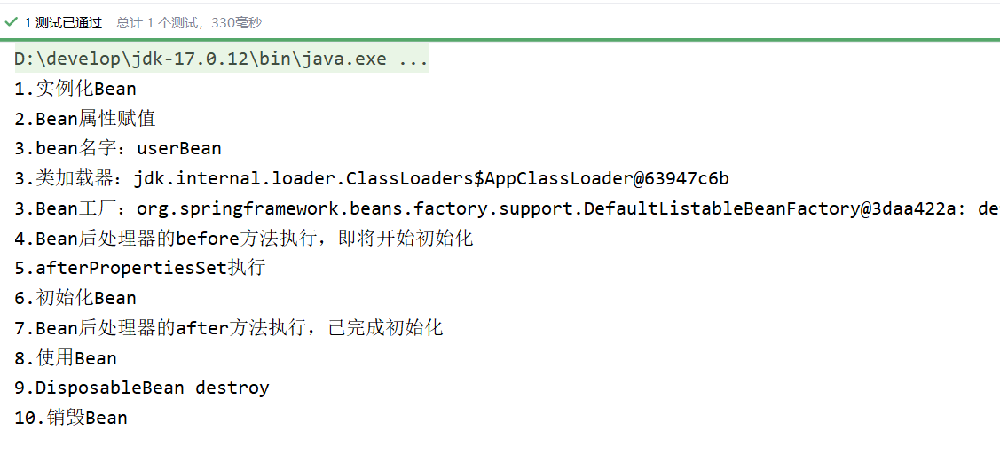

**通过测试可以看出来：**

- **InitializingBean的方法早于init-method的执行。**
- **DisposableBean的方法早于destroy-method的执行。**

对于SpringBean的生命周期，掌握之前的7步即可。够用。

---

## 8.6 Bean的作用域不同，管理方式不同

Spring 根据Bean的作用域来选择管理方式。

- 对于singleton作用域的Bean，Spring 能够精确地知道该Bean何时被创建，何时初始化完成，以及何时被销毁；
- 而对于 prototype 作用域的 Bean，Spring 只负责创建，当容器创建了 Bean 的实例后，Bean 的实例就交给客户端代码管理，Spring 容器将不再跟踪其生命周期。

> Spring容器只对singleton的Bean进行完整的生命周期管理。
>
> 如果是prototype作用域的Bean，Spring容器只负责将该Bean初始化完毕。等客户端程序一旦获取到该Bean之后，Spring容器就不再管理该对象的生命周期了。

我们把之前User类的spring.xml文件中的配置scope设置为prototype：

```xml
<?xml version="1.0" encoding="UTF-8"?>
<beans xmlns="http://www.springframework.org/schema/beans"
       xmlns:xsi="http://www.w3.org/2001/XMLSchema-instance"
       xsi:schemaLocation="http://www.springframework.org/schema/beans http://www.springframework.org/schema/beans/spring-beans.xsd">

    <!--
    init-method属性指定初始化方法。
    destroy-method属性指定销毁方法。
    -->
    <bean id="userBean" class="bean.User" init-method="initBean" destroy-method="destroyBean" scope="prototype">
        <property name="name" value="zhangsan"/>
    </bean>

    <!--配置Bean后处理器。这个后处理器将作用于当前配置文件中所有的bean。-->
    <bean class="bean.LogBeanPostProcessor"/>

</beans>
```

执行测试程序：

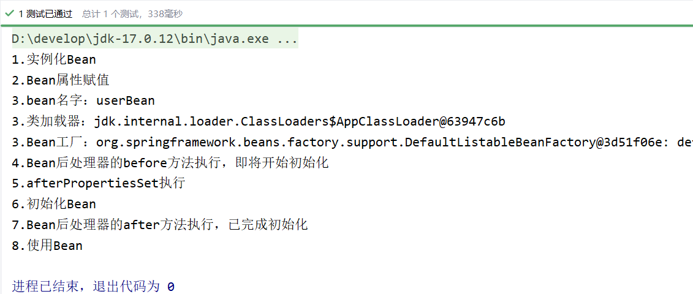

通过测试一目了然。只执行了前8步，第9和10都没有执行。

## 8.7 自己new的对象如何让Spring管理

有些时候可能会遇到这样的需求，某个java对象是我们自己new的，然后我们希望这个对象被Spring容器管理，怎么实现？

```java
public class User {
}
```

```java
@Test
public void testBeanRegister(){
    // 自己new的对象
    User user = new User();
    System.out.println(user);

    // 创建 默认可列表BeanFactory 对象
    DefaultListableBeanFactory factory = new DefaultListableBeanFactory();
    // 注册Bean
    factory.registerSingleton("userBean", user);
    // 从spring容器中获取bean
    User userBean = factory.getBean("userBean", User.class);
    System.out.println(userBean);
}
```

执行结果：

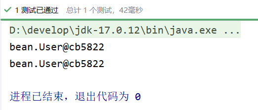

---

# 9. Bean的循环依赖问题

## 9.1 什么是Bean的循环依赖

A对象中有B属性。B对象中有A属性。这就是循环依赖。我依赖你，你也依赖我。
比如：丈夫类Husband，妻子类Wife。Husband中有Wife的引用。Wife中有Husband的引用。

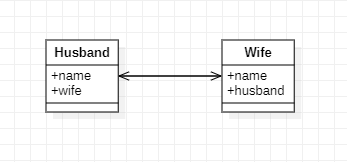

```java
public class Husband {
    private String name;
    private Wife wife;
}
```

```java
public class Wife {
    private String name;
    private Husband husband;
}
```

## 9.2 singleton下的set注入产生的循环依赖

我们来编写程序，测试一下在singleton+setter的模式下产生的循环依赖，Spring是否能够解决？

```java
public class Husband {
    private String name;
    private Wife wife;
    
    public void setName(String name) {
        this.name = name;
    }
    
    public String getName() {
        return name;
    }
    
    public void setWife(Wife wife) {
        this.wife = wife;
    }
    
    // toString()方法重写时需要注意：不能直接输出wife，输出wife.getName()。要不然会出现递归导致的栈内存溢出错误。
    @Override
    public String toString() {
        return "Husband{" +
                "name='" + name + '\'' +
                ", wife=" + wife.getName() +
                '}';
    }
}
```

```java
public class Wife {
    private String name;
    private Husband husband;
    
    public void setName(String name) {
        this.name = name;
    }
    
    public String getName() {
        return name;
    }
    
    public void setHusband(Husband husband) {
        this.husband = husband;
    }
    
    // toString()方法重写时需要注意：不能直接输出husband，输出husband.getName()。要不然会出现递归导致的栈内存溢出错误。
    @Override
    public String toString() {
        return "Wife{" +
                "name='" + name + '\'' +
                ", husband=" + husband.getName() +
                '}';
    }
}
```

```xml
<?xml version="1.0" encoding="UTF-8"?>
<beans xmlns="http://www.springframework.org/schema/beans"
       xmlns:xsi="http://www.w3.org/2001/XMLSchema-instance"
       xsi:schemaLocation="http://www.springframework.org/schema/beans http://www.springframework.org/schema/beans/spring-beans.xsd">

    <!--singleton + setter模式下的循环依赖是没有任何问题的。 -->
	<!--singleton表示在整个Spring容器当中是单例的，独一无二的对象。 -->
	<!--

	在singleton + setter模式下，为什么循环依赖不会出现问题，Spring是如何应对的？
	主要的原因是，在这种模式下Spring对Bean的管理主要分为清晰的两个阶段：
	    第一个阶段：在Spring容器加载的时候，实例化Bean，只要其中任意一个Bean实例化之后，马上进行“曝光”		【不等属性赋值就曝光】
    	第二个阶段：Bean“曝光”之后，再进行属性的赋值(调用set方法。)

	核心解决方案是：实例化对象和对象的属性赋值分为两个阶段来完成的。

	-->
    
    <bean id="husbandBean" class="bean.Husband" scope="singleton">
        <property name="name" value="张三"/>
        <property name="wife" ref="wifeBean"/>
    </bean>
    <bean id="wifeBean" class="bean.Wife" scope="singleton">
        <property name="name" value="小花"/>
        <property name="husband" ref="husbandBean"/>
    </bean>
</beans>
```

```java
@Test
public void testSingletonAndSet(){
    ApplicationContext applicationContext = new ClassPathXmlApplicationContext("beans.xml");
    Husband husbandBean = applicationContext.getBean("husbandBean", Husband.class);
    Wife wifeBean = applicationContext.getBean("wifeBean", Wife.class);
    System.out.println(husbandBean);
    System.out.println(wifeBean);
}
```

执行结果：

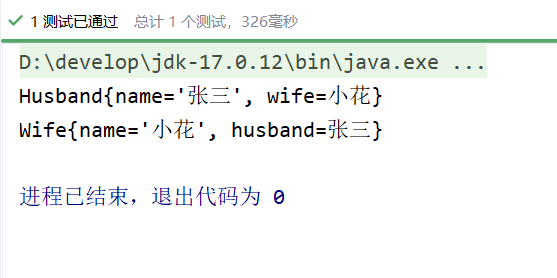

**通过测试得知：在singleton + set注入的情况下，循环依赖是没有问题的。Spring可以解决这个问题。**

---

## 9.3 prototype下的set注入产生的循环依赖

我们再来测试一下：prototype+set注入的方式下，循环依赖会不会出现问题？

```xml
<?xml version="1.0" encoding="UTF-8"?>
<beans xmlns="http://www.springframework.org/schema/beans"
       xmlns:xsi="http://www.w3.org/2001/XMLSchema-instance"
       xsi:schemaLocation="http://www.springframework.org/schema/beans http://www.springframework.org/schema/beans/spring-beans.xsd">

    <bean id="husbandBean" class="bean.Husband" scope="prototype">
        <property name="name" value="张三"/>
        <property name="wife" ref="wifeBean"/>
    </bean>
    <bean id="wifeBean" class="bean.Wife" scope="prototype">
        <property name="name" value="小花"/>
        <property name="husband" ref="husbandBean"/>
    </bean>
</beans>
```

执行测试程序：发生了异常，异常信息如下：

```
Caused by: org.springframework.beans.factory.**BeanCurrentlyInCreationException**: Error creating bean with name 'husbandBean': Requested bean is currently in creation: Is there an unresolvable circular reference?
	at org.springframework.beans.factory.support.AbstractBeanFactory.doGetBean(AbstractBeanFactory.java:265)
	at org.springframework.beans.factory.support.AbstractBeanFactory.getBean(AbstractBeanFactory.java:199)
	at org.springframework.beans.factory.support.BeanDefinitionValueResolver.resolveReference(BeanDefinitionValueResolver.java:325)
	... 44 more
```

翻译为：创建名为“husbandBean”的bean时出错：请求的bean当前正在创建中：是否存在无法解析的循环引用？
通过测试得知，当循环依赖的**所有Bean**的scope="prototype"的时候，产生的循环依赖，Spring是无法解决的，会出现**BeanCurrentlyInCreationException**异常。
大家可以测试一下，以上两个Bean，如果其中一个是singleton，另一个是prototype，是没有问题的。
为什么两个Bean都是prototype时会出错呢？

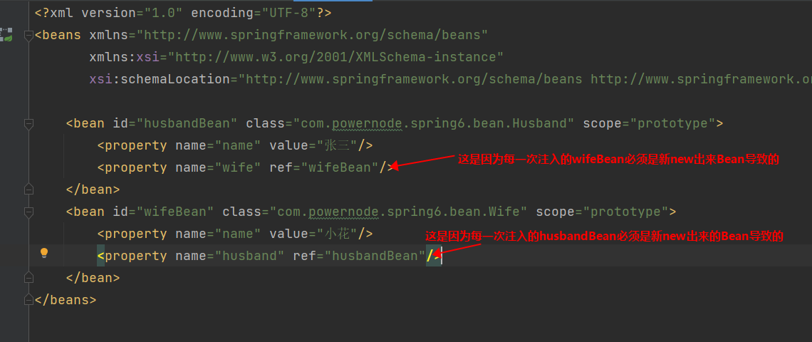

---

## 9.4 singleton下的构造注入产生的循环依赖

我们再来测试一下singleton + 构造注入的方式下，spring是否能够解决这种循环依赖。

```java
public class Husband {
    private String name;
    private Wife wife;
    
    public Husband(String name, Wife wife) {
        this.name = name;
        this.wife = wife;
    }
    
    // -----------------------分割线--------------------------------
    public String getName() {
        return name;
    }
    
    @Override
    public String toString() {
        return "Husband{" +
                "name='" + name + '\'' +
                ", wife=" + wife +
                '}';
    }
}
```

```java
public class Wife {
    private String name;
    private Husband husband;
    
    public Wife(String name, Husband husband) {
        this.name = name;
        this.husband = husband;
    }
    
    // -------------------------分割线--------------------------------
    public String getName() {
        return name;
    }
    
    @Override
    public String toString() {
        return "Wife{" +
                "name='" + name + '\'' +
                ", husband=" + husband +
                '}';
    }
}
```

```xml
<?xml version="1.0" encoding="UTF-8"?>
<beans xmlns="http://www.springframework.org/schema/beans"
       xmlns:xsi="http://www.w3.org/2001/XMLSchema-instance"
       xsi:schemaLocation="http://www.springframework.org/schema/beans http://www.springframework.org/schema/beans/spring-beans.xsd">

    <bean id="hBean" class="bean.Husband" scope="singleton">
        <constructor-arg name="name" value="张三"/>
        <constructor-arg name="wife" ref="wBean"/>
    </bean>

    <bean id="wBean" class="bean.Wife" scope="singleton">
        <constructor-arg name="name" value="小花"/>
        <constructor-arg name="husband" ref="hBean"/>
    </bean>
</beans>
```

```java
@Test
public void testSingletonAndConstructor(){
    ApplicationContext applicationContext = new ClassPathXmlApplicationContext("beans.xml");
    Husband hBean = applicationContext.getBean("hBean", Husband.class);
    Wife wBean = applicationContext.getBean("wBean", Wife.class);
    System.out.println(hBean);
    System.out.println(wBean);
}
```

执行结果：发生了异常，信息如下：

```
Caused by: org.springframework.beans.factory.**BeanCurrentlyInCreationException**: Error creating bean with name 'hBean': Requested bean is currently in creation: Is there an unresolvable circular reference?
	at org.springframework.beans.factory.support.DefaultSingletonBeanRegistry.beforeSingletonCreation(DefaultSingletonBeanRegistry.java:355)
	at org.springframework.beans.factory.support.DefaultSingletonBeanRegistry.getSingleton(DefaultSingletonBeanRegistry.java:227)
	at org.springframework.beans.factory.support.AbstractBeanFactory.doGetBean(AbstractBeanFactory.java:324)
	at org.springframework.beans.factory.support.AbstractBeanFactory.getBean(AbstractBeanFactory.java:199)
	at org.springframework.beans.factory.support.BeanDefinitionValueResolver.resolveReference(BeanDefinitionValueResolver.java:325)
	... 56 more
```

和上一个测试结果相同，都是提示产生了循环依赖，并且Spring是无法解决这种循环依赖的。
为什么呢？
**主要原因是因为通过构造方法注入导致的：因为构造方法注入会导致实例化对象的过程和对象属性赋值的过程没有分离开，必须在一起完成导致的。**

## 9.5 Spring解决循环依赖的机理

Spring为什么可以解决set + singleton模式下循环依赖？
根本的原因在于：这种方式可以做到将“实例化Bean”和“给Bean属性赋值”这两个动作分开去完成。
实例化Bean的时候：调用无参数构造方法来完成。**此时可以先不给属性赋值，可以提前将该Bean对象“曝光”给外界。**
给Bean属性赋值的时候：调用setter方法来完成。
两个步骤是完全可以分离开去完成的，并且这两步不要求在同一个时间点上完成。
也就是说，Bean都是单例的，我们可以先把所有的单例Bean实例化出来，放到一个集合当中（我们可以称之为缓存），所有的单例Bean全部实例化完成之后，以后我们再慢慢的调用setter方法给属性赋值。这样就解决了循环依赖的问题。
那么在Spring框架底层源码级别上是如何实现的呢？请看：

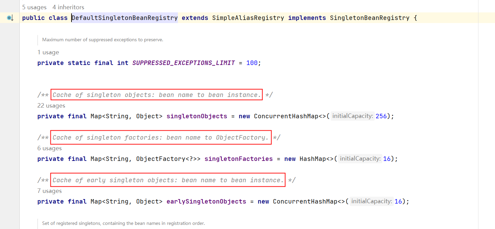

在以上类中包含三个重要的属性：
_**Cache of singleton objects: bean name to bean instance. **_**单例对象的缓存：key存储bean名称，value存储Bean对象【一级缓存】**
_**Cache of early singleton objects: bean name to bean instance. **_**早期单例对象的缓存：key存储bean名称，value存储早期的Bean对象【二级缓存】**
_**Cache of singleton factories: bean name to ObjectFactory. **_**单例工厂缓存：key存储bean名称，value存储该Bean对应的ObjectFactory对象【三级缓存】**

```java
源码分析：
	DefaultSingletonBeanRegistry类中有三个比较重要的缓存：
	private final Map<String, Object> singletonObjects            一级缓存
	private final Map<String, Object> earlySingletonObjects       二级缓存
	private final Map<String, ObjectFactory<?>> singletonFactories 三级缓存

	这三个缓存都是Map集合。
	Map集合的key存储的都是bean的name（bean id）。

	一级缓存存储的是：单例Bean对象。完整的单例Bean对象，也就是说这个缓存中的Bean对象的属性都已经赋值了。是一个完整的Bean对象。
	二级缓存存储的是：早期的单例Bean对象。这个缓存中的单例Bean对象的属性没有赋值。只是一个早期的实例对象。
	三级缓存存储的是：单例工厂对象。这个里面存储了大量的“工厂对象”，每一个单例Bean对象都会对应一个单例工厂对象。这个集合中存储的是，创建该单例对象时对应的那个单例工厂对象。
```

这三个缓存其实本质上是三个Map集合。
我们再来看，在该类中有这样一个方法addSingletonFactory()，这个方法的作用是：将创建Bean对象的ObjectFactory对象提前曝光。

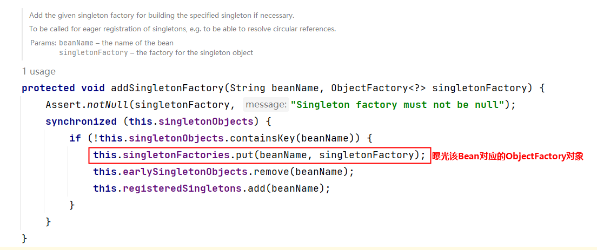

再分析下面的源码：

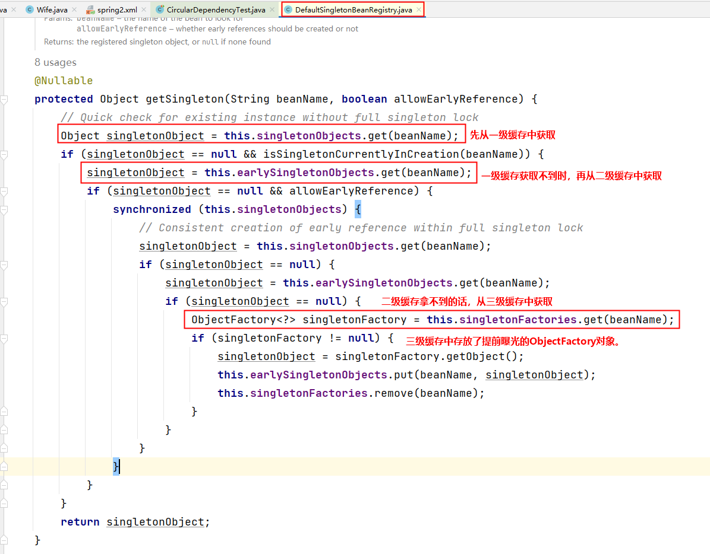

从源码中可以看到，spring会先从一级缓存中获取Bean，如果获取不到，则从二级缓存中获取Bean，如果二级缓存还是获取不到，则从三级缓存中获取之前曝光的ObjectFactory对象，通过ObjectFactory对象获取Bean实例，这样就解决了循环依赖的问题。
**总结：**
**Spring只能解决setter方法注入的单例bean之间的循环依赖。ClassA依赖ClassB，ClassB又依赖ClassA，形成依赖闭环。Spring在创建ClassA对象后，不需要等给属性赋值，直接将其曝光到bean缓存当中。在解析ClassA的属性时，又发现依赖于ClassB，再次去获取ClassB，当解析ClassB的属性时，又发现需要ClassA的属性，但此时的ClassA已经被提前曝光加入了正在创建的bean的缓存中，则无需创建新的的ClassA的实例，直接从缓存中获取即可。从而解决循环依赖问题。**

---

# 10. 回顾反射机制

## 10.1 分析方法四要素

我们先来看一下，不使用反射机制调用一个方法需要几个要素的参与。
有一个这样的类：

```java
public class SystemService {
    
    public void logout(){
        System.out.println("退出系统");
    }
    
    public boolean login(String username, String password){
        if ("admin".equals(username) && "admin123".equals(password)) {
            return true;
        }
        return false;
    }
}
```

```java
@Test
public void test(){
    // 创建对象
    SystemService systemService = new SystemService();

    // 调用方法并接收方法的返回值
    boolean success = systemService.login("admin", "admin123");

    System.out.println(success ? "登录成功" : "登录失败");
}
```

执行结果：

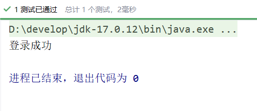

通过以上第16行代码可以看出，调用一个方法，一般涉及到4个要素：

- 调用哪个对象的（systemService）
- 哪个方法（login）
- 传什么参数（"admin", "admin123"）
- 返回什么值（success）

---

## 10.2 获取Method

要使用反射机制调用一个方法，首先你要获取到这个方法。
在反射机制中Method实例代表的是一个方法。那么怎么获取Method实例呢？
有这样一个类：

```java
public class SystemService {

    public void logout(){
        System.out.println("退出系统");
    }

    public boolean login(String username, String password){
        if ("admin".equals(username) && "admin123".equals(password)) {
            return true;
        }
        return false;
    }
    
    public boolean login(String password){
        if("110".equals(password)){
            return true;
        }
        return false;
    }
}
```

我们如何获取到 logout()、login(String,String)、login(String) 这三个方法呢？
要获取方法Method，首先你需要获取这个类Class。

```java
Class clazz = Class.forName("com.powernode.reflect.SystemService");
```

当拿到Class之后，调用getDeclaredMethod()方法可以获取到方法。
假如你要获取这个方法：login(String username, String password)

```java
Method loginMethod = clazz.getDeclaredMethod("login", String.class, String.class);
```

假如你要获取到这个方法：login(String password)

```java
Method loginMethod = clazz.getDeclaredMethod("login", String.class);
```

获取一个方法，需要告诉Java程序，你要获取的方法的名字是什么，这个方法上每个形参的类型是什么。这样Java程序才能给你拿到对应的方法。
这样的设计也非常合理，因为在同一个类当中，方法是支持重载的，也就是说方法名可以一样，但参数列表一定是不一样的，所以获取一个方法需要提供方法名以及每个形参的类型。
假设有这样一个方法：

```java
public void setAge(int age){
    this.age = age;
}
```

你要获取这个方法的话，代码应该这样写：

```java
Method setAgeMethod = clazz.getDeclaredMethod("setAge", int.class);
```

其中setAge是方法名，int.class是形参的类型。
如果要获取上面的logout方法，代码应该这样写：

```java
Method logoutMethod = clazz.getDeclaredMethod("logout");
```

因为这个方法形式参数的个数是0个。所以只需要提供方法名就行了。

---

## 10.3 调用Method

要让一个方法调用的话，就关联到四要素了：

- 调用哪个对象的
- 哪个方法
- 传什么参数
- 返回什么值

```java
public class SystemService {

    public void logout(){
        System.out.println("退出系统");
    }

    public boolean login(String username, String password){
        if ("admin".equals(username) && "admin123".equals(password)) {
            return true;
        }
        return false;
    }

    public boolean login(String password){
        if("110".equals(password)){
            return true;
        }
        return false;
    }
}
```

假如我们要调用的方法是：login(String, String)
第一步：创建对象（四要素之首：调用哪个对象的）

```java
Class clazz = Class.forName("com.powernode.reflect.SystemService");
Object obj = clazz.newInstance();
```

第二步：获取方法login(String,String)（四要素之一：哪个方法）

```java
Method loginMethod = clazz.getDeclaredMethod("login", String.class, String.class);
```

第三步：调用方法

```java
Object retValue = loginMethod.invoke(obj, "admin", "admin123");
```

解说四要素：

- 哪个对象：obj
- 哪个方法：loginMethod
- 传什么参数："admin", "admin123"
- 返回什么值：retValue

```java
@Test
public void test() throws Exception {
    Class clazz = Class.forName("service.SystemService");
    Object obj = clazz.newInstance();
    Method loginMethod = clazz.getDeclaredMethod("login", String.class, String.class);
    Object retValue = loginMethod.invoke(obj, "admin", "admin123");
    System.out.println(retValue);
}
```

执行结果：

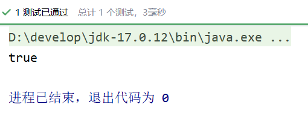

那如果调用既没有参数，又没有返回值的logout方法，应该怎么做？

```java
@Test
public void test() throws Exception {
    Class clazz = Class.forName("service.SystemService");
    Object obj = clazz.newInstance();
    Method logoutMethod = clazz.getDeclaredMethod("logout");
    logoutMethod.invoke(obj);
}
```

执行结果：

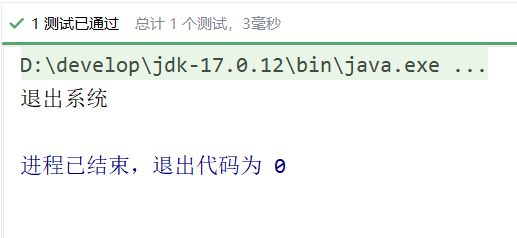

---

## 10.4 假设你知道属性名

假设有这样一个类：

```java
public class User {
    private String name;
    private int age;

    public String getName() {
        return name;
    }

    public void setName(String name) {
        this.name = name;
    }

    public int getAge() {
        return age;
    }

    public void setAge(int age) {
        this.age = age;
    }

    @Override
    public String toString() {
        return "User{" +
                "name='" + name + '\'' +
                ", age=" + age +
                '}';
    }
}
```

你知道以下这几条信息：

- 类名是：com.powernode.reflect.User
- 该类中有String类型的name属性和int类型的age属性。
- 另外你也知道该类的设计符合javabean规范。（也就是说属性私有化，对外提供setter和getter方法）

你如何通过反射机制给User对象的name属性赋值zhangsan，给age属性赋值20岁。

```java
    @Test
    public void test() throws Exception {
        // 已知类名
        String className = "bean.User";
        // 已知属性名
        String propertyAge = "age";
        String propertyName = "name";
        
        // 通过反射机制给User对象的name属性赋值zhangsan和age属性赋值20岁
        Class<?> clazz = Class.forName(className);
        Object obj = clazz.newInstance(); // 创建对象
        
        // 根据属性名获取setter方法名
        String setMethodAgeName = "set" + propertyAge.toUpperCase().charAt(0) + propertyAge.substring(1);
        String setMethodNameName = "set" + propertyName.toUpperCase().charAt(0) + propertyName.substring(1);
        
        // 获取Method
        Method setMethodAge = clazz.getDeclaredMethod(setMethodAgeName, int.class);
        Method setMethodName = clazz.getDeclaredMethod(setMethodNameName, String.class);
        
        // 调用Method
        setMethodAge.invoke(obj, 20);
        setMethodName.invoke(obj, "zhangsan");
        
        System.out.println(obj);
    }
```

执行结果：

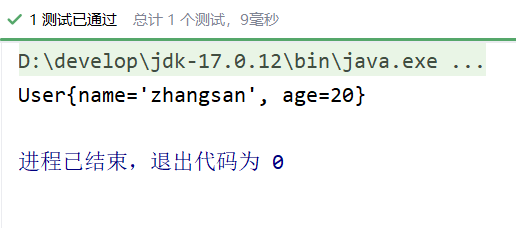

---

