# 12. Spring IoC注解式开发

## 12.1 回顾注解

注解的存在主要是为了简化XML的配置。**Spring6倡导全注解开发**。
我们来回顾一下：

- 第一：注解怎么定义，注解中的属性怎么定义？
- 第二：注解怎么使用？
- 第三：通过反射机制怎么读取注解？

**注解怎么定义，注解中的属性怎么定义？**

```java
@Target(value = {ElementType.TYPE})
@Retention(value = RetentionPolicy.RUNTIME)
public @interface MyComponent {
    String value();
}
```

以上是自定义了一个注解：`MyComponent`
该注解上面修饰的注解包括：`Target`注解和`Retention`注解，这两个注解被称为元注解。
`Target`注解用来设置`MyComponent`注解可以出现的位置，以上代表表示`MyComponent`注解只能用在类和接口上。
`Retention`注解用来设置`MyComponent`注解的保持性策略，以上代表`MyComponent`注解可以被反射机制读取。
`String value();` 是`MyComponent`注解中的一个属性。该属性类型`String`，属性名是`value`。
**注解怎么使用？**

```java
@MyComponent(value = "userBean")
public class User {
}
```

用法简单，语法格式：@注解类型名(属性名=属性值, 属性名=属性值, 属性名=属性值......)
userBean为什么使用双引号括起来，因为value属性是String类型，字符串。
另外如果属性名是value，则在使用的时候可以省略属性名，例如：

```java
//@MyComponent(value = "userBean")
@MyComponent("userBean")
public class User {
}
```

**通过反射机制怎么读取注解？**
接下来，我们来写一段程序，当`Bean`类上有`MyComponent`注解时，则实例化`Bean`对象，如果没有，则不实例化对象。
我们准备两个`Bean`，一个上面有注解，一个上面没有注解。

```java
@MyComponent("userBean")
public class User {
}
```

```java
public class Vip {
}
```

假设我们现在只知道包名：`bean`。至于这个包下有多少个`Bean`我们不知道。哪些`Bean`上有注解，哪些`Bean`上没有注解，这些我们都不知道，如何通过程序全自动化判断。

```java
@Test
public void test() {
    // Bean 容器：存储扫描到并实例化的 Bean 对象
    // key：bean 的唯一标识（beanId），value：对应的 Bean 实例对象
    Map<String, Object> beanMap = new HashMap<>();

    // 指定需要扫描的包名
    String packageName = "bean";
    // 将包名的 "." 替换为路径分隔符 "/"，转换为类路径下的目录格式
    // 如 gua.bean --> gua/bean
    String path = packageName.replaceAll("\\.", "/");

    // 通过系统类加载器，获取扫描目录对应的资源 URL
    URL url = ClassLoader.getSystemClassLoader().getResource(path);
    // 将资源 URL 转换为 File 对象，用于操作目录下的文件
    File file = new File(url.getPath());
    // 获取该目录下的所有文件（即包内的 .class 字节码文件）
    File[] files = file.listFiles();

    // 遍历目录下所有文件，逐个解析类并筛选带注解的组件
    Arrays.stream(files).forEach(f -> {
        // 拼接得到类的全限定名（包名 + 类名），去掉文件名的 .class 后缀
        String className = packageName + "." + f.getName().split("\\.")[0];
        try {
            // 根据全限定名反射加载对应的 Class 类对象
            Class<?> clazz = Class.forName(className);

            // 判断当前类是否标注了 @MyComponent 自定义组件注解
            if (clazz.isAnnotationPresent(MyComponent.class)) {
                // 获取类上的 @MyComponent 注解实例
                MyComponent myComponent = clazz.getAnnotation(MyComponent.class);
                // 读取注解的 value 属性，作为该 Bean 的唯一 id
                String beanId = myComponent.value();
                // 通过类的无参构造方法，反射实例化得到 Bean 对象
                Object bean = clazz.newInstance();
                // 将 beanId 与 Bean 实例存入容器
                beanMap.put(beanId, bean);
            }
        } catch (Exception e) {
            // 捕获类加载、实例化过程中可能出现的异常，打印异常栈
            e.printStackTrace();
        }
    });

    // 打印最终扫描完成的 Bean 容器，查看所有注册的 Bean
    System.out.println(beanMap);
}
```

执行结果：

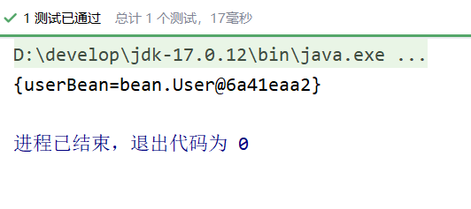

---

## 12.2 声明Bean的注解

负责声明Bean的注解，常见的包括四个：

- @Component
- @Controller
- @Service
- @Repository

源码如下：

```java
package org.springframework.stereotype;

import ...

@Target({ElementType.TYPE})
@Retention(RetentionPolicy.RUNTIME)
@Documented
@Indexed
public @interface Component {
    String value() default "";
}
```

```java
package org.springframework.stereotype;

import ...

@Target({ElementType.TYPE})
@Retention(RetentionPolicy.RUNTIME)
@Documented
@Component
public @interface Controller {
    @AliasFor(
        annotation = Component.class
    )
    String value() default "";
}
```

```java
package org.springframework.stereotype;

import ...
    
@Target({ElementType.TYPE})
@Retention(RetentionPolicy.RUNTIME)
@Documented
@Component
public @interface Service {
    @AliasFor(
        annotation = Component.class
    )
    String value() default "";
}
```

```java
package org.springframework.stereotype;

import ...
    
@Target({ElementType.TYPE})
@Retention(RetentionPolicy.RUNTIME)
@Documented
@Component
public @interface Repository {
    @AliasFor(
        annotation = Component.class
    )
    String value() default "";
}
```

通过源码可以看到，@Controller、@Service、@Repository这三个注解都是@Component注解的别名。
也就是说：这四个注解的功能都一样。用哪个都可以。
只是为了增强程序的可读性，建议：

- 控制器类上使用：Controller
- service类上使用：Service
- dao类上使用：Repository

他们都是只有一个value属性。value属性用来指定bean的id，也就是bean的名字。

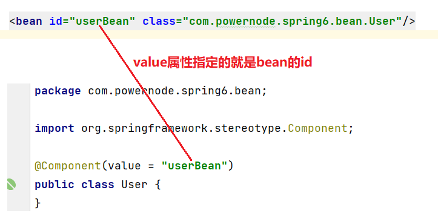

---

## 12.3 Spring注解的使用

如何使用以上的注解呢？

- 第一步：加入aop的依赖
- 第二步：在配置文件中添加context命名空间
- 第三步：在配置文件中指定扫描的包
- 第四步：在Bean类上使用注解

**第一步：加入aop的依赖**
我们可以看到当加入spring-context依赖之后，会关联加入aop的依赖。所以这一步不用做。

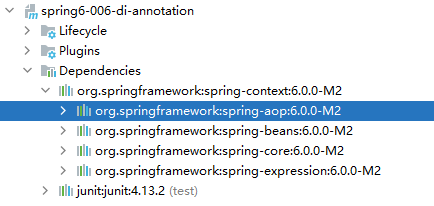

**第二步：在配置文件中添加context命名空间**

```xml
<?xml version="1.0" encoding="UTF-8"?>
<beans xmlns="http://www.springframework.org/schema/beans"
       xmlns:xsi="http://www.w3.org/2001/XMLSchema-instance"
       xmlns:context="http://www.springframework.org/schema/context"
       xsi:schemaLocation="http://www.springframework.org/schema/beans http://www.springframework.org/schema/beans/spring-beans.xsd
                           http://www.springframework.org/schema/context http://www.springframework.org/schema/context/spring-context.xsd">

</beans>
```

**第三步：在配置文件中指定要扫描的包**

```xml
<?xml version="1.0" encoding="UTF-8"?>
<beans xmlns="http://www.springframework.org/schema/beans"
       xmlns:xsi="http://www.w3.org/2001/XMLSchema-instance"
       xmlns:context="http://www.springframework.org/schema/context"
       xsi:schemaLocation="http://www.springframework.org/schema/beans http://www.springframework.org/schema/beans/spring-beans.xsd
                           http://www.springframework.org/schema/context http://www.springframework.org/schema/context/spring-context.xsd">
    
    <context:component-scan base-package="bean"/>
    
</beans>
```

**第四步：在Bean类上使用注解**

```java
@Component(value = "userBean")
public class User {
}
```

编写测试程序：

```java
@Test
public void testBean(){
    ApplicationContext applicationContext = new ClassPathXmlApplicationContext("beans.xml");
    User userBean = applicationContext.getBean("userBean", User.class);
    System.out.println(userBean);
}
```

执行结果：

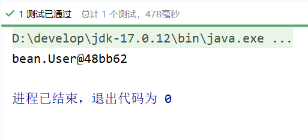

**如果注解的属性名是value，那么value是可以省略的。**

```java
@Component("vipBean")
public class Vip {
}
```

```java
@Test
public void testBean(){
    ApplicationContext applicationContext = new ClassPathXmlApplicationContext("beans.xml");

    User userBean = applicationContext.getBean("userBean", User.class);
    System.out.println(userBean);

    Vip vipBean = applicationContext.getBean("vipBean", Vip.class);
    System.out.println(vipBean);
}
```

执行结果：

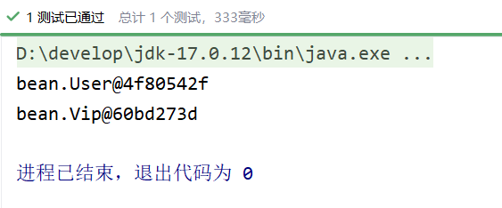

**如果把value属性彻底去掉，spring会被Bean自动取名吗？会的。并且默认名字的规律是：Bean类名首字母小写即可。**

```java
@Component
public class BankDao {
}
```

也就是说，这个BankDao的bean的名字为：bankDao
测试一下

```java
@Test
public void testBean(){
    ApplicationContext applicationContext = new ClassPathXmlApplicationContext("beans.xml");

    BankDao bankDao = applicationContext.getBean("bankDao", BankDao.class);
    System.out.println(bankDao);
}
```

执行结果：

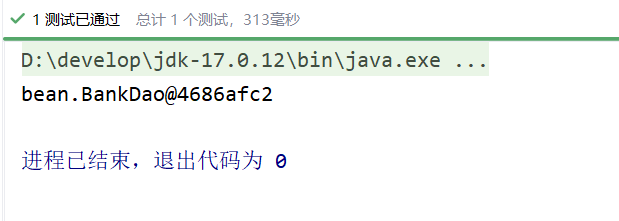

我们将Component注解换成其它三个注解，看看是否可以用：

```java
@Controller
public class BankDao {
}
```

执行结果：

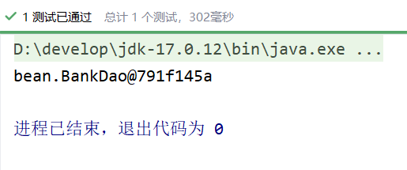

**如果是多个包怎么办？有两种解决方案：**

- **第一种：在配置文件中指定多个包，用逗号隔开。**
- **第二种：指定多个包的共同父包。**

先来测试一下逗号（英文）的方式：
创建一个新的包：bean2，定义一个Bean类。

```java
@Service
public class Order {
}
```

配置文件修改：

```xml
<?xml version="1.0" encoding="UTF-8"?>
<beans xmlns="http://www.springframework.org/schema/beans"
       xmlns:xsi="http://www.w3.org/2001/XMLSchema-instance"
       xmlns:context="http://www.springframework.org/schema/context"
       xsi:schemaLocation="http://www.springframework.org/schema/beans http://www.springframework.org/schema/beans/spring-beans.xsd
                           http://www.springframework.org/schema/context http://www.springframework.org/schema/context/spring-context.xsd">

    <context:component-scan base-package="bean, bean2"/>

</beans>
```

测试程序：

```java
@Test
public void testBean(){
    ApplicationContext applicationContext = new ClassPathXmlApplicationContext("beans.xml");
    BankDao bankDao = applicationContext.getBean("bankDao", BankDao.class);
    System.out.println(bankDao);
    Order order = applicationContext.getBean("order", Order.class);
    System.out.println(order);
}
```

执行结果：

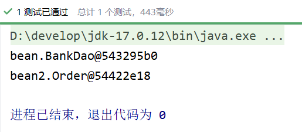

我们再来看看，指定共同的父包行不行：

```java
<?xml version="1.0" encoding="UTF-8"?>
<beans xmlns="http://www.springframework.org/schema/beans"
       xmlns:xsi="http://www.w3.org/2001/XMLSchema-instance"
       xmlns:context="http://www.springframework.org/schema/context"
       xsi:schemaLocation="http://www.springframework.org/schema/beans http://www.springframework.org/schema/beans/spring-beans.xsd
                           http://www.springframework.org/schema/context http://www.springframework.org/schema/context/spring-context.xsd">

    <context:component-scan base-package="spring"/>

</beans>
```

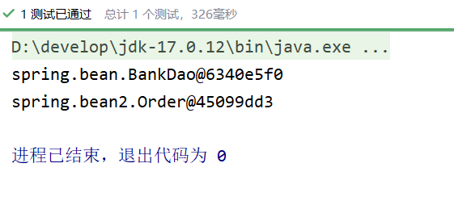

---

## 12.4 选择性实例化Bean

假设在某个包下有很多Bean，有的Bean上标注了Component，有的标注了Controller，有的标注了Service，有的标注了Repository，现在由于某种特殊业务的需要，只允许其中所有的Controller参与Bean管理，其他的都不实例化。这应该怎么办呢？

```java
@Component
public class A {
    public A() {
        System.out.println("A的无参数构造方法执行");
    }
}

@Controller
class B {
    public B() {
        System.out.println("B的无参数构造方法执行");
    }
}

@Service
class C {
    public C() {
        System.out.println("C的无参数构造方法执行");
    }
}

@Repository
class D {
    public D() {
        System.out.println("D的无参数构造方法执行");
    }
}

@Controller
class E {
    public E() {
        System.out.println("E的无参数构造方法执行");
    }
}

@Controller
class F {
    public F() {
        System.out.println("F的无参数构造方法执行");
    }
}
```

我只想实例化bean包下的Controller。配置文件这样写：

```xml
<?xml version="1.0" encoding="UTF-8"?>
<beans xmlns="http://www.springframework.org/schema/beans"
       xmlns:xsi="http://www.w3.org/2001/XMLSchema-instance"
       xmlns:context="http://www.springframework.org/schema/context"
       xsi:schemaLocation="http://www.springframework.org/schema/beans http://www.springframework.org/schema/beans/spring-beans.xsd
                           http://www.springframework.org/schema/context http://www.springframework.org/schema/context/spring-context.xsd">

    <context:component-scan base-package="bean" use-default-filters="false">
        <context:include-filter type="annotation" expression="org.springframework.stereotype.Controller"/>
    </context:component-scan>

</beans>
```

use-default-filters="true" 表示：使用spring默认的规则，只要有Component、Controller、Service、Repository中的任意一个注解标注，则进行实例化。

**use-default-filters="false"** 表示：不再spring默认实例化规则，即使有Component、Controller、Service、Repository这些注解标注，也不再实例化。

<context:include-filter type="annotation" expression="org.springframework.stereotype.Controller"/> 表示只有Controller进行实例化。

```java
@Test
public void testChoose(){
    ApplicationContext applicationContext = new ClassPathXmlApplicationContext("beans.xml");
}
```

执行结果：

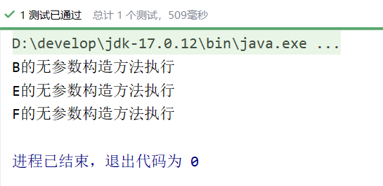

也可以将use-default-filters设置为true（不写就是true），并且采用exclude-filter方式排出哪些注解标注的Bean不参与实例化：

```xml
<?xml version="1.0" encoding="UTF-8"?>
<beans xmlns="http://www.springframework.org/schema/beans"
       xmlns:xsi="http://www.w3.org/2001/XMLSchema-instance"
       xmlns:context="http://www.springframework.org/schema/context"
       xsi:schemaLocation="http://www.springframework.org/schema/beans http://www.springframework.org/schema/beans/spring-beans.xsd
                           http://www.springframework.org/schema/context http://www.springframework.org/schema/context/spring-context.xsd">

    <context:component-scan base-package="bean">
        <context:exclude-filter type="annotation" expression="org.springframework.stereotype.Repository"/>
        <context:exclude-filter type="annotation" expression="org.springframework.stereotype.Service"/>
        <context:exclude-filter type="annotation" expression="org.springframework.stereotype.Controller"/>
    </context:component-scan>

</beans>
```

执行测试程序：

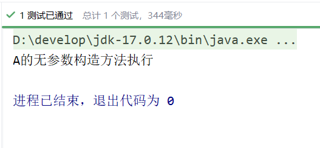

---

## 12.5 负责注入的注解

@Component @Controller @Service @Repository 这四个注解是用来声明Bean的，声明后这些Bean将被实例化。接下来我们看一下，如何给Bean的属性赋值。给Bean属性赋值需要用到这些注解：

- @Value
- @Autowired
- @Qualifier
- @Resource

### 12.5.1 @Value

当属性的类型是简单类型时，可以使用@Value注解进行注入。

```java
@Component
public class User {
    @Value(value = "zhangsan")
    private String name;
    @Value("20")
    private int age;

    @Override
    public String toString() {
        return "User{" +
                "name='" + name + '\'' +
                ", age=" + age +
                '}';
    }
}
```

开启包扫描：

```xml
<?xml version="1.0" encoding="UTF-8"?>
<beans xmlns="http://www.springframework.org/schema/beans"
       xmlns:xsi="http://www.w3.org/2001/XMLSchema-instance"
       xmlns:context="http://www.springframework.org/schema/context"
       xsi:schemaLocation="http://www.springframework.org/schema/beans http://www.springframework.org/schema/beans/spring-beans.xsd
                           http://www.springframework.org/schema/context http://www.springframework.org/schema/context/spring-context.xsd">
    
    <context:component-scan base-package="bean"/>
    
</beans>
```

```java
@Test
public void testValue(){
    ApplicationContext applicationContext = new ClassPathXmlApplicationContext("beans.xml");
    Object user = applicationContext.getBean("user");
    System.out.println(user);
}
```

执行结果：

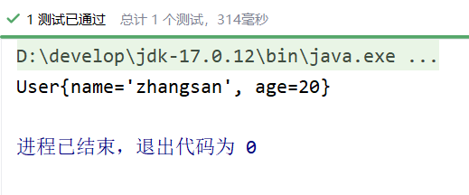

通过以上代码可以发现，我们并没有给属性提供setter方法，但仍然可以完成属性赋值。
如果提供setter方法，并且在setter方法上添加@Value注解，可以完成注入吗？尝试一下：

```java
@Component
public class User {
    
    private String name;

    private int age;

    @Value("李四")
    public void setName(String name) {
        this.name = name;
    }

    @Value("30")
    public void setAge(int age) {
        this.age = age;
    }

    @Override
    public String toString() {
        return "User{" +
                "name='" + name + '\'' +
                ", age=" + age +
                '}';
    }
}
```

执行结果：

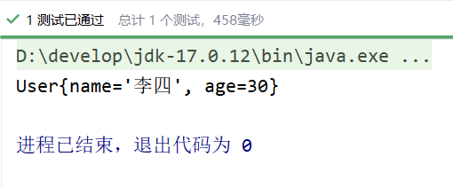

通过测试可以得知，@Value注解可以直接使用在属性上，也可以使用在setter方法上。都是可以的。都可以完成属性的赋值。
为了简化代码，以后我们一般不提供setter方法，直接在属性上使用@Value注解完成属性赋值。
出于好奇，我们再来测试一下，是否能够通过构造方法完成注入：

```java
@Component
public class User {

    private String name;

    private int age;

    public User(@Value("隔壁老王") String name, @Value("33") int age) {
        this.name = name;
        this.age = age;
    }

    @Override
    public String toString() {
        return "User{" +
                "name='" + name + '\'' +
                ", age=" + age +
                '}';
    }
}
```

执行结果：

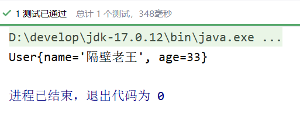

通过测试得知：@Value注解可以出现在属性上、setter方法上、以及构造方法的形参上。可见Spring给我们提供了多样化的注入。太灵活了。

---

### 12.5.2 @Autowired与@Qualifier

@Autowired注解可以用来注入**非简单类型**。被翻译为：自动连线的，或者自动装配。
单独使用@Autowired注解，**默认根据类型装配**。【默认是byType】
看一下它的源码：

```java
package org.springframework.beans.factory.annotation;

import ...

@Target({ElementType.CONSTRUCTOR, ElementType.METHOD, ElementType.PARAMETER, ElementType.FIELD, ElementType.ANNOTATION_TYPE})
@Retention(RetentionPolicy.RUNTIME)
@Documented
public @interface Autowired {
	boolean required() default true;
}
```

源码中有两处需要注意：

- 第一处：该注解可以标注在哪里？
  - 构造方法上
  - 方法上
  - 形参上
  - 属性上
  - 注解上
- 第二处：该注解有一个required属性，默认值是true，表示在注入的时候要求被注入的Bean必须是存在的，如果不存在则报错。如果required属性设置为false，表示注入的Bean存在或者不存在都没关系，存在的话就注入，不存在的话，也不报错。

**我们先在属性上使用@Autowired注解：**

```java
package dao;

public interface UserDao {
    void insert();
}
```

```java
@Repository //纳入bean管理
public class UserDaoForMySQL implements UserDao{
    @Override
    public void insert() {
        System.out.println("正在向mysql数据库插入User数据");
    }
}
```

```java
@Service // 纳入bean管理
public class UserService {

    @Autowired // 在属性上注入
    private UserDao userDao;
    
    // 没有提供构造方法和setter方法。

    public void save(){
        userDao.insert();
    }
}
```

```xml
<?xml version="1.0" encoding="UTF-8"?>
<beans xmlns="http://www.springframework.org/schema/beans"
       xmlns:xsi="http://www.w3.org/2001/XMLSchema-instance"
       xmlns:context="http://www.springframework.org/schema/context"
       xsi:schemaLocation="http://www.springframework.org/schema/beans http://www.springframework.org/schema/beans/spring-beans.xsd
                           http://www.springframework.org/schema/context http://www.springframework.org/schema/context/spring-context.xsd">
    
    <context:component-scan base-package="dao,service"/>
    
</beans>
```

```java
@Test
public void testAutowired(){
    ApplicationContext applicationContext = new ClassPathXmlApplicationContext("beans.xml");
    UserService userService = applicationContext.getBean("userService", UserService.class);
    userService.save();
}
```

执行结果：

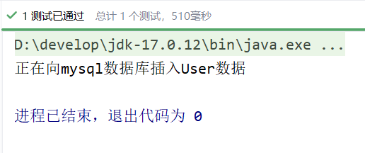

以上构造方法和setter方法都没有提供，经过测试，仍然可以注入成功。
**接下来，再来测试一下@Autowired注解出现在setter方法上：**

```java
@Service
public class UserService {

    private UserDao userDao;

    @Autowired
    public void setUserDao(UserDao userDao) {
        this.userDao = userDao;
    }

    public void save(){
        userDao.insert();
    }
}
```

执行结果：

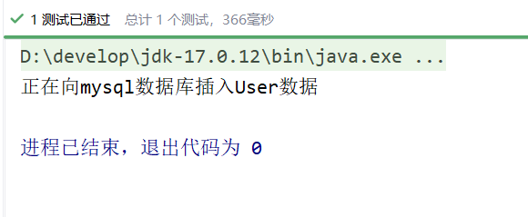

**我们再来看看能不能出现在构造方法上：**

```java
@Service
public class UserService {

    private UserDao userDao;

    public UserService(@Autowired UserDao userDao) {
        this.userDao = userDao;
    }

    public void save(){
        userDao.insert();
    }
}
```

执行结果：

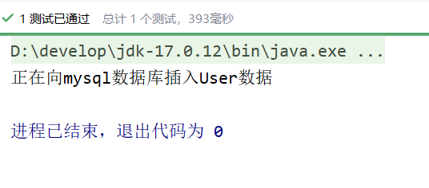

**当有参数的构造方法只有一个时，@Autowired注解可以省略。**

```java
@Service
public class UserService {

    private UserDao userDao;

    public UserService(UserDao userDao) {
        this.userDao = userDao;
    }

    public void save(){
        userDao.insert();
    }
}
```

执行结果：

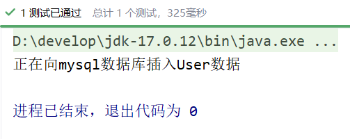

**当然，如果有多个构造方法，@Autowired肯定是不能省略的。**

```java
@Service
public class UserService {

    private UserDao userDao;

    public UserService(UserDao userDao) {
        this.userDao = userDao;
    }
    
    public UserService(){
        
    }

    public void save(){
        userDao.insert();
    }
}
```

执行结果：

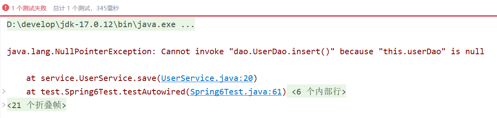

到此为止，我们已经清楚@Autowired注解可以出现在哪些位置了。
@Autowired注解默认是byType进行注入的，也就是说根据类型注入的，如果以上程序中，UserDao接口还有另外一个实现类，会出现问题吗？

```java
@Repository //纳入bean管理
public class UserDaoForOracle implements UserDao{
    @Override
    public void insert() {
        System.out.println("正在向Oracle数据库插入User数据");
    }
}
```

当你写完这个新的实现类之后，此时IDEA工具已经提示错误信息了：

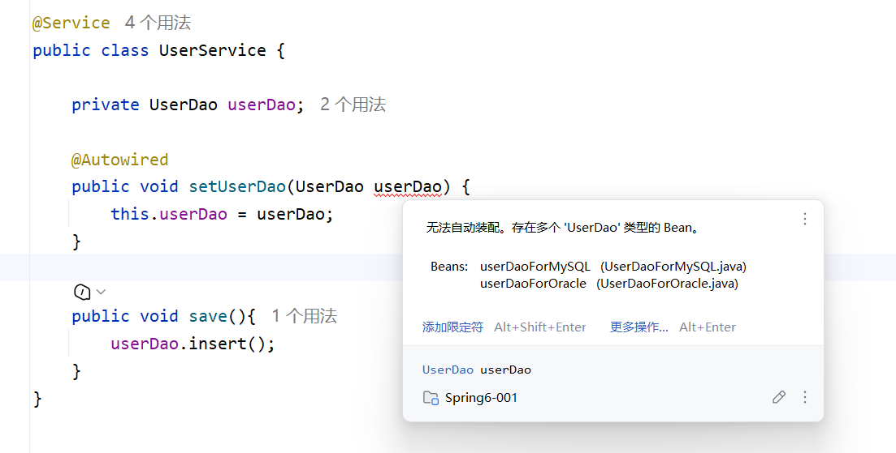

错误信息中说：不能装配，UserDao这个Bean的数量大于1.
怎么解决这个问题呢？**当然要byName，根据名称进行装配了。**
@Autowired注解和@Qualifier注解联合起来才可以根据名称进行装配，在@Qualifier注解中指定Bean名称。

```java
@Repository // 这里没有给bean起名，默认名字是：userDaoForOracle
public class UserDaoForOracle implements UserDao{
    @Override
    public void insert() {
        System.out.println("正在向Oracle数据库插入User数据");
    }
}
```

```java
@Service
public class UserService {

    private UserDao userDao;

    @Autowired
    @Qualifier("userDaoForOracle") // 这个是bean的名字。
    public void setUserDao(UserDao userDao) {
        this.userDao = userDao;
    }

    public void save(){
        userDao.insert();
    }
}
```

执行结果：

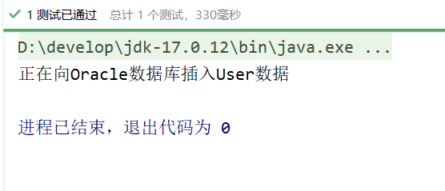

总结：

- @Autowired注解可以出现在：属性上、构造方法上、构造方法的参数上、setter方法上。
- 当带参数的构造方法只有一个，@Autowired注解可以省略。
- @Autowired注解默认根据类型注入。如果要根据名称注入的话，需要配合@Qualifier注解一起使用。

---

### 12.5.3 @Resource

@Resource注解也可以完成非简单类型注入。那它和@Autowired注解有什么区别？

- @Resource注解是JDK扩展包中的，也就是说属于JDK的一部分。所以该注解是标准注解，更加具有通用性。(JSR-250标准中制定的注解类型。JSR是Java规范提案。)
- @Autowired注解是Spring框架自己的。
- **@Resource注解默认根据名称装配byName，未指定name时，使用属性名作为name。通过name找不到的话会自动启动通过类型byType装配。**
- **@Autowired注解默认根据类型装配byType，如果想根据名称装配，需要配合@Qualifier注解一起用。**
- @Resource注解用在属性上、setter方法上。
- @Autowired注解用在属性上、setter方法上、构造方法上、构造方法参数上。

@Resource注解属于JDK扩展包，所以不在JDK当中，需要额外引入以下依赖：【**如果是JDK8的话不需要额外引入依赖。高于JDK11或低于JDK8需要引入以下依赖。**】

```xml
<!-- 如果你是Spring6+版本, 需要使用该依赖-->
<dependency>
    <groupId>jakarta.annotation</groupId>
    <artifactId>jakarta.annotation-api</artifactId>
    <version>2.1.1</version>
</dependency>
```

一定要注意：**如果你用Spring6，要知道Spring6不再支持JavaEE，它支持的是JakartaEE9。（Oracle把JavaEE贡献给Apache了，Apache把JavaEE的名字改成JakartaEE了，大家之前所接触的所有的  javax.*  包名统一修改为  jakarta.*包名了。）**

```xml
<!-- 如果你是Spring5-版本, 需要使用该依赖-->
<dependency>
    <groupId>javax.annotation</groupId>
    <artifactId>javax.annotation-api</artifactId>
    <version>1.3.2</version>
</dependency>
```

@Resource注解的源码如下：

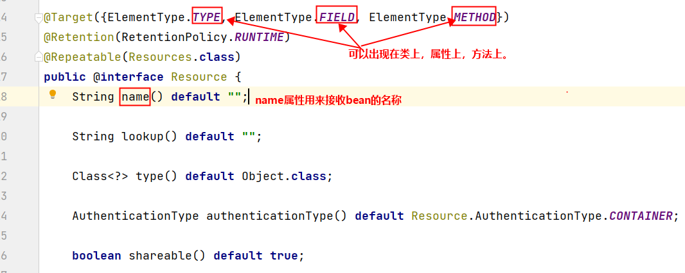

测试一下：

```java
@Repository("xyz")
public class UserDaoForOracle implements UserDao{
    @Override
    public void insert() {
        System.out.println("正在向Oracle数据库插入User数据");
    }
}
```

```java
@Service
public class UserService {

    @Resource(name = "xyz")
    private UserDao userDao;

    public void save(){
        userDao.insert();
    }
}
```

执行测试程序：

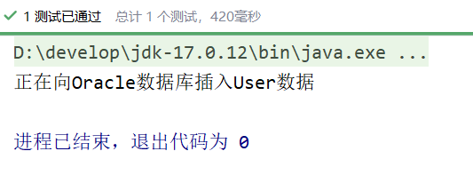

**我们把UserDaoForOracle的名字xyz修改为userDao，让这个Bean的名字和UserService类中的UserDao属性名一致：**

```java
@Repository("userDao")
public class UserDaoForOracle implements UserDao{
    @Override
    public void insert() {
        System.out.println("正在向Oracle数据库插入User数据");
    }
}
```

```java
@Service
public class UserService {

    @Resource
    private UserDao userDao;

    public void save(){
        userDao.insert();
    }
}
```

执行测试程序：

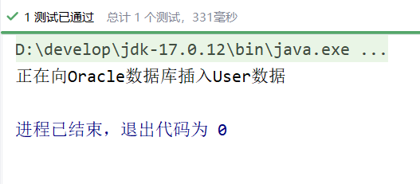

通过测试得知，当@Resource注解使用时没有指定name的时候，还是根据name进行查找，这个name是属性名。
接下来把UserService类中的属性名修改一下：

```java
@Service
public class UserService {

    @Resource
    private UserDao userDao2;

    public void save(){
        userDao2.insert();
    }
}
```

执行结果：

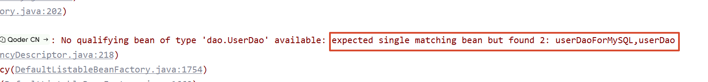

根据异常信息得知：显然当通过name找不到的时候，自然会启动byType进行注入。以上的错误是因为UserDao接口下有两个实现类导致的。所以根据类型注入就会报错。
我们再来看@Resource注解使用在setter方法上可以吗？

```java
@Service
public class UserService {

    private UserDao userDao;

    @Resource
    public void setUserDao(UserDao userDao) {
        this.userDao = userDao;
    }

    public void save(){
        userDao.insert();
    }
}
```

注意这个setter方法的方法名，setUserDao去掉set之后，将首字母变小写userDao，userDao就是name
执行结果：

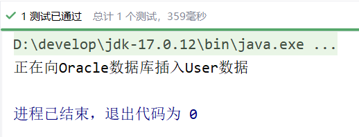

当然，也可以指定name：

```java
@Service
public class UserService {

    private UserDao userDao;

    @Resource(name = "userDaoForMySQL")
    public void setUserDao(UserDao userDao) {
        this.userDao = userDao;
    }

    public void save(){
        userDao.insert();
    }
}
```

执行结果：

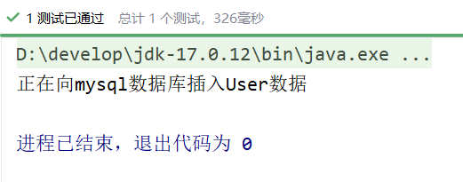

一句话总结@Resource注解：默认byName注入，没有指定name时把属性名当做name，根据name找不到时，才会byType注入。byType注入时，某种类型的Bean只能有一个。

## 12.6 全注解式开发

所谓的全注解开发就是不再使用spring配置文件了。写一个配置类来代替配置文件。

```java
@Configuration
@ComponentScan({"dao", "service"})
public class Spring6Configuration {
}
```

编写测试程序：不再new ClassPathXmlApplicationContext()对象了。

```java
@Test
public void testNoXml(){
    ApplicationContext applicationContext = new AnnotationConfigApplicationContext(Spring6Configuration.class);
    UserService userService = applicationContext.getBean("userService", UserService.class);
    userService.save();
}
```

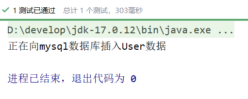

---

# 13. JdbcTemplate

JdbcTemplate是Spring提供的一个JDBC模板类，是对JDBC的封装，简化JDBC代码。
当然，你也可以不用，可以让Spring集成其它的ORM框架，例如：MyBatis、Hibernate等。

> 这里跳过不学,后续遇到用到再回来补

---

# 14. GoF之代理模式

## 14.1 对代理模式的理解

**生活场景1**：牛村的牛二看上了隔壁村小花，牛二不好意思直接找小花，于是牛二找来了媒婆王妈妈。这里面就有一个非常典型的代理模式。牛二不能和小花直接对接，只能找一个中间人。其中王妈妈是代理类，牛二是目标类。王妈妈代替牛二和小花先见个面。（现实生活中的婚介所）【在程序中，对象A和对象B无法直接交互时。】

**生活场景2**：你刚到北京，要租房子，可以自己找，也可以找链家帮你找。其中链家是代理类，你是目标类。你们两个都有共同的行为：找房子。不过链家除了满足你找房子，另外会收取一些费用的。(现实生活中的房产中介)【在程序中，功能需要增强时。】

**西游记场景**：八戒和高小姐的故事。八戒要强抢民女高翠兰。悟空得知此事之后怎么做的？悟空幻化成高小姐的模样。代替高小姐与八戒会面。其中八戒是客户端程序。悟空是代理类。高小姐是目标类。那天夜里，在八戒眼里，眼前的就是高小姐，对于八戒来说，他是不知道眼前的高小姐是悟空幻化的，在他内心里这就是高小姐。所以悟空代替高小姐和八戒亲了嘴儿。这是非常典型的代理模式实现的保护机制。

**代理模式中有一个非常重要的特点：对于客户端程序来说，使用代理对象时就像在使用目标对象一样。【在程序中，目标需要被保护时】**

**业务场景**：系统中有A、B、C三个模块，使用这些模块的前提是需要用户登录，也就是说在A模块中要编写判断登录的代码，B模块中也要编写，C模块中还要编写，这些判断登录的代码反复出现，显然代码没有得到复用，可以为A、B、C三个模块提供一个代理，在代理当中写一次登录判断即可。代理的逻辑是：请求来了之后，判断用户是否登录了，如果已经登录了，则执行对应的目标，如果没有登录则跳转到登录页面。【在程序中，目标不但受到保护，并且代码也得到了复用。】

代理模式是GoF23种设计模式之一。属于结构型设计模式。

代理模式的作用是：为其他对象提供一种代理以控制对这个对象的访问。在某些情况下，一个客户不想或者不能直接引用一个对象，此时可以通过一个称之为“代理”的第三者来实现间接引用。代理对象可以在客户端和目标对象之间起到中介的作用，并且可以通过代理对象去掉客户不应该看到的内容和服务或者添加客户需要的额外服务。 通过引入一个新的对象来实现对真实对象的操作或者将新的对象作为真实对象的一个替身，这种实现机制即为代理模式，通过引入代理对象来间接访问一个对象，这就是代理模式的模式动机。

代理模式中的角色：

- 代理类（代理主题）
- 目标类（真实主题）
- 代理类和目标类的公共接口（抽象主题）：客户端在使用代理类时就像在使用目标类，不被客户端所察觉，所以代理类和目标类要有共同的行为，也就是实现共同的接口。

代理模式的类图：

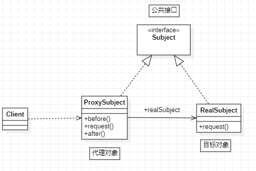

代理模式在代码实现上，包括两种形式：

- 静态代理
- 动态代理

---

## 14.2 静态代理

现在有这样一个接口和实现类：

```java
public interface OrderService {
    /**
     * 生成订单
     */
    void generate();

    /**
     * 查看订单详情
     */
    void detail();

    /**
     * 修改订单
     */
    void modify();
}
```

```java
public class OrderServiceImpl implements OrderService {
    @Override
    public void generate() {
        try {
            Thread.sleep(1234);
        } catch (InterruptedException e) {
            e.printStackTrace();
        }
        System.out.println("订单已生成");
    }

    @Override
    public void detail() {
        try {
            Thread.sleep(2541);
        } catch (InterruptedException e) {
            e.printStackTrace();
        }
        System.out.println("订单信息如下：******");
    }

    @Override
    public void modify() {
        try {
            Thread.sleep(1010);
        } catch (InterruptedException e) {
            e.printStackTrace();
        }
        System.out.println("订单已修改");
    }
}
```

其中Thread.sleep()方法的调用是为了模拟操作耗时。
项目已上线，并且运行正常，只是客户反馈系统有一些地方运行较慢，要求项目组对系统进行优化。于是项目负责人就下达了这个需求。首先需要搞清楚是哪些业务方法耗时较长，于是让我们统计每个业务方法所耗费的时长。如果是你，你该怎么做呢？
第一种方案：直接修改Java源代码，在每个业务方法中添加统计逻辑，如下：

```java
public class OrderServiceImpl implements OrderService {
    @Override
    public void generate() {
        long begin = System.currentTimeMillis();
        try {
            Thread.sleep(1234);
        } catch (InterruptedException e) {
            e.printStackTrace();
        }
        System.out.println("订单已生成");
        long end = System.currentTimeMillis();
        System.out.println("耗费时长"+(end - begin)+"毫秒");
    }

    @Override
    public void detail() {
        long begin = System.currentTimeMillis();
        try {
            Thread.sleep(2541);
        } catch (InterruptedException e) {
            e.printStackTrace();
        }
        System.out.println("订单信息如下：******");
        long end = System.currentTimeMillis();
        System.out.println("耗费时长"+(end - begin)+"毫秒");
    }

    @Override
    public void modify() {
        long begin = System.currentTimeMillis();
        try {
            Thread.sleep(1010);
        } catch (InterruptedException e) {
            e.printStackTrace();
        }
        System.out.println("订单已修改");
        long end = System.currentTimeMillis();
        System.out.println("耗费时长"+(end - begin)+"毫秒");
    }
}
```

需求可以满足，但显然是违背了OCP开闭原则。这种方案不可取。
第二种方案：编写一个子类继承OrderServiceImpl，在子类中重写每个方法，代码如下：

```java
public class OrderServiceImplSub extends OrderServiceImpl{
    @Override
    public void generate() {
        long begin = System.currentTimeMillis();
        super.generate();
        long end = System.currentTimeMillis();
        System.out.println("耗时"+(end - begin)+"毫秒");
    }

    @Override
    public void detail() {
        long begin = System.currentTimeMillis();
        super.detail();
        long end = System.currentTimeMillis();
        System.out.println("耗时"+(end - begin)+"毫秒");
    }

    @Override
    public void modify() {
        long begin = System.currentTimeMillis();
        super.modify();
        long end = System.currentTimeMillis();
        System.out.println("耗时"+(end - begin)+"毫秒");
    }
}
```

这种方式可以解决，但是存在两个问题：

- 第一个问题：假设系统中有100个这样的业务类，需要提供100个子类，并且之前写好的创建Service对象的代码，都要修改为创建子类对象。
- 第二个问题：由于采用了继承的方式，导致代码之间的耦合度较高。

这种方案也不可取。

第三种方案：使用代理模式（这里采用静态代理）
可以为OrderService接口提供一个代理类。

```java
public class OrderServiceProxy implements OrderService{ // 代理对象

    // 目标对象
    private OrderService orderService;

    // 通过构造方法将目标对象传递给代理对象
    public OrderServiceProxy(OrderService orderService) {
        this.orderService = orderService;
    }

    @Override
    public void generate() {
        long begin = System.currentTimeMillis();
        // 执行目标对象的目标方法
        orderService.generate();
        long end = System.currentTimeMillis();
        System.out.println("耗时"+(end - begin)+"毫秒");
    }

    @Override
    public void detail() {
        long begin = System.currentTimeMillis();
        // 执行目标对象的目标方法
        orderService.detail();
        long end = System.currentTimeMillis();
        System.out.println("耗时"+(end - begin)+"毫秒");
    }

    @Override
    public void modify() {
        long begin = System.currentTimeMillis();
        // 执行目标对象的目标方法
        orderService.modify();
        long end = System.currentTimeMillis();
        System.out.println("耗时"+(end - begin)+"毫秒");
    }
}
```

这种方式的优点：符合OCP开闭原则，同时采用的是关联关系，所以程序的耦合度较低。所以这种方案是被推荐的。
编写客户端程序：

```java
public class Client {
    public static void main(String[] args) {
        // 创建目标对象
        OrderService target = new OrderServiceImpl();
        // 创建代理对象
        OrderService proxy = new OrderServiceProxy(target);
        // 调用代理对象的代理方法
        proxy.generate();
        proxy.modify();
        proxy.detail();
    }
}
```

运行结果：

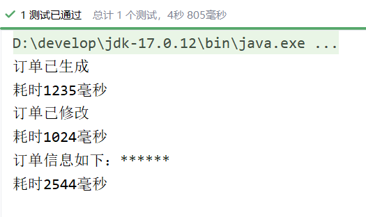

以上就是代理模式中的静态代理，其中OrderService接口是代理类和目标类的共同接口。OrderServiceImpl是目标类。OrderServiceProxy是代理类。
大家思考一下：如果系统中业务接口很多，一个接口对应一个代理类，显然也是不合理的，会导致类爆炸。怎么解决这个问题？动态代理可以解决。因为在动态代理中可以在内存中动态的为我们生成代理类的字节码。代理类不需要我们写了。类爆炸解决了，而且代码只需要写一次，代码也会得到复用。

---

## 14.3 动态代理

在程序运行阶段，在内存中动态生成代理类，被称为动态代理，目的是为了减少代理类的数量。解决代码复用的问题。
在内存当中动态生成类的技术常见的包括：

- JDK动态代理技术：只能代理接口。
- CGLIB动态代理技术：CGLIB(Code Generation Library)是一个开源项目。是一个强大的，高性能，高质量的Code生成类库，它可以在运行期扩展Java类与实现Java接口。它既可以代理接口，又可以代理类，**底层是通过继承的方式实现的**。性能比JDK动态代理要好。**（底层有一个小而快的字节码处理框架ASM。）**
- Javassist动态代理技术：Javassist是一个开源的分析、编辑和创建Java字节码的类库。是由东京工业大学的数学和计算机科学系的 Shigeru Chiba （千叶 滋）所创建的。它已加入了开放源代码JBoss 应用服务器项目，通过使用Javassist对字节码操作为JBoss实现动态"AOP"框架。

### 14.3.1 JDK动态代理

我们还是使用静态代理中的例子：一个接口和一个实现类。

```java
public interface OrderService {
    /**
     * 生成订单
     */
    void generate();

    /**
     * 查看订单详情
     */
    void detail();

    /**
     * 修改订单
     */
    void modify();
}
```

```java
public class OrderServiceImpl implements OrderService {
    @Override
    public void generate() {
        try {
            Thread.sleep(1234);
        } catch (InterruptedException e) {
            e.printStackTrace();
        }
        System.out.println("订单已生成");
    }

    @Override
    public void detail() {
        try {
            Thread.sleep(2541);
        } catch (InterruptedException e) {
            e.printStackTrace();
        }
        System.out.println("订单信息如下：******");
    }

    @Override
    public void modify() {
        try {
            Thread.sleep(1010);
        } catch (InterruptedException e) {
            e.printStackTrace();
        }
        System.out.println("订单已修改");
    }
}
```

我们在静态代理的时候，除了以上一个接口和一个实现类之外，是不是要写一个代理类UserServiceProxy呀！在动态代理中UserServiceProxy代理类是可以动态生成的。这个类不需要写。我们直接写客户端程序即可：

```java
@Test
public void test() {
    // 第一步：创建目标对象
    OrderService target = new OrderServiceImpl();
    // 第二步：创建代理对象
    OrderService orderServiceProxy = Proxy.newProxyInstance(target.getClass().getClassLoader(),
                                                            target.getClass().getInterfaces(),
                                                            调用处理器对象);
    // 第三步：调用代理对象的代理方法
    orderServiceProxy.detail();
    orderServiceProxy.modify();
    orderServiceProxy.generate();
}
```

以上第二步创建代理对象是需要大家理解的：
`OrderService orderServiceProxy = Proxy.newProxyInstance(target.getClass().getClassLoader(), target.getClass().getInterfaces(), 调用处理器对象);`
这行代码做了两件事：

- 第一件事：在内存中生成了代理类的字节码
- 第二件事：创建代理对象

Proxy类全名：`java.lang.reflect.Proxy`。这是JDK提供的一个类（所以称为JDK动态代理）。主要是通过这个类在内存中生成代理类的字节码。
其中`newProxyInstance()`方法有三个参数：

- 第一个参数：类加载器。在内存中生成了字节码，要想执行这个字节码，也是需要先把这个字节码加载到内存当中的。所以要指定使用哪个类加载器加载。
- 第二个参数：接口类型。代理类和目标类实现相同的接口，所以要通过这个参数告诉JDK动态代理生成的类要实现哪些接口。
- 第三个参数：调用处理器。这是一个JDK动态代理规定的接口，接口全名：`java.lang.reflect.InvocationHandler`。显然这是一个回调接口，也就是说调用这个接口中方法的程序已经写好了，就差这个接口的实现类了。

所以接下来我们要写一下`java.lang.reflect.InvocationHandler`接口的实现类，并且实现接口中的方法，代码如下：

```java
package service;

import java.lang.reflect.InvocationHandler;
import java.lang.reflect.Method;

public class TimerInvocationHandler implements InvocationHandler {
    @Override
    public Object invoke(Object proxy, Method method, Object[] args) throws Throwable {
        return null;
    }
}
```

InvocationHandler接口中有一个方法invoke，这个invoke方法上有三个参数：

- 第一个参数：Object proxy。代理对象。设计这个参数只是为了后期的方便，如果想在invoke方法中使用代理对象的话，尽管通过这个参数来使用。
- 第二个参数：Method method。目标方法。
- 第三个参数：Object[] args。目标方法调用时要传的参数。

我们将来肯定是要调用“目标方法”的，但要调用目标方法的话，需要“目标对象”的存在，“目标对象”从哪儿来呢？我们可以给TimerInvocationHandler提供一个构造方法，可以通过这个构造方法传过来“目标对象”，代码如下：

```java
public class TimerInvocationHandler implements InvocationHandler {
    // 目标对象
    private Object target;
    
    // 通过构造方法来传目标对象
    public TimerInvocationHandler(Object target) {
        this.target = target;
    }
    
    @Override
    public Object invoke(Object proxy, Method method, Object[] args) throws Throwable {
        return null;
    }
}
```

有了目标对象我们就可以在invoke()方法中调用目标方法了。代码如下：

```java
public class TimerInvocationHandler implements InvocationHandler {
    // 目标对象
    private Object target;

    // 通过构造方法来传目标对象
    public TimerInvocationHandler(Object target) {
        this.target = target;
    }

    @Override
    public Object invoke(Object proxy, Method method, Object[] args) throws Throwable {
        // 目标执行之前增强
        long begin = System.currentTimeMillis();
        // 调用目标对象的目标方法
        Object retValue = method.invoke(target, args);
        // 目标执行之后增强
        long end = System.currentTimeMillis();
        System.out.println("耗时"+(end - begin)+"毫秒");
        // 一定要记得返回
        return retValue;
    }
}
```

到此为止，调用处理器就完成了。接下来，应该继续完善Client程序：

```java
@Test
public void test() {
    // 创建目标对象
    OrderService target = new OrderServiceImpl();
    // 创建代理对象
    OrderService orderServiceProxy = (OrderService) Proxy.newProxyInstance(target.getClass().getClassLoader(),
            target.getClass().getInterfaces(),
            new TimerInvocationHandler(target));
    // 调用代理对象的代理方法
    orderServiceProxy.detail();
    orderServiceProxy.modify();
    orderServiceProxy.generate();
}
```

大家可能会比较好奇：那个InvocationHandler接口中的invoke()方法没看见在哪里调用呀？
注意：当你调用代理对象的代理方法的时候，注册在InvocationHandler接口中的invoke()方法会被调用。也就是上面代码第24 25 26行，这三行代码中任意一行代码执行，注册在InvocationHandler接口中的invoke()方法都会被调用。
执行结果：

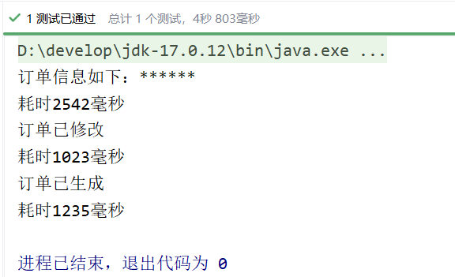

不过我们看以下这个代码确实有点繁琐，对于客户端来说，用起来不方便：

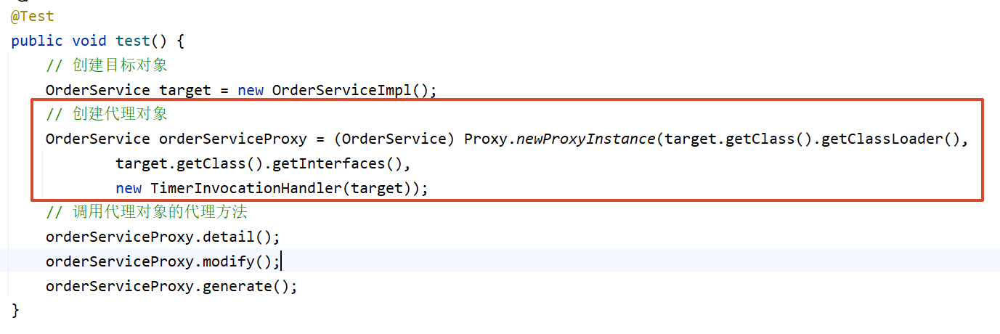

我们可以提供一个工具类：ProxyUtil，封装一个方法：

```java
public class ProxyUtil {
    public static Object newProxyInstance(Object target) {
        return Proxy.newProxyInstance(target.getClass().getClassLoader(), 
                target.getClass().getInterfaces(), 
                new TimerInvocationHandler(target));
    }
}
```

这样客户端代码就不需要写那么繁琐了：

```java
@Test
public void test() {
    // 创建目标对象
    OrderService target = new OrderServiceImpl();
    // 创建代理对象
    OrderService orderServiceProxy = (OrderService) ProxyUtil.newProxyInstance(target);
    // 调用代理对象的代理方法
    orderServiceProxy.detail();
    orderServiceProxy.modify();
    orderServiceProxy.generate();
}
```

### 14.3.2 CGLIB动态代理

CGLIB既可以代理接口，又可以代理类。底层采用继承的方式实现。所以被代理的目标类不能使用final修饰。
使用CGLIB，需要引入它的依赖：

```xml
<dependency>
  <groupId>cglib</groupId>
  <artifactId>cglib</artifactId>
  <version>3.3.0</version>
</dependency>
```

我们准备一个没有实现接口的类，如下：

```java
public class UserService {

    public void login(){
        System.out.println("用户正在登录系统....");
    }

    public void logout(){
        System.out.println("用户正在退出系统....");
    }
}
```

使用CGLIB在内存中为UserService类生成代理类，并创建对象：

```java
@Test
public void test() {
    // 创建字节码增强器
    Enhancer enhancer = new Enhancer();
    // 告诉cglib要继承哪个类
    enhancer.setSuperclass(UserService.class);
    // 设置回调接口
    enhancer.setCallback(方法拦截器对象);
    // 生成源码，编译class，加载到JVM，并创建代理对象
    UserService userServiceProxy = (UserService)enhancer.create();

    userServiceProxy.login();
    userServiceProxy.logout();
}
```

和JDK动态代理原理差不多，在CGLIB中需要提供的不是InvocationHandler，而是：net.sf.cglib.proxy.MethodInterceptor
编写MethodInterceptor接口实现类：

```java
package service;

import net.sf.cglib.proxy.MethodInterceptor;
import net.sf.cglib.proxy.MethodProxy;

import java.lang.reflect.Method;

public class TimerMethodInterceptor implements MethodInterceptor {
    @Override
    public Object intercept(Object target, Method method, Object[] objects, MethodProxy methodProxy) throws Throwable {
        return null;
    }
}
```

MethodInterceptor接口中有一个方法intercept()，该方法有4个参数：
第一个参数：目标对象
第二个参数：目标方法
第三个参数：目标方法调用时的实参
第四个参数：代理方法
在MethodInterceptor的intercept()方法中调用目标以及添加增强：

```java
public class TimerMethodInterceptor implements MethodInterceptor {
    @Override
    public Object intercept(Object target, Method method, Object[] objects, MethodProxy methodProxy) throws Throwable {
        // 前增强
        long begin = System.currentTimeMillis();
        // 调用目标
        Object retValue = methodProxy.invokeSuper(target, objects);
        // 后增强
        long end = System.currentTimeMillis();
        System.out.println("耗时" + (end - begin) + "毫秒");
        // 一定要返回
        return retValue;
    }
}
```

回调已经写完了，可以修改客户端程序了：

```java
@Test
public void test() {
    // 创建字节码增强器
    Enhancer enhancer = new Enhancer();
    // 告诉cglib要继承哪个类
    enhancer.setSuperclass(UserService.class);
    // 设置回调接口
    enhancer.setCallback(new TimerMethodInterceptor());
    // 生成源码，编译class，加载到JVM，并创建代理对象
    UserService userServiceProxy = (UserService)enhancer.create();

    userServiceProxy.login();
    userServiceProxy.logout();
}
```

对于高版本的JDK，如果使用CGLIB，需要在启动项中添加两个启动参数：


- --add-opens java.base/java.lang=ALL-UNNAMED
- --add-opens java.base/sun.net.util=ALL-UNNAMED

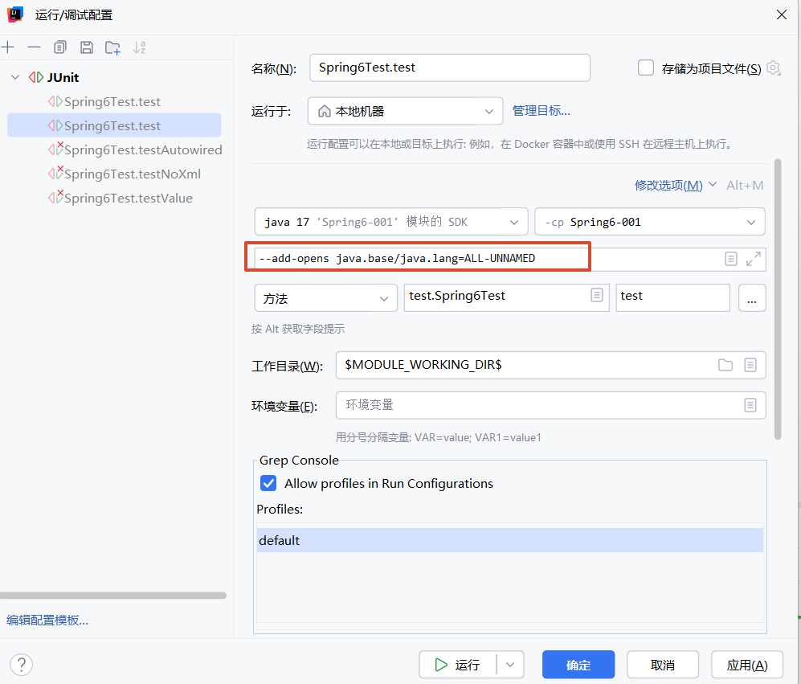

如果在test里面的话只加上面那个

执行结果：

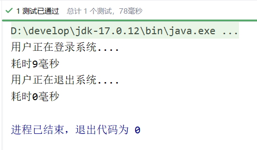

---

# 15. 面向切面编程AOP

IoC使软件组件松耦合。AOP让你能够捕捉系统中经常使用的功能，把它转化成组件。
AOP（Aspect Oriented Programming）：面向切面编程，面向方面编程。（AOP是一种编程技术）
AOP是对OOP的补充延伸。
AOP底层使用的就是动态代理来实现的。
Spring的AOP使用的动态代理是：JDK动态代理 + CGLIB动态代理技术。Spring在这两种动态代理中灵活切换，如果是代理接口，会默认使用JDK动态代理，如果要代理某个类，这个类没有实现接口，就会切换使用CGLIB。当然，你也可以强制通过一些配置让Spring只使用CGLIB。

## 15.1 AOP介绍

一般一个系统当中都会有一些系统服务，例如：日志、事务管理、安全等。这些系统服务被称为：**交叉业务**
这些**交叉业务**几乎是通用的，不管你是做银行账户转账，还是删除用户数据。日志、事务管理、安全，这些都是需要做的。
如果在每一个业务处理过程当中，都掺杂这些交叉业务代码进去的话，存在两方面问题：

- 第一：交叉业务代码在多个业务流程中反复出现，显然这个交叉业务代码没有得到复用。并且修改这些交叉业务代码的话，需要修改多处。
- 第二：程序员无法专注核心业务代码的编写，在编写核心业务代码的同时还需要处理这些交叉业务。

使用AOP可以很轻松的解决以上问题。
请看下图，可以帮助你快速理解AOP的思想：

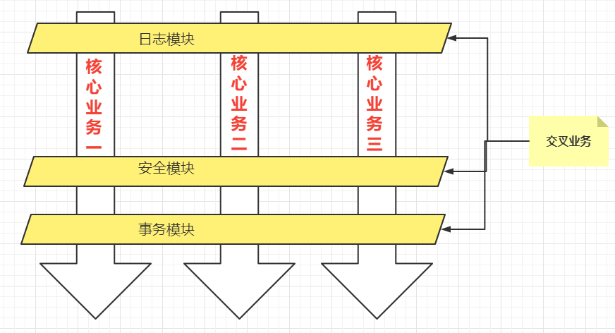

**用一句话总结AOP：将与核心业务无关的代码独立的抽取出来，形成一个独立的组件，然后以横向交叉的方式应用到业务流程当中的过程被称为AOP。**
**AOP的优点：**

- **第一：代码复用性增强。**
- **第二：代码易维护。**
- **第三：使开发者更关注业务逻辑。**

---

## 15.2 AOP的七大术语

```java
public class UserService{
    public void do1(){
        System.out.println("do 1");
    }
    public void do2(){
        System.out.println("do 2");
    }
    public void do3(){
        System.out.println("do 3");
    }
    public void do4(){
        System.out.println("do 4");
    }
    public void do5(){
        System.out.println("do 5");
    }
    // 核心业务方法
    public void service(){
        do1();
        do2();
        do3();
        do5();
    }
}
```

- **连接点 Joinpoint**
  - 在程序的整个执行流程中，**可以织入**切面的位置。方法的执行前后，异常抛出之后等位置。
- **切点 Pointcut**
  - 在程序执行流程中，**真正织入**切面的方法。（一个切点对应多个连接点）
- **通知 Advice**
  - 通知又叫增强，就是具体你要织入的代码。
  - 通知包括：
    - 前置通知
    - 后置通知
    - 环绕通知
    - 异常通知
    - 最终通知
- **切面 Aspect**
  - **切点 + 通知就是切面。**
- 织入 Weaving
  - 把通知应用到目标对象上的过程。
- 代理对象 Proxy
  - 一个目标对象被织入通知后产生的新对象。
- 目标对象 Target
  - 被织入通知的对象。

通过下图，大家可以很好的理解AOP的相关术语：

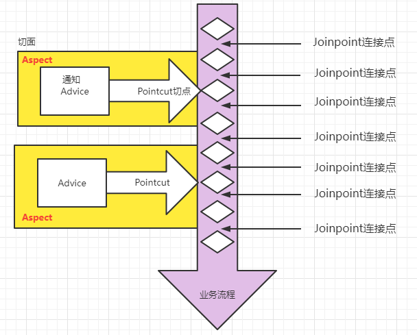

---

## 15.3 切点表达式

切点表达式用来定义通知（Advice）往哪些方法上切入。
切入点表达式语法格式：

```
execution([访问控制权限修饰符] 返回值类型 [全限定类名]方法名(形式参数列表) [异常])
```

访问控制权限修饰符：

- 可选项。
- 没写，就是4个权限都包括。
- 写public就表示只包括公开的方法。

返回值类型：

- 必填项。
- * 表示返回值类型任意。

全限定类名：

- 可选项。
- 两个点“..”代表当前包以及子包下的所有类。
- 省略时表示所有的类。

方法名：

- 必填项。
- *表示所有方法。
- set*表示所有的set方法。

形式参数列表：

- 必填项
- () 表示没有参数的方法
- (..) 参数类型和个数随意的方法
- (*) 只有一个参数的方法
- (*, String) 第一个参数类型随意，第二个参数是String的。

异常：

- 可选项。
- 省略时表示任意异常类型。

理解以下的切点表达式：

```java
execution(public * com.powernode.mall.service.*.delete*(..))
```

```java
execution(* com.powernode.mall..*(..))
```

```java
execution(* *(..))
```

---

## 15.4 使用Spring的AOP

Spring对AOP的实现包括以下3种方式：

- **第一种方式：Spring框架结合AspectJ框架实现的AOP，基于注解方式。**
- **第二种方式：Spring框架结合AspectJ框架实现的AOP，基于XML方式。**
- 第三种方式：Spring框架自己实现的AOP，基于XML配置方式。

实际开发中，都是Spring+AspectJ来实现AOP。所以我们重点学习第一种和第二种方式。
什么是AspectJ？（Eclipse组织的一个支持AOP的框架。AspectJ框架是独立于Spring框架之外的一个框架，Spring框架用了AspectJ） 
AspectJ项目起源于帕洛阿尔托（Palo Alto）研究中心（缩写为PARC）。该中心由Xerox集团资助，Gregor Kiczales领导，从1997年开始致力于AspectJ的开发，1998年第一次发布给外部用户，2001年发布1.0 release。为了推动AspectJ技术和社团的发展，PARC在2003年3月正式将AspectJ项目移交给了Eclipse组织，因为AspectJ的发展和受关注程度大大超出了PARC的预期，他们已经无力继续维持它的发展。

### 15.4.1 准备工作

使用Spring+AspectJ的AOP需要引入的依赖如下：

```xml
<!--spring context依赖-->
<dependency>
  <groupId>org.springframework</groupId>
  <artifactId>spring-context</artifactId>
  <version>6.0.0-M2</version>
</dependency>
<!--spring aop依赖-->
<dependency>
  <groupId>org.springframework</groupId>
  <artifactId>spring-aop</artifactId>
  <version>6.0.0-M2</version>
</dependency>
<!--spring aspects依赖-->
<dependency>
  <groupId>org.springframework</groupId>
  <artifactId>spring-aspects</artifactId>
  <version>6.0.0-M2</version>
</dependency>
```

>引入spring context依赖会自动引入spring aop依赖

Spring配置文件中添加context命名空间和aop命名空间

```xml
<?xml version="1.0" encoding="UTF-8"?>
<beans xmlns="http://www.springframework.org/schema/beans"
       xmlns:xsi="http://www.w3.org/2001/XMLSchema-instance"
       xmlns:context="http://www.springframework.org/schema/context"
       xmlns:aop="http://www.springframework.org/schema/aop"
       xsi:schemaLocation="http://www.springframework.org/schema/beans http://www.springframework.org/schema/beans/spring-beans.xsd
                           http://www.springframework.org/schema/context http://www.springframework.org/schema/context/spring-context.xsd
                           http://www.springframework.org/schema/aop http://www.springframework.org/schema/aop/spring-aop.xsd">

</beans>
```

### 15.4.2 基于AspectJ的AOP注解式开发

#### 实现步骤

第一步：定义目标类以及目标方法s
