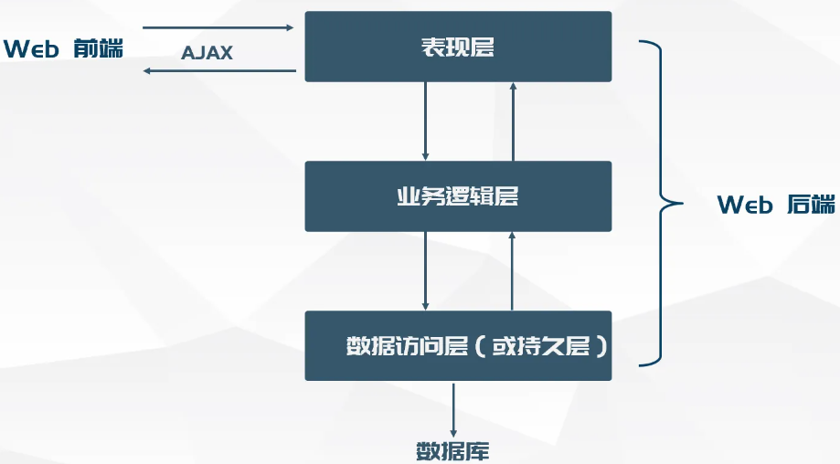
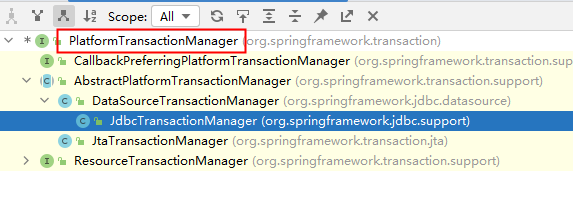
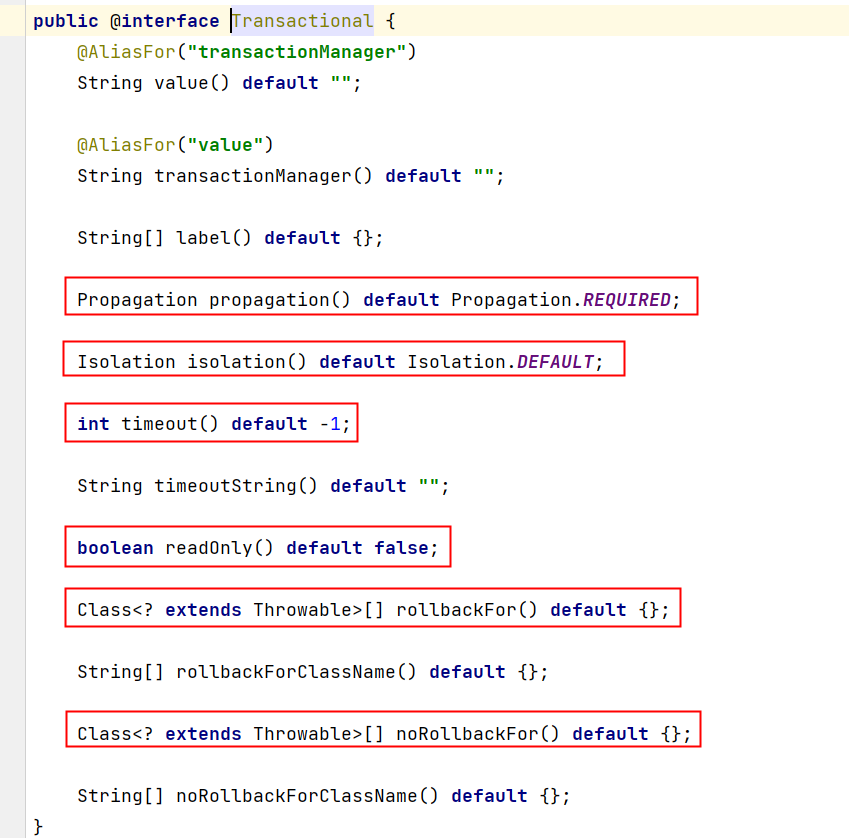
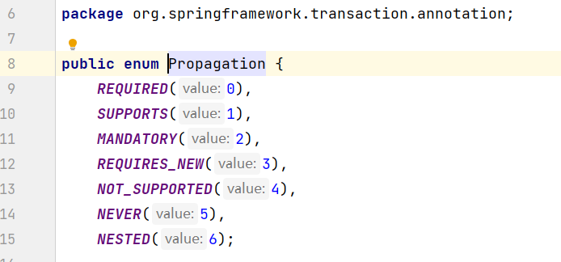
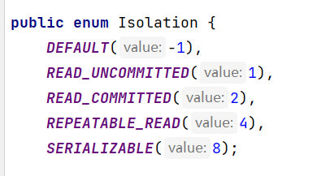
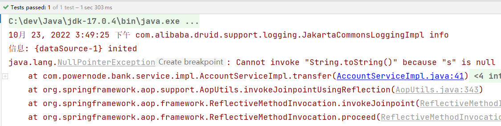
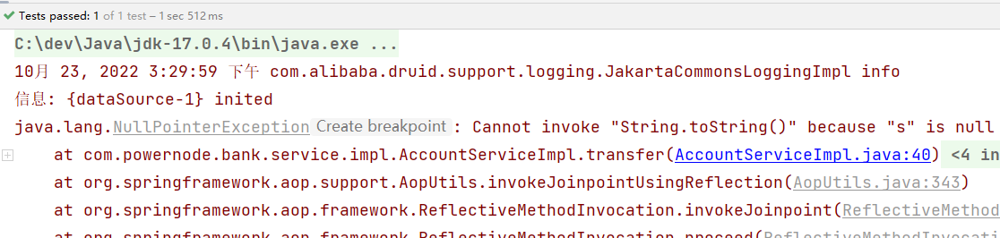
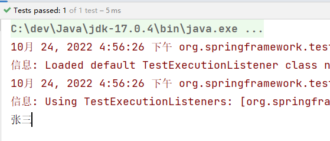
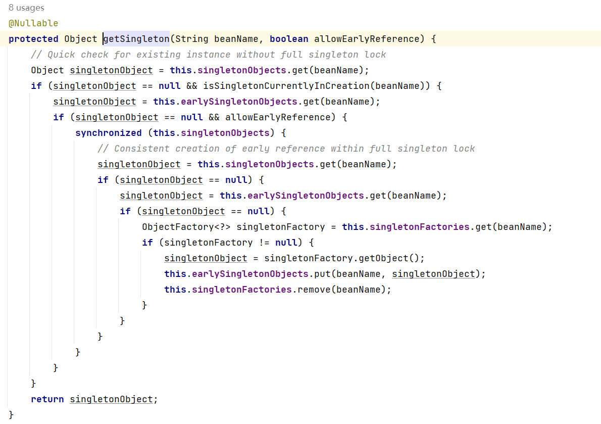

# 16. Spring对事务的支持

## 16.1 事务概述

- 什么是事务
  - 在一个业务流程当中，通常需要多条DML（insert delete update）语句共同联合才能完成，这多条DML语句必须同时成功，或者同时失败，这样才能保证数据的安全。
  - 多条DML要么同时成功，要么同时失败，这叫做事务。
  - 事务：Transaction（tx）
- 事务的四个处理过程：
  - 第一步：开启事务 (start transaction)
  - 第二步：执行核心业务代码
  - 第三步：提交事务（如果核心业务处理过程中没有出现异常）(commit transaction)
  - 第四步：回滚事务（如果核心业务处理过程中出现异常）(rollback transaction)
- 事务的四个特性：
  - A 原子性：事务是最小的工作单元，不可再分。
  - C 一致性：事务要求要么同时成功，要么同时失败。事务前和事务后的总量不变。
  - I 隔离性：事务和事务之间因为有隔离性，才可以保证互不干扰。
  - D 持久性：持久性是事务结束的标志。

## 16.2 引入事务场景

以银行账户转账为例学习事务。两个账户act-001和act-002。act-001账户向act-002账户转账10000，必须同时成功，或者同时失败。（一个减成功，一个加成功， 这两条update语句必须同时成功，或同时失败。）
连接数据库的技术采用Spring框架的JdbcTemplate。
采用三层架构搭建：



> 这里不进行展示了, 没那个必要, 直接进重点

---

## 16.3 Spring对事务的支持

### Spring实现事务的两种方式

- 编程式事务
  - 通过编写代码的方式来实现事务的管理。
- 声明式事务
  - 基于注解方式
  - 基于XML配置方式

### Spring事务管理API

Spring对事务的管理底层实现方式是基于AOP实现的。采用AOP的方式进行了封装。所以Spring专门针对事务开发了一套API，API的核心接口如下：



`PlatformTransactionManager`接口：spring事务管理器的核心接口。在**Spring6**中它有两个实现：

- `DataSourceTransactionManager`：支持`JdbcTemplate、MyBatis、Hibernate`等事务管理。
- `JtaTransactionManager`：支持分布式事务管理。

如果要在Spring6中使用`JdbcTemplate`，就要使用`DataSourceTransactionManager`来管理事务。（Spring内置写好了，可以直接用。）

### 声明式事务之注解实现方式

- 第一步：在spring配置文件中配置事务管理器。

```xml
<bean id="transactionManager" class="org.springframework.jdbc.datasource.DataSourceTransactionManager">
  <property name="dataSource" ref="dataSource"/>
</bean>
```

- 第二步：在spring配置文件中引入tx命名空间。

```xml
<?xml version="1.0" encoding="UTF-8"?>
<beans xmlns="http://www.springframework.org/schema/beans"
       xmlns:xsi="http://www.w3.org/2001/XMLSchema-instance"
       xmlns:context="http://www.springframework.org/schema/context"
       xmlns:tx="http://www.springframework.org/schema/tx"
       xsi:schemaLocation="http://www.springframework.org/schema/beans http://www.springframework.org/schema/beans/spring-beans.xsd
                           http://www.springframework.org/schema/context http://www.springframework.org/schema/context/spring-context.xsd
                           http://www.springframework.org/schema/tx http://www.springframework.org/schema/tx/spring-tx.xsd">
```

- 第三步：在spring配置文件中配置“事务注解驱动器”，开始注解的方式控制事务。

```xml
<tx:annotation-driven transaction-manager="transactionManager"/>
```

- 整体xml文件内容

```xml
<?xml version="1.0" encoding="UTF-8"?>
<beans xmlns="http://www.springframework.org/schema/beans"
       xmlns:xsi="http://www.w3.org/2001/XMLSchema-instance"
       xmlns:context="http://www.springframework.org/schema/context"
       xmlns:tx="http://www.springframework.org/schema/tx"
       xsi:schemaLocation="http://www.springframework.org/schema/beans http://www.springframework.org/schema/beans/spring-beans.xsd
                           http://www.springframework.org/schema/context http://www.springframework.org/schema/context/spring-context.xsd
                           http://www.springframework.org/schema/tx http://www.springframework.org/schema/tx/spring-tx.xsd">

    <bean id="dataSource" class="com.alibaba.druid.pool.DruidDataSource">
        <property name="driverClassName" value="com.mysql.cj.jdbc.Driver"/>
        <property name="url" value="jdbc:mysql://localhost:3306/spring6"/>
        <property name="username" value="root"/>
        <property name="password" value="123456"/>
    </bean>

    <bean id="transactionManager" class="org.springframework.jdbc.datasource.DataSourceTransactionManager">
        <property name="dataSource" ref="dataSource"/>
    </bean>

    <tx:annotation-driven transaction-manager="transactionManager"/>

</beans>
```

- 第四步：在service类上或方法上添加@Transactional注解

在类上添加该注解，该类中所有的方法都有事务。在某个方法上添加该注解，表示只有这个方法使用事务。

```java
@Service("accountService")
@Transactional
public class AccountServiceImpl implements AccountService {

    @Resource(name = "accountDao")
    private AccountDao accountDao;

    @Override
    public void transfer(String fromActno, String toActno, double money) {
        // 查询账户余额是否充足
        Account fromAct = accountDao.selectByActno(fromActno);
        if (fromAct.getBalance() < money) {
            throw new RuntimeException("账户余额不足");
        }
        // 余额充足，开始转账
        Account toAct = accountDao.selectByActno(toActno);
        fromAct.setBalance(fromAct.getBalance() - money);
        toAct.setBalance(toAct.getBalance() + money);
        int count = accountDao.update(fromAct);

        // 模拟异常
        String s = null;
        s.toString();

        count += accountDao.update(toAct);
        if (count != 2) {
            throw new RuntimeException("转账失败，请联系银行");
        }
    }
}
```

> 此处省略了许多代码, 但只需要知道加上@Transactional就是开启事务即可

---

### 事务属性

#### 事务属性包括哪些



事务中的重点属性：

- 事务传播行为
- 事务隔离级别
- 事务超时
- 只读事务
- 设置出现哪些异常回滚事务
- 设置出现哪些异常不回滚事务

---

#### 事务传播行为

什么是事务的传播行为？
在service类中有a()方法和b()方法，a()方法上有事务，b()方法上也有事务，当a()方法执行过程中调用了b()方法，事务是如何传递的？合并到一个事务里？还是开启一个新的事务？这就是事务传播行为。
事务传播行为在spring框架中被定义为枚举类型：



一共有七种传播行为：

- REQUIRED：支持当前事务，如果不存在就新建一个(默认)**【没有就新建，有就加入】**
- SUPPORTS：支持当前事务，如果当前没有事务，就以非事务方式执行**【有就加入，没有就不管了】**
- MANDATORY：必须运行在一个事务中，如果当前没有事务正在发生，将抛出一个异常**【有就加入，没有就抛异常】**
- REQUIRES_NEW：开启一个新的事务，如果一个事务已经存在，则将这个存在的事务挂起**【不管有没有，直接开启一个新事务，开启的新事务和之前的事务不存在嵌套关系，之前事务被挂起】**
- NOT_SUPPORTED：以非事务方式运行，如果有事务存在，挂起当前事务**【不支持事务，存在就挂起】**
- NEVER：以非事务方式运行，如果有事务存在，抛出异常**【不支持事务，存在就抛异常】**
- NESTED：如果当前正有一个事务在进行中，则该方法应当运行在一个嵌套式事务中。被嵌套的事务可以独立于外层事务进行提交或回滚。如果外层事务不存在，行为就像REQUIRED一样。**【有事务的话，就在这个事务里再嵌套一个完全独立的事务，嵌套的事务可以独立的提交和回滚。没有事务就和REQUIRED一样。】**

在代码中设置事务的传播行为：

```java
@Transactional(propagation = Propagation.REQUIRED)
```

可以编写程序测试一下传播行为：

```java
@Transactional(propagation = Propagation.REQUIRED)
public void save(Account act) {

    // 这里调用dao的insert方法。
    accountDao.insert(act); // 保存act-003账户

    // 创建账户对象
    Account act2 = new Account("act-004", 1000.0);
    try {
        accountService.save(act2); // 保存act-004账户
    } catch (Exception e) {

    }
    // 继续往后进行我当前1号事务自己的事儿。
}
```

```java
@Override
//@Transactional(propagation = Propagation.REQUIRED)
@Transactional(propagation = Propagation.REQUIRES_NEW)
public void save(Account act) {
    accountDao.insert(act);
    // 模拟异常
    String s = null;
    s.toString();

    // 事儿没有处理完，这个大括号当中的后续也许还有其他的DML语句。
}
```

**一定要集成Log4j2日志框架，在日志信息中可以看到更加详细的信息。**

#### 事务隔离级别

> 对于这块的内容, 可以去看看mysql的笔记, 那里有更为详细的讲解

事务隔离级别类似于教室A和教室B之间的那道墙，隔离级别越高表示墙体越厚。隔音效果越好。
数据库中读取数据存在的三大问题：（三大读问题）

- **脏读：读取到没有提交到数据库的数据，叫做脏读。**
- **不可重复读：在同一个事务当中，第一次和第二次读取的数据不一样。**
- **幻读：读到的数据是假的。**

事务隔离级别包括四个级别：

- 读未提交：`READ_UNCOMMITTED`
  - 这种隔离级别，存在脏读问题，所谓的脏读(dirty read)表示能够读取到其它事务未提交的数据。
- 读提交：`READ_COMMITTED`
  - 解决了脏读问题，其它事务提交之后才能读到，但存在不可重复读问题。
- 可重复读：`REPEATABLE_READ`
  - 解决了不可重复读，可以达到可重复读效果，只要当前事务不结束，读取到的数据一直都是一样的。但存在幻读问题。
- 序列化：`SERIALIZABLE`
  - 解决了幻读问题，事务排队执行。不支持并发。

大家可以通过一个表格来记忆：

| **隔离级别** | **脏读** | **不可重复读** | **幻读** |
| ------------ | -------- | -------------- | -------- |
| 读未提交     | **有**   | **有**         | **有**   |
| 读提交       | 无       | **有**         | **有**   |
| 可重复读     | 无       | 无             | **有**   |
| 序列化       | 无       | 无             | 无       |

在Spring代码中如何设置隔离级别？
隔离级别在spring中以枚举类型存在：



```java
@Transactional(isolation = Isolation.READ_COMMITTED)
```

测试事务隔离级别：READ_UNCOMMITTED 和 READ_COMMITTED
怎么测试：一个service负责插入，一个service负责查询。负责插入的service要模拟延迟。

```java
@Service("i1")
public class IsolationService1 {

    @Resource(name = "accountDao")
    private AccountDao accountDao;

    // 1号
    // 负责查询
    // 当前事务可以读取到别的事务没有提交的数据。
    //@Transactional(isolation = Isolation.READ_UNCOMMITTED)
    // 对方事务提交之后的数据我才能读取到。
    @Transactional(isolation = Isolation.READ_COMMITTED)
    public void getByActno(String actno) {
        Account account = accountDao.selectByActno(actno);
        System.out.println("查询到的账户信息：" + account);
    }

}
```

```java
@Service("i2")
public class IsolationService2 {

    @Resource(name = "accountDao")
    private AccountDao accountDao;

    // 2号
    // 负责insert
    @Transactional
    public void save(Account act) {
        accountDao.insert(act);
        // 睡眠一会
        try {
            Thread.sleep(1000 * 20);
        } catch (InterruptedException e) {
            e.printStackTrace();
        }
    }

}
```

测试程序

```java
@Test
public void testIsolation1(){
    ApplicationContext applicationContext = new ClassPathXmlApplicationContext("spring.xml");
    IsolationService1 i1 = applicationContext.getBean("i1", IsolationService1.class);
    i1.getByActno("act-004");
}

@Test
public void testIsolation2(){
    ApplicationContext applicationContext = new ClassPathXmlApplicationContext("spring.xml");
    IsolationService2 i2 = applicationContext.getBean("i2", IsolationService2.class);
    Account act = new Account("act-004", 1000.0);
    i2.save(act);
}
```

通过执行结果可以清晰的看出隔离级别不同，执行效果不同。

#### 事务超时

代码如下：

```java
@Transactional(timeout = 10)
```

以上代码表示设置事务的超时时间为10秒。
**表示超过10秒如果该事务中所有的DML语句还没有执行完毕的话，最终结果会选择回滚。**
默认值-1，表示没有时间限制。
**这里有个坑，事务的超时时间指的是哪段时间？**
**在当前事务当中，最后一条DML语句执行之前的时间。如果最后一条DML语句后面很有很多业务逻辑，这些业务代码执行的时间不被计入超时时间。**

```java
@Transactional(timeout = 10) // 设置事务超时时间为10秒。
public void save(Account act) {
    accountDao.insert(act);
    // 睡眠一会
    try {
        Thread.sleep(1000 * 15);
    } catch (InterruptedException e) {
        e.printStackTrace();
    }
}
```

```java
@Transactional(timeout = 10) // 设置事务超时时间为10秒。
public void save(Account act) {
    // 睡眠一会
    try {
        Thread.sleep(1000 * 15);
    } catch (InterruptedException e) {
        e.printStackTrace();
    }
    accountDao.insert(act);
}
```

**当然，如果想让整个方法的所有代码都计入超时时间的话，可以在方法最后一行添加一行无关紧要的DML语句。**

#### 只读事务

代码如下：

```java
@Transactional(readOnly = true)
```

将当前事务设置为只读事务，在该事务执行过程中只允许select语句执行，delete insert update均不可执行。
该特性的作用是：**启动spring的优化策略。提高select语句执行效率。**
如果该事务中确实没有增删改操作，建议设置为只读事务。

#### 设置哪些异常回滚事务

代码如下：

```java
@Transactional(rollbackFor = RuntimeException.class)
```

表示只有发生RuntimeException异常或该异常的子类异常才回滚。

#### 设置哪些异常不回滚事务

代码如下：

```java
@Transactional(noRollbackFor = NullPointerException.class)
```

表示发生NullPointerException或该异常的子类异常不回滚，其他异常则回滚。

### 事务的全注解式开发

编写一个类来代替配置文件，代码如下：

```java
@Configuration
@ComponentScan("com.powernode.bank")
@EnableTransactionManagement
public class Spring6Config {

    @Bean
    public DataSource getDataSource(){
        DruidDataSource dataSource = new DruidDataSource();
        dataSource.setDriverClassName("com.mysql.cj.jdbc.Driver");
        dataSource.setUrl("jdbc:mysql://localhost:3306/spring6");
        dataSource.setUsername("root");
        dataSource.setPassword("root");
        return dataSource;
    }

    @Bean(name = "jdbcTemplate")
    public JdbcTemplate getJdbcTemplate(DataSource dataSource){
        JdbcTemplate jdbcTemplate = new JdbcTemplate();
        jdbcTemplate.setDataSource(dataSource);
        return jdbcTemplate;
    }

    @Bean
    public DataSourceTransactionManager getDataSourceTransactionManager(DataSource dataSource){
        DataSourceTransactionManager dataSourceTransactionManager = new DataSourceTransactionManager();
        dataSourceTransactionManager.setDataSource(dataSource);
        return dataSourceTransactionManager;
    }

}

```

测试程序如下：

```java
@Test
public void testNoXml(){
    ApplicationContext applicationContext = new AnnotationConfigApplicationContext(Spring6Config.class);
    AccountService accountService = applicationContext.getBean("accountService", AccountService.class);
    try {
        accountService.transfer("act-001", "act-002", 10000);
        System.out.println("转账成功");
    } catch (Exception e) {
        e.printStackTrace();
    }
}
```

执行结果：



### 声明式事务之XML实现方式

配置步骤：

- 第一步：配置事务管理器
- 第二步：配置通知
- 第三步：配置切面

记得添加aspectj的依赖：

```xml
<!--aspectj依赖-->
<dependency>
  <groupId>org.springframework</groupId>
  <artifactId>spring-aspects</artifactId>
  <version>6.0.0-M2</version>
</dependency>
```

Spring配置文件如下：
**记得添加aop的命名空间。**

```xml
<?xml version="1.0" encoding="UTF-8"?>
<beans xmlns="http://www.springframework.org/schema/beans"
       xmlns:xsi="http://www.w3.org/2001/XMLSchema-instance"
       xmlns:context="http://www.springframework.org/schema/context"
       xmlns:tx="http://www.springframework.org/schema/tx"
       xmlns:aop="http://www.springframework.org/schema/aop"
       xsi:schemaLocation="http://www.springframework.org/schema/beans http://www.springframework.org/schema/beans/spring-beans.xsd
                           http://www.springframework.org/schema/context http://www.springframework.org/schema/context/spring-context.xsd
                           http://www.springframework.org/schema/tx http://www.springframework.org/schema/tx/spring-tx.xsd
                           http://www.springframework.org/schema/aop http://www.springframework.org/schema/aop/spring-aop.xsd">

    <context:component-scan base-package="com.powernode.bank"/>

    <bean id="dataSource" class="com.alibaba.druid.pool.DruidDataSource">
        <property name="driverClassName" value="com.mysql.cj.jdbc.Driver"/>
        <property name="url" value="jdbc:mysql://localhost:3306/spring6"/>
        <property name="username" value="root"/>
        <property name="password" value="root"/>
    </bean>

    <bean id="jdbcTemplate" class="org.springframework.jdbc.core.JdbcTemplate">
        <property name="dataSource" ref="dataSource"/>
    </bean>

    <!--配置事务管理器-->
    <bean id="transactionManager" class="org.springframework.jdbc.datasource.DataSourceTransactionManager">
        <property name="dataSource" ref="dataSource"/>
    </bean>

    <!--配置通知-->
    <tx:advice id="txAdvice" transaction-manager="txManager">
        <tx:attributes>
            <tx:method name="save*" propagation="REQUIRED" rollback-for="java.lang.Throwable"/>
            <tx:method name="del*" propagation="REQUIRED" rollback-for="java.lang.Throwable"/>
            <tx:method name="update*" propagation="REQUIRED" rollback-for="java.lang.Throwable"/>
            <tx:method name="transfer*" propagation="REQUIRED" rollback-for="java.lang.Throwable"/>
        </tx:attributes>
    </tx:advice>

    <!--配置切面-->
    <aop:config>
        <aop:pointcut id="txPointcut" expression="execution(* com.powernode.bank.service..*(..))"/>
        <!--切面 = 通知 + 切点-->
        <aop:advisor advice-ref="txAdvice" pointcut-ref="txPointcut"/>
    </aop:config>

</beans>
```

将AccountServiceImpl类上的@Transactional注解删除。
编写测试程序：

```java
@Test
public void testTransferXml(){
    ApplicationContext applicationContext = new ClassPathXmlApplicationContext("spring2.xml");
    AccountService accountService = applicationContext.getBean("accountService", AccountService.class);
    try {
        accountService.transfer("act-001", "act-002", 10000);
        System.out.println("转账成功");
    } catch (Exception e) {
        e.printStackTrace();
    }
}
```

执行结果：



---

# 17. Spring6整合JUnit5

## 17.1 Spring对JUnit4的支持

准备工作：

```xml
<dependencies>
        <!--spring context依赖-->
        <dependency>
            <groupId>org.springframework</groupId>
            <artifactId>spring-context</artifactId>
            <version>6.0.0-M2</version>
        </dependency>
        <!--spring对junit的支持相关依赖-->
        <dependency>
            <groupId>org.springframework</groupId>
            <artifactId>spring-test</artifactId>
            <version>6.0.0-M2</version>
        </dependency>
        <!--junit4依赖-->
        <dependency>
            <groupId>junit</groupId>
            <artifactId>junit</artifactId>
            <version>4.13.2</version>
            <scope>test</scope>
        </dependency>
    </dependencies>
```

```java
@Component
public class User {

    @Value("张三")
    private String name;

    @Override
    public String toString() {
        return "User{" +
                "name='" + name + '\'' +
                '}';
    }

    public String getName() {
        return name;
    }

    public void setName(String name) {
        this.name = name;
    }

    public User() {
    }

    public User(String name) {
        this.name = name;
    }
}
```

```xml
<?xml version="1.0" encoding="UTF-8"?>
<beans xmlns="http://www.springframework.org/schema/beans"
       xmlns:xsi="http://www.w3.org/2001/XMLSchema-instance"
       xmlns:context="http://www.springframework.org/schema/context"
       xsi:schemaLocation="http://www.springframework.org/schema/beans http://www.springframework.org/schema/beans/spring-beans.xsd
                           http://www.springframework.org/schema/context http://www.springframework.org/schema/context/spring-context.xsd">
    <context:component-scan base-package="com.powernode.spring6.bean"/>
</beans>
```

```java
@RunWith(SpringJUnit4ClassRunner.class)
@ContextConfiguration("classpath:spring.xml")
public class SpringJUnit4Test {

    @Autowired
    private User user;

    @Test
    public void testUser(){
        System.out.println(user.getName());
    }
}
```

执行结果如下：



Spring提供的方便主要是这几个注解：
@RunWith(SpringJUnit4ClassRunner.class)
@ContextConfiguration("classpath:spring.xml")
在单元测试类上使用这两个注解之后，在单元测试类中的属性上可以使用@Autowired。比较方便。

## 17.2 Spring对JUnit5的支持

引入JUnit5的依赖，Spring对JUnit支持的依赖还是：spring-test，如下：

```xml
<dependencies>
        <!--spring context依赖-->
        <dependency>
            <groupId>org.springframework</groupId>
            <artifactId>spring-context</artifactId>
            <version>6.0.0-M2</version>
        </dependency>
        <!--spring对junit的支持相关依赖-->
        <dependency>
            <groupId>org.springframework</groupId>
            <artifactId>spring-test</artifactId>
            <version>6.0.0-M2</version>
        </dependency>
        <!--junit5依赖-->
        <dependency>
            <groupId>org.junit.jupiter</groupId>
            <artifactId>junit-jupiter</artifactId>
            <version>5.9.0</version>
            <scope>test</scope>
        </dependency>
    </dependencies>
```

```java
@ExtendWith(SpringExtension.class)
@ContextConfiguration("classpath:spring.xml")
public class SpringJUnit5Test {

    @Autowired
    private User user;

    @Test
    public void testUser(){
        System.out.println(user.getName());
    }
}
```

在JUnit5当中，可以使用Spring提供的以下两个注解，标注到单元测试类上，这样在类当中就可以使用@Autowired注解了。
@ExtendWith(SpringExtension.class)
@ContextConfiguration("classpath:spring.xml")

---

# 18. Spring6集成MyBatis3.5

## 18.1 实现步骤

- 第一步：准备数据库表
  - 使用t_act表（账户表）
- 第二步：IDEA中创建一个模块，并引入依赖
  - spring-context
  - spring-jdbc
  - mysql驱动
  - mybatis
  - mybatis-spring：**mybatis提供的与spring框架集成的依赖**
  - 德鲁伊连接池
  - junit
- 第三步：基于三层架构实现，所以提前创建好所有的包
  - com.powernode.bank.mapper
  - com.powernode.bank.service
  - com.powernode.bank.service.impl
  - com.powernode.bank.pojo
- 第四步：编写pojo
  - Account，属性私有化，提供公开的setter getter和toString。
- 第五步：编写mapper接口
  - AccountMapper接口，定义方法
- 第六步：编写mapper配置文件
  - 在配置文件中配置命名空间，以及每一个方法对应的sql。
- 第七步：编写service接口和service接口实现类
  - AccountService
  - AccountServiceImpl
- 第八步：编写jdbc.properties配置文件
  - 数据库连接池相关信息
- 第九步：编写mybatis-config.xml配置文件
  - 该文件可以没有，大部分的配置可以转移到spring配置文件中。
  - 如果遇到mybatis相关的系统级配置，还是需要这个文件。
- 第十步：编写spring.xml配置文件
  - 组件扫描
  - 引入外部的属性文件
  - 数据源
  - SqlSessionFactoryBean配置
    - 注入mybatis核心配置文件路径
    - 指定别名包
    - 注入数据源
  - Mapper扫描配置器
    - 指定扫描的包
  - 事务管理器DataSourceTransactionManager
    - 注入数据源
  - 启用事务注解
    - 注入事务管理器
- 第十一步：编写测试程序，并添加事务，进行测试

> 这里跳过, 后续需要再补

---

# 19. Spring中的八大模式

## 19.1 简单工厂模式

BeanFactory的getBean()方法，通过唯一标识来获取Bean对象。是典型的简单工厂模式（静态工厂模式）；

## 19.2 工厂方法模式

FactoryBean是典型的工厂方法模式。在配置文件中通过factory-method属性来指定工厂方法，该方法是一个实例方法。

## 19.3 单例模式

Spring用的是双重判断加锁的单例模式。请看下面代码，我们之前讲解Bean的循环依赖的时候见过：



## 19.4 代理模式

Spring的AOP就是使用了动态代理实现的。

## 19.5 装饰器模式

JavaSE中的IO流是非常典型的装饰器模式。
Spring 中配置 DataSource 的时候，这些dataSource可能是各种不同类型的，比如不同的数据库：Oracle、SQL Server、MySQL等，也可能是不同的数据源：比如apache 提供的org.apache.commons.dbcp.BasicDataSource、spring提供的org.springframework.jndi.JndiObjectFactoryBean等。
这时，能否在尽可能少修改原有类代码下的情况下，做到动态切换不同的数据源？此时就可以用到装饰者模式。
Spring根据每次请求的不同，将dataSource属性设置成不同的数据源，以到达切换数据源的目的。
**Spring中类名中带有：Decorator和Wrapper单词的类，都是装饰器模式。**

## 19.6 观察者模式

定义对象间的一对多的关系，当一个对象的状态发生改变时，所有依赖于它的对象都得到通知并自动更新。Spring中观察者模式一般用在listener的实现。
Spring中的事件编程模型就是观察者模式的实现。在Spring中定义了一个ApplicationListener接口，用来监听Application的事件，Application其实就是ApplicationContext，ApplicationContext内置了几个事件，其中比较容易理解的是：ContextRefreshedEvent、ContextStartedEvent、ContextStoppedEvent、ContextClosedEvent

## 19.7 策略模式

策略模式是行为性模式，调用不同的方法，适应行为的变化 ，强调父类的调用子类的特性 。
getHandler是HandlerMapping接口中的唯一方法，用于根据请求找到匹配的处理器。
比如我们自己写了AccountDao接口，然后这个接口下有不同的实现类：AccountDaoForMySQL，AccountDaoForOracle。对于service来说不需要关心底层具体的实现，只需要面向AccountDao接口调用，底层可以灵活切换实现，这就是策略模式。

## 19.8 模板方法模式

Spring中的JdbcTemplate类就是一个模板类。它就是一个模板方法设计模式的体现。在模板类的模板方法execute中编写核心算法，具体的实现步骤在子类中完成。

---

